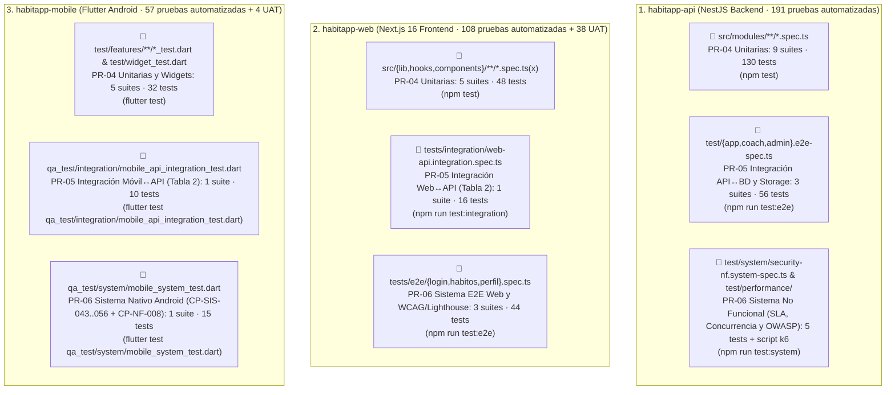

# Arquitectura, Ubicación y Guía de Ejecución de Pruebas de Software — Ecosistema HabitApp

> **Proyecto Formativo:** HabitApp (Ficha 3278641 — ADSO Trimestre VI · SENA CEET)  
> **Repositorios del Ecosistema:** `habitapp-api` (NestJS v1.4.0) · `habitapp-web` (Next.js 16 v1.2.0) · `habitapp-mobile` (Flutter Android v1.0.0)  
> **Referentes Normativos:** ISO/IEC/IEEE 29119-3 · ISO/IEC/IEEE 29119-4 · ISO/IEC 25010:2023 · ISO/IEC 25023 · ISO/IEC 25019 · IEEE 1028 · IEEE 1044 · OWASP Top 10 · WCAG 2.2 AA

---

## 0. Organización de la Carpeta `.docs/5-calidad-qa/`

Toda la documentación de Aseguramiento de Calidad (QA) del Trimestre VI está estructurada en `.docs/5-calidad-qa/` de la siguiente manera:

1. **[modelo_calidad_iso_25010_y_tecnicas_pruebas.md](./modelo_calidad_iso_25010_y_tecnicas_pruebas.md):** **(Entregables 1 y 3 de la Lista de Chequeo Trimestre VI)** — Evidencia detallada de las **Técnicas de Pruebas de Software (Caja Negra y Caja Blanca bajo ISO 29119-4)** y evaluación de las **9 características del Modelo de Calidad ISO/IEC 25010:2023** con sus herramientas gratuitas.
2. **[arquitectura-y-guia-ejecucion-pruebas.md](./arquitectura-y-guia-ejecucion-pruebas.md):** *(Este documento)* — Mapa arquitectónico de dónde se ubica cada prueba en los 3 repositorios, distribución matemática sin duplicados (`398 pruebas`) y comandos exactos para ejecutar todas las suites en vivo.
3. **[historias_usuario_definitivas.md](./historias_usuario_definitivas.md):** Catálogo definitivo de las **42 Historias de Usuario (`US001` a `US042`)** y sus **132 criterios de aceptación**.
4. **[matriz_riesgo_y_alcance_pruebas.md](./matriz_riesgo_y_alcance_pruebas.md):** Matriz de priorización de riesgo ($P \times I$) por historia de usuario y exclusiones formales de alcance.
5. **[casos_fallidos_y_bloqueados.md](./casos_fallidos_y_bloqueados.md):** Bitácora técnica de hallazgos de ingeniería e historial de resolución y cierre de defectos (`100 % corregidos y verificados en código`).
6. **[formato_qa.md](./formato_qa.md):** Estándar de plantillas y convenciones documentales de QA.
7. **Carpeta [`documentos-pruebas-software/`](./documentos-pruebas-software/):** Paquete oficial de los **9 informes normativos (`PR-01` a `PR-09`)**.

---

## 1. Distribución Matemática Exacta de las 398 Pruebas (Cero Duplicados entre Repositorios)

Todas las pruebas dinámicas del proyecto están repartidas entre los **3 repositorios** según la responsabilidad arquitectónica de cada capa, de modo que **ningún caso de prueba se duplica entre repositorios** y la suma horizontal y vertical coincide al 100 % con los informes **`PR-04`**, **`PR-05`**, **`PR-06`**, **`PR-08`** y **`PR-09`**:

| Nivel de Prueba (Informe) | `habitapp-api` (Backend NestJS) | `habitapp-web` (Frontend Next.js) | `habitapp-mobile` (App Flutter Android) | **Total Ecosistema** |
| :--- | :---: | :---: | :---: | :---: |
| **1. Unitarias (`PR-04`)** | **130** (`9 suites`) | **48** (`5 suites`) | **32** (`5 suites`) | **210** (`UT-001` a `UT-210`) |
| **2. Integración (`PR-05` · Tabla 2)** | **56** (`48 API↔BD/RLS + 8 API↔Storage/SMTP`) | **16** (`16 Web↔API Server Actions/Guards`) | **10** (`10 Móvil↔API DioClient/AuthInterceptor`) | **82** (`CP-INT-001` a `CP-INT-082`) |
| **3. Sistema y No Funcionales (`PR-06`)** | **5** (`CP-NF-002..004, 006..007` + script k6) | **44** (`42 CP-SIS Web + CP-NF-001, 005`) | **15** (`14 CP-SIS Android + CP-NF-008`) | **64** (`56 CP-SIS + 8 CP-NF`) |
| **4. Aceptación UAT (`PR-08` · Gherkin)** | *(Motor Backend integrado)* | **38** (`US001` a `US038` en Web/API) | **4** (`US039` a `US042` Hardware Android) | **42** (`CP-ACE-001` a `CP-ACE-042`) |
| **TOTAL PIRÁMIDE (`PR-09`)** | **191 pruebas** | **146 pruebas** | **61 pruebas** | **398 pruebas (100 % ejecutadas)** |

---

## 2. Mapa Arquitectónico de Ubicación de las Pruebas en los 3 Repositorios



---

## 3. Árbol Detallado de Archivos de Prueba por Repositorio

### 3.1. Backend API (`habitapp-api` — `/home/kairos/Proyectos/habitapp-api`)

```text
habitapp-api/
├── sonar-project.properties                     # PR-03 Configuración SonarQube Cloud (UTF-8, exclusiones CPD y LCOV)
├── eslint.config.js                             # PR-03 Reglas estáticas ESLint + TypeScript
│
├── src/modules/                                 # 🟢 NIVEL 1: PRUEBAS UNITARIAS (PR-04 · 9 suites · 130 tests)
│   ├── auth/services/auth.service.spec.ts                     (20 tests: UT-001 a UT-020 — Registro, Bcrypt, Login JWT, Límites 5/6/50/51)
│   ├── habits/repositories/records.repository.spec.ts         (24 tests: UT-021 a UT-044 — Rachas TD3, Puntos +10 TD2, UTC-5 DEF-001, Concurrencia DEF-002)
│   ├── habits/services/habits.service.spec.ts                 (18 tests: UT-045 a UT-062 — CRUD Hábitos, Dashboard Hoy TD1, Borrado vs Archivado)
│   ├── community/services/community.service.spec.ts           (20 tests: UT-063 a UT-082 — Foros TD4, Comentarios anidados, Retos TD5 DEF-003)
│   ├── coach/services/coach.service.spec.ts                   (12 tests: UT-083 a UT-094 — Pupilos asignados, Progreso solo lectura TD6, Rutinas)
│   ├── coach/coach-qa.spec.ts                                 (10 tests: UT-095 a UT-104 — Materialización de hábitos [Coach: ...] y bloqueo de duplicados)
│   ├── admin/services/admin.service.spec.ts                   (12 tests: UT-105 a UT-116 — Administración TD7 y moderación en cascada)
│   ├── notifications/services/notifications.service.spec.ts   ( 7 tests: UT-117 a UT-123 — Límite de 30 alertas y resiliencia ante fallo SMTP)
│   └── notifications/controllers/notifications.controller.spec.ts (7 tests: UT-124 a UT-130 — Marcado individual y masivo de lectura)
│
├── test/                                        # 🔵 NIVEL 2: PRUEBAS DE INTEGRACIÓN API↔BD Y STORAGE (PR-05 · 3 suites · 56 tests)
│   ├── jest-e2e.json
│   ├── app.e2e-spec.ts                                        (53 tests: CP-INT-001..047, 055..057, 080..082 — Auth, Perfil, Hábitos, Storage 5 MiB DEF-006, RLS DEF-005)
│   ├── coach.e2e-spec.ts                                      ( 2 tests: CP-INT-072 y 073 — Persistencia de rutinas y asignación transaccional en BD)
│   ├── admin.e2e-spec.ts                                      ( 1 test : CP-INT-079 — Borrado administrativo en cascada sobre comunidad.foros y comentarios)
│   │
│   ├── system/                                  # 🟣 NIVEL 3: PRUEBAS DE SISTEMA NO FUNCIONALES EN API (PR-06 · 1 suite · 5 tests)
│   │   ├── jest-system.json
│   │   └── security-nf.system-spec.ts                         ( 5 tests: CP-NF-002, 003, 004, 006 y 007 — SLA <= 800 ms, concurrencia +10 pts, OWASP Top 10 y Secretos)
│   └── performance/
│       └── load-test-pr06.k6.js                               (Script Grafana k6: rampa 0 -> 100 VUs durante 10 min, p95 <= 800 ms)
│
└── coverage/
    ├── index.html                               # Reporte visual HTML de cobertura unitaria Istanbul (PR-04: 88,55% Stmts / 89,87% Lines)
    └── newman-integracion-pr05.html             # Dashboard visual HTML de ejecución Newman htmlextra (PR-05: 82 requests consolidados, 98,8% éxito)
```

---

### 3.2. Frontend Web (`habitapp-web` — `/home/kairos/Proyectos/habitapp-web`)

```text
habitapp-web/
├── sonar-project.properties                     # PR-03 Configuración SonarQube Cloud
├── eslint.config.mjs                            # PR-03 Reglas estáticas ESLint Next.js 16 + React 19
├── jest.config.cjs                              # PR-04 Configuración Jest para pruebas unitarias en src/
├── playwright.config.ts                         # PR-06 Configuración Playwright Chromium E2E
│
├── src/                                         # 🟢 NIVEL 1: PRUEBAS UNITARIAS Y DE COMPONENTES (PR-04 · 5 suites · 48 tests)
│   ├── lib/date-utils.spec.ts                                 (10 tests: UT-131 a UT-140 — Fechas locales UTC-5 y prevención de salto a día UTC)
│   ├── hooks/useHabitForm.spec.ts                             (10 tests: UT-141 a UT-150 — Estado y validación reactiva del formulario de hábitos)
│   ├── components/dashboard/DashboardWidgets.spec.tsx         (10 tests: UT-151 a UT-160 — DailyProgress 0/0 sin NaN% DEF-004, StreakWidget, HabitItemCard)
│   ├── components/comunidad/ComunidadCards.spec.tsx           (10 tests: UT-161 a UT-170 — ForoCard, RetoCard, ArticleReaderModal, ExplorarHabitos)
│   └── components/reportes/ReportesAndAdmin.spec.tsx          ( 8 tests: UT-171 a UT-178 — ReportesInteractiveView, Heatmap 90 días, Coach y Admin)
│
├── tests/
│   ├── integration/                             # 🔵 NIVEL 2: PRUEBAS DE INTEGRACIÓN WEB ↔ API (PR-05 Tabla 2 · 1 suite · 16 tests)
│   │   ├── jest-integration.config.cjs
│   │   └── web-api.integration.spec.ts                        (16 tests: CP-INT-048..054, 068..071, 074..078 — Server Actions, Cookies HttpOnly, Guards y DEF-007)
│   │
│   └── e2e/                                     # 🟣 NIVEL 3: PRUEBAS DE SISTEMA E2E WEB Y ACCESIBILIDAD (PR-06 · 3 suites · 44 tests)
│       ├── login.spec.ts                                      (11 tests: CP-SIS-001 a 010 + CP-NF-001 — Onboarding, Auth, Middleware, Responsividad 360/414/1280px)
│       ├── habitos.spec.ts                                    (12 tests: CP-SIS-011 a 022 — Hábitos, Frecuencia, Check optimista UTC-5, Archivado, Progreso, Rachas)
│       └── perfil.spec.ts                                     (21 tests: CP-SIS-023 a 042 + CP-NF-005 — Puntos, Heatmap 90d, Reportes, Comunidad, Coach, Admin, WCAG DEF-009)
│
├── coverage/
│   └── index.html                               # Reporte visual HTML de cobertura unitaria Web (PR-04: 84,74% Stmts / 95,65% Lines)
└── playwright-report/
    └── index.html                               # Reporte visual HTML de Playwright (PR-06: 44/44 passed en Web)
```

---

### 3.3. Aplicación Móvil (`habitapp-mobile` — `/home/kairos/Proyectos/habitapp-mobile`)

```text
habitapp-mobile/
├── analysis_options.yaml                        # PR-03 Configuración estática flutter_lints 5.0.0
│
├── test/                                        # 🟢 NIVEL 1: PRUEBAS UNITARIAS Y DE WIDGETS (PR-04 · 5 suites · 32 tests)
│   ├── widget_test.dart                                       (8 tests: UT-187 a UT-194 — DailyProgressBar, HabitModel y CategoryModel)
│   └── features/
│       ├── onboarding/onboarding_screen_test.dart             (8 tests: UT-179 a UT-186 — OnboardingScreen slides, enlaces legales y has_seen_onboarding)
│       ├── notifications/notification_provider_test.dart      (6 tests: UT-195 a UT-200 — NotificationRepository y Tabla de Decisión 8 de alarmas locales)
│       ├── auth/biometric_provider_test.dart                  (5 tests: UT-201 a UT-205 — BiometricRepository, BiometricPrompt y Tabla de Decisión 9)
│       └── location/location_provider_test.dart               (5 tests: UT-206 a UT-210 — LocationRepository y captura GPS On-Device en Bogotá)
│
├── qa_test/
│   ├── integration/                             # 🔵 NIVEL 2: PRUEBAS DE INTEGRACIÓN MÓVIL ↔ API (PR-05 Tabla 2 · 1 suite · 10 tests)
│   │   └── mobile_api_integration_test.dart                   (10 tests: CP-INT-058 a 067 + DioClient, AuthInterceptor auto-refresh 401, UTC-5, Avatar 5 MiB, Zero-Mock)
│   │
│   └── system/                                  # 🟣 NIVEL 3: PRUEBAS DE SISTEMA NATIVO ANDROID (PR-06 · 1 suite · 15 tests)
│       └── mobile_system_test.dart                            (15 tests: CP-SIS-043 a 056 + CP-NF-008 — POST_NOTIFICATIONS, Doze exactAllowWhileIdle DEF-008, GPS, Cámara, Biometría)
│
└── coverage/html/
    └── index.html                               # Reporte visual HTML de cobertura LCOV/genhtml en Flutter (PR-04: 80,8% Lines)
```

---

## 4. Guía Rápida de Comandos para Demostración y Sustentación en Vivo

### 4.1. Ejecución en `habitapp-api` (Backend NestJS — `130 + 56 + 5 = 191 pruebas`)

```bash
cd /home/kairos/Proyectos/habitapp-api

# 1. PR-03: Análisis Estático (ESLint + TypeScript Compiler -> 0 errores, 0 warnings)
npm run lint && npx tsc --noEmit

# 2. PR-04: Pruebas Unitarias (9 suites -> 130/130 passed) + Abrir Reporte HTML
npm test
xdg-open /home/kairos/Proyectos/habitapp-api/coverage/index.html

# 3. PR-05: Pruebas de Integración API↔BD y Storage (3 suites -> 56/56 passed) + Abrir Dashboard HTML Newman
npm run test:e2e
xdg-open /home/kairos/Proyectos/habitapp-api/coverage/newman-integracion-pr05.html

# 4. PR-06: Pruebas de Sistema No Funcionales en API (1 suite -> 5/5 passed: SLA, Concurrencia y OWASP Top 10)
npm run test:system
```

---

### 4.2. Ejecución en `habitapp-web` (Frontend Web Next.js 16 — `48 + 16 + 44 = 108 pruebas`)

```bash
cd /home/kairos/Proyectos/habitapp-web

# 1. PR-03: Análisis Estático (ESLint + TypeScript Compiler -> 0 errores, 0 warnings)
npm run lint && npx --no-install tsc --noEmit

# 2. PR-04: Pruebas Unitarias y de Componentes (5 suites Jest -> 48/48 passed) + Abrir Reporte HTML
npm test
xdg-open /home/kairos/Proyectos/habitapp-web/coverage/index.html

# 3. PR-05: Pruebas de Integración Web ↔ API (1 suite -> 16/16 passed)
npm run test:integration

# 4. PR-06: Pruebas de Sistema E2E Web y Accesibilidad en Playwright (3 suites -> 44/44 passed) + Abrir Reporte HTML
npm run test:e2e
xdg-open /home/kairos/Proyectos/habitapp-web/playwright-report/index.html
```

---

### 4.3. Ejecución en `habitapp-mobile` (Aplicación Móvil Flutter Android — `32 + 10 + 15 = 57 pruebas`)

```bash
cd /home/kairos/Proyectos/habitapp-mobile

# 1. PR-03: Análisis Estático Oficial de Dart/Flutter (-> "No issues found!")
/home/kairos/development/flutter/bin/flutter analyze

# 2. PR-04: Pruebas Unitarias y de Widgets (5 suites -> 32/32 passed) + Abrir Reporte HTML
/home/kairos/development/flutter/bin/flutter test
xdg-open /home/kairos/Proyectos/habitapp-mobile/coverage/html/index.html

# 3. PR-05: Pruebas de Integración Móvil ↔ API (1 suite -> 10/10 passed)
/home/kairos/development/flutter/bin/flutter test qa_test/integration/mobile_api_integration_test.dart

# 4. PR-06: Pruebas de Sistema Nativo Android (1 suite -> 15/15 passed)
/home/kairos/development/flutter/bin/flutter test qa_test/system/mobile_system_test.dart
```
