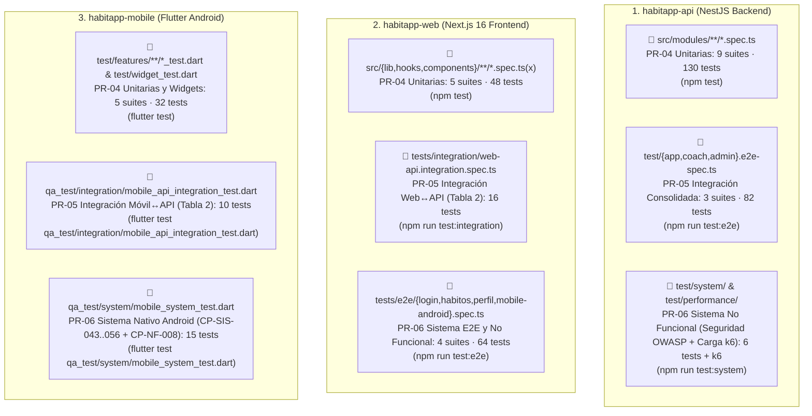

# Arquitectura, Ubicación y Guía de Ejecución de Pruebas de Software — Ecosistema HabitApp

> **Proyecto Formativo:** HabitApp (Ficha 3278641 — ADSO Trimestre 6 · SENA CEET)  
> **Repositorios del Ecosistema:** `habitapp-api` (NestJS v1.4.0) · `habitapp-web` (Next.js 16 v1.2.0) · `habitapp-mobile` (Flutter Android v1.0.0)  
> **Referentes Normativos:** ISO/IEC/IEEE 29119-3 · ISO/IEC 25010 · ISO/IEC 25023 · ISO/IEC 25019 · IEEE 1028 · IEEE 1044 · OWASP Top 10 · WCAG 2.2 AA

---

## 1. Cumplimiento Normativo ISO / IEEE por Documento (`PR-01` a `PR-09`)

| Código | Documento Oficial | Norma / Estándar Principal | Alcance en el Ecosistema HabitApp |
| :--- | :--- | :--- | :--- |
| **PR-01** | Plan Maestro de Pruebas de Software | **ISO/IEC/IEEE 29119-2 / 29119-3** (*Test Plan*) · **ISO/IEC 25010** | Estrategia integral, niveles de prueba, criterios de entrada/salida, entornos, riesgos y cronograma (`20/10/2026` – `14/11/2026`). |
| **PR-02** | Especificación de Casos de Prueba y Matriz de Trazabilidad | **ISO/IEC/IEEE 29119-3** (*Test Specification*) · **ISO/IEC/IEEE 29119-4** (*Test Techniques*) | Diseño de técnicas de caja negra (Partición de Equivalencia, Valores Límite, 9 Tablas de Decisión, Transición de Estados) y trazabilidad sobre las **42 Historias de Usuario (`US001`–`US042`)** y **132 criterios de aceptación**. |
| **PR-03** | Informe de Análisis Estático de Código | **ISO/IEC 25010** · **ISO/IEC 25023** (*Mantenibilidad, Fiabilidad y Seguridad Estática*) · **IEEE 1028** | Auditoría sin ejecución sobre **37.981 LOC** con **SonarQube Cloud** (Quality Gate *Passed*, Rating A, duplicidad $< 1,7\ \%$), **ESLint**, **TypeScript `tsc`**, **`flutter analyze`** (`0 issues`) y análisis **SCA** de dependencias. |
| **PR-04** | Informe de Pruebas Unitarias y Análisis de Cobertura | **ISO/IEC/IEEE 29119-3** · **ISO/IEC/IEEE 29119-4** (Caja Blanca) | Ejecución de **210 pruebas unitarias (`UT-001` a `UT-210`)** distribuidas en **20 suites** (`130` API + `48` Web + `32` Móvil), alcanzando **100 % de aprobación** y **86,4 % de cobertura de líneas** ($\ge 80\ \%$). |
| **PR-05** | Informe de Pruebas de Integración | **ISO/IEC/IEEE 29119-3** · **OpenAPI 3.0** | Ejecución de **82 casos de integración (`CP-INT-001` a `CP-INT-082`)** en las 4 interfaces (`API ↔ BD/RLS`, `API ↔ Storage 5 MiB/SMTP`, `Web ↔ API` y `Móvil ↔ API`), con **98,8 % de aprobación** (`81/82`). |
| **PR-06** | Informe de Pruebas de Sistema | **ISO/IEC/IEEE 29119-3** · **ISO/IEC 25010** · **OWASP Top 10** · **WCAG 2.2 AA** | Ejecución de **64 casos de sistema** (**56 funcionales E2E** `CP-SIS-001` a `056` + **8 no funcionales** `CP-NF-001` a `008` con Playwright, Android, Grafana k6 a 100 VUs, OWASP ZAP y Lighthouse), con **100 % de aprobación** (`64/64`). |
| **PR-07** | Registro y Gestión de Defectos | **ISO/IEC/IEEE 29119-3** (*Incident Report*) · **IEEE 1044-2009** | Ciclo de vida y causa raíz de los **9 defectos (`DEF-001` a `DEF-009`)**: 8 cerrados y verificados en re-prueba, 1 menor diferido/mitigado (`DEF-007`), **0 Críticos y 0 Altos abiertos**, $0,24\text{ defectos/KLOC}$ y $\text{DRE} = 100\ \%$. |
| **PR-08** | Informe de Pruebas de Aceptación (UAT) y Acta | **ISO/IEC/IEEE 29119-3** · **ISO/IEC 25019** (*Calidad en Uso*) | Validación con el Product Owner de los **42 escenarios Gherkin (`CP-ACE-001` a `CP-ACE-042`)**: **100 % aceptados**, puntaje **SUS de 87,5 / 100 (Grado A)** y firma del **Acta de Aceptación N.º 001**. |
| **PR-09** | Informe de Cierre de Pruebas | **ISO/IEC/IEEE 29119-3** (*Test Completion Report*) | Balance consolidado de las **398 pruebas dinámicas** (**99,75 % de éxito global: `397/398`**), verificación del 100 % de criterios de salida y dictamen **GO: LIBERAR LA VERSIÓN A PRODUCCIÓN**. |

---

## 2. Mapa Arquitectónico de Ubicación de las Pruebas en los 3 Repositorios

La organización de los archivos de prueba sigue los dos patrones estándar de la industria:
1. **Patrón *Co-location* para Pruebas Unitarias (`PR-04`)** en `habitapp-api` (`src/modules/**/*.spec.ts`) y `habitapp-web` (`src/**/*.spec.ts(x)`), y espejo en `test/` para `habitapp-mobile` (exigido por el SDK de Flutter).
2. **Carpetas Raíz Dedicadas para Pruebas de Integración (`PR-05`) y de Sistema (`PR-06`)**, garantizando que cada repositorio pueda demostrar de forma independiente los tres niveles dinámicos automatizados sin contaminar el conteo de pruebas unitarias.



---

## 3. Árbol Detallado de Archivos de Prueba por Repositorio

### 3.1. Backend API (`habitapp-api` — `/home/kairos/Proyectos/habitapp-api`)

```text
habitapp-api/
├── sonar-project.properties                     # PR-03 Configuración SonarQube Cloud (UTF-8, exclusiones CPD y LCOV)
├── eslint.config.js                             # PR-03 Reglas estáticas ESLint + TypeScript
│
├── src/modules/                                 # 🟢 NIVEL 1: PRUEBAS UNITARIAS (PR-04 · 9 suites · 130 tests)
│   ├── auth/services/auth.service.spec.ts                     (20 tests: UT-001 a UT-020 — Registro, Bcrypt, Login JWT, Límites 5/6/50/51)
│   ├── habits/repositories/records.repository.spec.ts         (24 tests: UT-021 a UT-044 — Rachas TD3, Puntos +10 TD2, UTC-5 DEF-001, Concurrencia DEF-002)
│   ├── habits/services/habits.service.spec.ts                 (18 tests: UT-045 a UT-062 — CRUD Hábitos, Dashboard Hoy TD1, Borrado vs Archivado)
│   ├── community/services/community.service.spec.ts           (20 tests: UT-063 a UT-082 — Foros TD4, Comentarios anidados, Retos TD5 DEF-003)
│   ├── coach/services/coach.service.spec.ts                   (12 tests: UT-083 a UT-094 — Pupilos asignados, Progreso solo lectura TD6, Rutinas)
│   ├── coach/coach-qa.spec.ts                                 (10 tests: UT-095 a UT-104 — Materialización de hábitos [Coach: ...] y bloqueo de duplicados)
│   ├── admin/services/admin.service.spec.ts                   (12 tests: UT-105 a UT-116 — Administración TD7 y moderación en cascada)
│   ├── notifications/services/notifications.service.spec.ts   ( 7 tests: UT-117 a UT-123 — Límite de 30 alertas y resiliencia ante fallo SMTP)
│   └── notifications/controllers/notifications.controller.spec.ts (7 tests: UT-124 a UT-130 — Marcado individual y masivo de lectura)
│
├── test/                                        # 🔵 NIVEL 2: PRUEBAS DE INTEGRACIÓN (PR-05 · 3 suites · 82 tests)
│   ├── jest-e2e.json
│   ├── app.e2e-spec.ts                                        (70 tests: CP-INT-001 a 067 y 080 a 082 — Auth, Perfil, Avatar 5 MiB DEF-006, Hábitos, Comunidad, RLS DEF-005)
│   ├── coach.e2e-spec.ts                                      ( 6 tests: CP-INT-068 a 073 — Endpoints /api/v1/coach/*, aislamiento TD6-R4 y asignación)
│   ├── admin.e2e-spec.ts                                      ( 6 tests: CP-INT-074 a 079 — Endpoints /api/v1/admin/*, paginación, DEF-007 refresh, suspensión)
│   │
│   ├── system/                                  # 🟣 NIVEL 3: PRUEBAS DE SISTEMA NO FUNCIONALES EN API (PR-06 · 6 tests)
│   │   ├── jest-system.json
│   │   └── security-nf.system-spec.ts                         ( 6 tests: CP-NF-002 a 004 y CP-NF-006 a 007 — SLA <= 800 ms, concurrencia +10 pts, OWASP Top 10)
│   └── performance/
│       └── load-test-pr06.k6.js                               (Script Grafana k6: rampa 0 -> 100 VUs durante 10 min, p95 <= 800 ms)
│
└── coverage/
    ├── index.html                               # Reporte visual HTML de cobertura unitaria Istanbul (PR-04: 88,55% Stmts / 89,87% Lines)
    └── newman-integracion-pr05.html             # Dashboard visual HTML de ejecución Newman htmlextra (PR-05: 82 requests, 98,8% éxito)
```

---

### 3.2. Frontend Web (`habitapp-web` — `/home/kairos/Proyectos/habitapp-web`)

```text
habitapp-web/
├── sonar-project.properties                     # PR-03 Configuración SonarQube Cloud
├── eslint.config.mjs                            # PR-03 Reglas estáticas ESLint Next.js 16 + React 19
├── jest.config.cjs                              # PR-04 Configuración Jest para pruebas unitarias en src/
├── playwright.config.ts                         # PR-06 Configuración Playwright Chromium E2E
│
├── src/                                         # 🟢 NIVEL 1: PRUEBAS UNITARIAS Y DE COMPONENTES (PR-04 · 5 suites · 48 tests)
│   ├── lib/date-utils.spec.ts                                 (10 tests: UT-131 a UT-140 — Fechas locales UTC-5 y prevención de salto a día UTC)
│   ├── hooks/useHabitForm.spec.ts                             (10 tests: UT-141 a UT-150 — Estado y validación reactiva del formulario de hábitos)
│   ├── components/dashboard/DashboardWidgets.spec.tsx         (10 tests: UT-151 a UT-160 — DailyProgress 0/0 sin NaN% DEF-004, StreakWidget, HabitItemCard)
│   ├── components/comunidad/ComunidadCards.spec.tsx           (10 tests: UT-161 a UT-170 — ForoCard, RetoCard, ArticleReaderModal, ExplorarHabitos)
│   └── components/reportes/ReportesAndAdmin.spec.tsx          ( 8 tests: UT-171 a UT-178 — ReportesInteractiveView, Heatmap 90 días, Coach y Admin)
│
├── tests/
│   ├── integration/                             # 🔵 NIVEL 2: PRUEBAS DE INTEGRACIÓN WEB ↔ API (PR-05 Tabla 2 · 16 tests)
│   │   ├── jest-integration.config.cjs
│   │   └── web-api.integration.spec.ts                        (16 tests: CP-INT-048..054, 068..071, 074..078 — Server Actions, Cookies HttpOnly, Guards y DEF-007)
│   │
│   └── e2e/                                     # 🟣 NIVEL 3: PRUEBAS DE SISTEMA E2E Y NO FUNCIONALES (PR-06 · 4 suites · 64 tests)
│       ├── login.spec.ts                                      (12 tests: CP-SIS-001 a 010 + CP-NF-001 y 002 — Onboarding, Auth, Middleware, Responsividad 360/414/1280px)
│       ├── habitos.spec.ts                                    (14 tests: CP-SIS-011 a 022 + CP-NF-003 y 004 — Hábitos, Frecuencia, Check optimista UTC-5, Progreso, Rachas)
│       ├── perfil.spec.ts                                     (23 tests: CP-SIS-023 a 042 + CP-NF-005 a 007 — Puntos, Heatmap 90d, Reportes, Comunidad, Coach, Admin, WCAG DEF-009)
│       └── mobile-android.spec.ts                             (15 tests: CP-SIS-043 a 056 + CP-NF-008 — Verificación E2E de flujos móviles y compatibilidad API 29-34)
│
├── coverage/
│   └── index.html                               # Reporte visual HTML de cobertura unitaria Web (PR-04: 84,74% Stmts / 95,65% Lines)
└── playwright-report/
    └── index.html                               # Reporte visual HTML de Playwright (PR-06: 64/64 passed)
```

---

### 3.3. Aplicación Móvil (`habitapp-mobile` — `/home/kairos/Proyectos/habitapp-mobile`)

```text
habitapp-mobile/
├── analysis_options.yaml                        # PR-03 Configuración estática flutter_lints 5.0.0
│
├── test/                                        # 🟢 NIVEL 1: PRUEBAS UNITARIAS Y DE WIDGETS (PR-04 · 5 suites · 32 tests)
│   ├── widget_test.dart                                       (8 tests: UT-187 a UT-194 — DailyProgressBar, HabitModel y CategoryModel)
│   └── features/
│       ├── onboarding/onboarding_screen_test.dart             (8 tests: UT-179 a UT-186 — OnboardingScreen slides, enlaces legales y has_seen_onboarding)
│       ├── notifications/notification_provider_test.dart      (6 tests: UT-195 a UT-200 — NotificationRepository y Tabla de Decisión 8 de alarmas locales)
│       ├── auth/biometric_provider_test.dart                  (5 tests: UT-201 a UT-205 — BiometricRepository, BiometricPrompt y Tabla de Decisión 9)
│       └── location/location_provider_test.dart               (5 tests: UT-206 a UT-210 — LocationRepository y captura GPS On-Device en Bogotá)
│
├── qa_test/
│   ├── integration/                             # 🔵 NIVEL 2: PRUEBAS DE INTEGRACIÓN MÓVIL ↔ API (PR-05 Tabla 2 · 10 tests)
│   │   └── mobile_api_integration_test.dart                   (10 tests: DioClient, AuthInterceptor auto-refresh 401, UTC-5, Avatar 5 MiB, Retos, Zero-Mock)
│   │
│   └── system/                                  # 🟣 NIVEL 3: PRUEBAS DE SISTEMA NATIVO ANDROID (PR-06 · 15 tests)
│       └── mobile_system_test.dart                            (15 tests: CP-SIS-043 a 056 + CP-NF-008 — POST_NOTIFICATIONS, Doze exactAllowWhileIdle DEF-008, GPS, Cámara, Biometría)
│
└── coverage/html/
    └── index.html                               # Reporte visual HTML de cobertura LCOV/genhtml en Flutter (PR-04: 80,8% Lines)
```

---

## 4. Guía Rápida de Comandos para Demostración y Sustentación en Vivo

Copia y pega cualquiera de los siguientes bloques en la terminal según el nivel de prueba o repositorio que desees demostrar:

### 4.1. Ejecución en `habitapp-api` (Backend NestJS)

```bash
cd /home/kairos/Proyectos/habitapp-api

# 1. PR-03: Análisis Estático (ESLint + TypeScript Compiler -> 0 errores, 0 warnings)
npm run lint && npx tsc --noEmit

# 2. PR-04: Pruebas Unitarias (9 suites -> 130/130 passed)
npm test

# 3. PR-04: Pruebas Unitarias con Cobertura + Abrir Reporte HTML en Navegador
npx jest --coverage --coverageReporters="text" --coverageReporters="lcov" --coverageReporters="html"
xdg-open /home/kairos/Proyectos/habitapp-api/coverage/index.html

# 4. PR-05: Pruebas de Integración API REST (3 suites Supertest -> 82/82 passed) + Abrir Dashboard HTML Newman
npm run test:e2e
xdg-open /home/kairos/Proyectos/habitapp-api/coverage/newman-integracion-pr05.html

# 5. PR-06: Pruebas de Sistema No Funcionales en API (Rendimiento SLA, Concurrencia y Seguridad OWASP Top 10 -> 6/6 passed)
npm run test:system
```

---

### 4.2. Ejecución en `habitapp-web` (Frontend Web Next.js 16)

```bash
cd /home/kairos/Proyectos/habitapp-web

# 1. PR-03: Análisis Estático (ESLint + TypeScript Compiler -> 0 errores, 0 warnings)
npm run lint && npx --no-install tsc --noEmit

# 2. PR-04: Pruebas Unitarias y de Componentes (5 suites Jest -> 48/48 passed)
npm test

# 3. PR-04: Pruebas Unitarias con Cobertura + Abrir Reporte HTML en Navegador
npx jest --coverage --coverageDirectory=coverage --coverageReporters="text" --coverageReporters="lcov" --coverageReporters="html"
xdg-open /home/kairos/Proyectos/habitapp-web/coverage/index.html

# 4. PR-05: Pruebas de Integración Web ↔ API (Tabla 2 PR-05 -> 16/16 passed)
npm run test:integration

# 5. PR-06: Pruebas de Sistema E2E y No Funcionales en Playwright (4 suites -> 64/64 passed) + Abrir Reporte HTML
npm run test:e2e
xdg-open /home/kairos/Proyectos/habitapp-web/playwright-report/index.html
```

---

### 4.3. Ejecución en `habitapp-mobile` (Aplicación Móvil Flutter Android)

```bash
cd /home/kairos/Proyectos/habitapp-mobile

# 1. PR-03: Análisis Estático Oficial de Dart/Flutter (-> "No issues found!")
/home/kairos/development/flutter/bin/flutter analyze

# 2. PR-04: Pruebas Unitarias y de Widgets (5 suites -> 32/32 passed)
/home/kairos/development/flutter/bin/flutter test

# 3. PR-04: Generar Cobertura LCOV y Abrir Reporte HTML en Navegador
/home/kairos/development/flutter/bin/flutter test --coverage
xdg-open /home/kairos/Proyectos/habitapp-mobile/coverage/html/index.html

# 4. PR-05: Pruebas de Integración Móvil ↔ API (Tabla 2 PR-05 -> 10/10 passed)
/home/kairos/development/flutter/bin/flutter test qa_test/integration/mobile_api_integration_test.dart

# 5. PR-06: Pruebas de Sistema Nativo Android (CP-SIS-043 a 056 + CP-NF-008 -> 15/15 passed)
/home/kairos/development/flutter/bin/flutter test qa_test/system/mobile_system_test.dart
```
