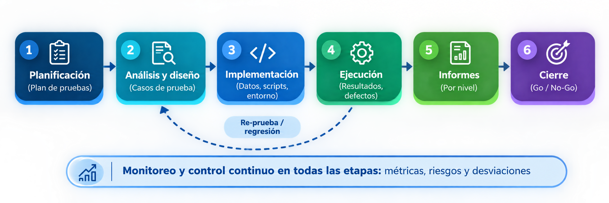
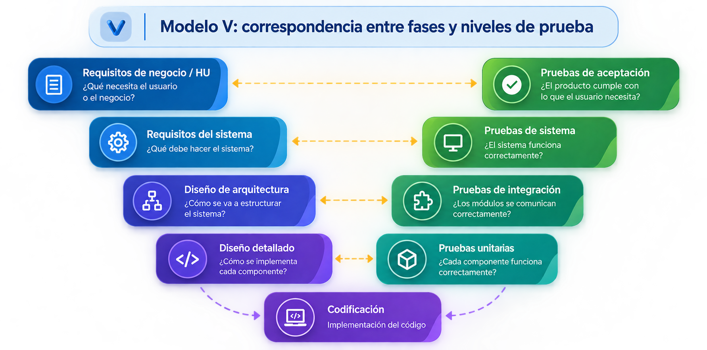
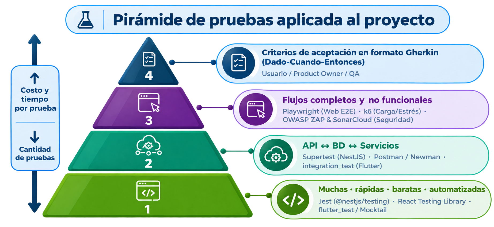

|  | Servicio Nacional de Aprendizaje — SENA · Centro de Electricidad, Electrónica y Telecomunicaciones — CEET | Tecnólogo en Análisis y Desarrollo de Software (ADSO) · Trimestre 6 |
| :---: | ----- | ----- |

# CAPÍTULO III · PR-01

## Plan Maestro de Pruebas de Software

**Estrategia, niveles, técnicas, automatización y criterios de entrada y salida**

| Campo | Detalle |
| ----- | ----- |
| **FASE** | **PLANEACIÓN** |
| **Proyecto formativo** | HabitApp |
| **Ficha** | 3278641 |
| **Equipo / Autores** | Carlos Mario Acosta Velasquez, Breiner Rodriguez Causil, Nicolas Estiben Crispoca Caicedo y Juan Esteban Diaz Galindo |
| **Instructor(es)** | Zaida Ojeda · Javier Yara · Victor Cortez |
| **Criterio de evaluación** | Trimestre 6 — En el proyecto se evidencia que se haya usado alguna técnica de pruebas de software. |
| **Versión del documento** | 1.0 |
| **Fecha** | 26 de octubre de 2026 |
| **Ciudad** | Bogotá D.C. |

## Control del documento

### Historial de versiones

| Versión | Fecha | Autor(es) | Descripción del cambio |
| ----- | ----- | ----- | ----- |
| 0.1 | 20/10/2026 | Carlos Mario Acosta Velasquez | Creación del documento a partir de la plantilla |
| 0.2 | 23/10/2026 | Carlos Mario Acosta Velasquez, Breiner Rodriguez Causil, Nicolas Estiben Crispoca Caicedo y Juan Esteban Diaz Galindo | Definición del alcance de las 42 HU, matriz de riesgos de producto, niveles y estrategia de automatización |
| 1.0 | 26/10/2026 | Carlos Mario Acosta Velasquez | Consolidación de entornos, cronograma definitivo y versión final aprobada del Plan Maestro de Pruebas |

### Revisión y aprobación

| Rol | Nombre | Firma | Fecha |
| ----- | ----- | :---: | ----- |
| Elaboró (aprendiz / equipo) | Carlos Mario Acosta Velasquez |  | 20/10/2026 |
| Revisó (líder técnico / Scrum Master) | Carlos Mario Acosta Velasquez |  | 23/10/2026 |
| Aprobó (instructor / Product Owner) | Zaida Ojeda |  | 26/10/2026 |

## Ubicación en el paquete documental

| Atributo | Referencia |
| ----- | ----- |
| **Documento que lo precede** | GC-02 Informe de evidencias del repositorio |
| **Documento que lo sucede** | PR-02 Especificación de casos de prueba |
| **Norma / referente principal** | ISO/IEC/IEEE 29119-2 y 29119-3 (Test Plan) · Glosario ISTQB |

## Contenido

 1. [Introducción](#1-introducción)
    * 1.1 [Propósito](#11-propósito)
    * 1.2 [Proceso de pruebas adoptado](#12-proceso-de-pruebas-adoptado)
    * 1.3 [Documentos relacionados](#13-documentos-relacionados)
 2. [Alcance de las pruebas](#2-alcance-de-las-pruebas)
    * 2.1 [Elementos de prueba](#21-elementos-de-prueba)
    * 2.2 [Funcionalidades a probar](#22-funcionalidades-a-probar)
    * 2.3 [Funcionalidades excluidas](#23-funcionalidades-excluidas)
 3. [Análisis de riesgos de producto](#3-análisis-de-riesgos-de-producto)
 4. [Estrategia de pruebas](#4-estrategia-de-pruebas)
    * 4.1 [Niveles de prueba](#41-niveles-de-prueba)
    * 4.2 [Tipos de prueba](#42-tipos-de-prueba)
    * 4.3 [Técnicas de diseño de pruebas](#43-técnicas-de-diseño-de-pruebas)
    * 4.4 [Estrategia de automatización](#44-estrategia-de-automatización)
 5. [Criterios](#5-criterios)
    * 5.1 [Criterios de entrada](#51-criterios-de-entrada)
    * 5.2 [Criterios de salida](#52-criterios-de-salida)
    * 5.3 [Criterios de suspensión y reanudación](#53-criterios-de-suspensión-y-reanudación)
 6. [Entornos y datos de prueba](#6-entornos-y-datos-de-prueba)
 7. [Gestión de defectos](#7-gestión-de-defectos)
 8. [Roles, cronograma y recursos](#8-roles-cronograma-y-recursos)
 9. [Riesgos del proyecto de pruebas](#9-riesgos-del-proyecto-de-pruebas)
10. [Entregables de pruebas](#10-entregables-de-pruebas)
11. [Aprobación](#11-aprobación)

## 1. Introducción

### 1.1 Propósito

Definir el enfoque, alcance, recursos, cronograma y criterios de las pruebas del sistema HabitApp versiones API 1.4.0, web 1.2.0 y móvil 1.0.0., de acuerdo con las métricas y umbrales del Modelo de Calidad (MC-01).

### 1.2 Proceso de pruebas adoptado



*Figura 1. Proceso de pruebas dinámicas — Fuente: Adaptado de ISO/IEC/IEEE 29119-2*

### 1.3 Documentos relacionados

| Documento | Relación |
| ----- | ----- |
| MC-01 Modelo de calidad | Fuente de umbrales y criterios de salida |
| Product Backlog / HU | Base de prueba (test basis) |
| PR-02 Casos de prueba | Diseño derivado de este plan |
| PR-03 a PR-09 | Informes de ejecución y cierre |

## 2. Alcance de las pruebas

### 2.1 Elementos de prueba

| Componente | Versión | Módulos incluidos |
| ----- | ----- | ----- |
| API REST | 1.4.0 | Autenticación y Usuarios (auth, users), Gestión de Hábitos y Seguimiento (habits), Gamificación y Puntos, Comunidad y Retos (community), Entrenador/Coach (coach), Administración (admin), Notificaciones (notifications) y Reportes Analíticos (reports). |
| Aplicación web | 1.2.0 | Onboarding y Autenticación, Gestión de Perfil y Ajustes, Core de Hábitos (crear, frecuencia, check diario, archivar), Métricas y Gamificación (rachas, heatmap, leaderboard, insignias), Reportes Editoriales, Bandeja de Notificaciones In-App, Comunidad (foros, comentarios anidados, retos, catálogo de hábitos, especialistas), Panel de Entrenador y Panel de Administración. |
| Aplicación móvil | 1.0.0 | Onboarding interactivo, Autenticación y Perfil, Core de Hábitos y Registro de Progreso Diario, Gamificación y Ranking, Comunidad y Retos, y Capacidades Nativas de Hardware en Android (Notificaciones locales programadas en el dispositivo, Geolocalización GPS on-device, Cámara/Galería nativa y Desbloqueo Biométrico mediante huella / BiometricPrompt). |
| Base de datos | PostgreSQL 15+ (Supabase DB) | Esquemas relacionales (gestion, seguimiento, comunidad), Tablas e Integridad Referencial, Procedimientos almacenados y Funciones PL/pgSQL, Triggers automáticos (auditoría y sumatoria de puntos), Restricciones de integridad (CHECK, UNIQUE, Foreign Keys), Índices Non-Clustered y Políticas de Seguridad Row Level Security (RLS). |

### 2.2 Funcionalidades a probar

Se prueban las 42 historias de usuario del MVP de HabitApp (US001 a US042), tanto de la aplicación web (Next.js) como de la aplicación móvil (Flutter), agrupadas por módulo. A cada una se le asignó un nivel de riesgo ($\text{Riesgo} = \text{Probabilidad} \times \text{Impacto}$, con escala de 1 a 3), que determina la profundidad de las pruebas: riesgo $\ge 6$, pruebas exhaustivas y automatizadas; riesgo de 3 a 4, pruebas estándar; riesgo $\le 2$, pruebas exploratorias.

| Módulo | HU | Funcionalidad | Prob. | Impacto | Riesgo | Tipo de prueba |
| ----- | ----- | ----- | ----- | ----- | ----- | ----- |
| Autenticación, acceso y perfil | US001 | Onboarding e inducción interactiva (detección de primera visita) | 1 | 2 | 2 | Exploratoria |
|  | US002 | Registro de usuario con validación de credenciales | 2 | 3 | 6 | Exhaustiva y automatizada |
|  | US003 | Autenticación, inicio de sesión y emisión de JWT | 2 | 3 | 6 | Exhaustiva y automatizada |
|  | US004 | Persistencia de sesión con auto-refresh de JWT y Secure Storage | 2 | 3 | 6 | Exhaustiva y automatizada |
|  | US005 | Recuperación y restablecimiento de contraseña vía email | 2 | 3 | 6 | Exhaustiva y automatizada |
|  | US006 | Creación de perfil base y asignación de UUID en BD | 1 | 3 | 3 | Estándar |
|  | US007 | Edición de perfil de usuario y almacenamiento de zona horaria | 2 | 2 | 4 | Estándar |
|  | US008 | Panel de ajustes y preferencias de cuenta (/ajustes) | 1 | 2 | 2 | Exploratoria |
|  | US009 | Restricción de acceso a rutas protegidas mediante Middleware | 2 | 3 | 6 | Exhaustiva y automatizada |
|  | US010 | Cierre de sesión y destrucción de sesión (Logout) | 2 | 3 | 6 | Exhaustiva y automatizada |
| Core de hábitos y seguimiento | US011 | Creación de nuevos hábitos con metas y categorías | 2 | 3 | 6 | Exhaustiva y automatizada |
|  | US012 | Configuración de frecuencia y días específicos | 2 | 2 | 4 | Estándar |
|  | US013 | Configuración y persistencia de recordatorios horarios | 2 | 2 | 4 | Estándar |
|  | US014 | Filtrado y visualización de hábitos de “Hoy” | 2 | 3 | 6 | Exhaustiva y automatizada |
|  | US015 | Registro interactivo de cumplimiento diario (check) | 3 | 3 | 9 | Exhaustiva y automatizada |
|  | US016 | Desmarcado y reversión de cumplimiento de hábito | 2 | 2 | 4 | Estándar |
|  | US017 | Modificación y archivado de hábitos | 2 | 3 | 6 | Exhaustiva y automatizada |
|  | US018 | Eliminación física controlada sin registros previos | 1 | 2 | 2 | Exploratoria |
| Métricas, reportes y gamificación | US019 | Cálculo dinámico de barra de progreso del día (0-100%) | 2 | 2 | 4 | Estándar |
|  | US020 | Cálculo automático de rachas continuas (Streaks) | 3 | 3 | 9 | Exhaustiva y automatizada |
|  | US021 | Asignación de puntos y prevención de doble registro | 3 | 3 | 9 | Exhaustiva y automatizada |
|  | US022 | Matriz de consistencia histórica (Heatmap 90 días) | 2 | 2 | 4 | Estándar |
|  | US023 | Análisis editorial y reportes de progreso (/reportes) | 2 | 2 | 4 | Estándar |
|  | US024 | Centro de notificaciones internas e in-app (campanita y /notificaciones) | 2 | 2 | 4 | Estándar |
|  | US025 | Tabla de clasificación comunitaria (Leaderboard) | 2 | 2 | 4 | Estándar |
|  | US026 | Desbloqueo de logros, hitos e insignias | 2 | 2 | 4 | Estándar |
| Comunidad, retos y bienestar | US027 | Muro de foros comunitarios filtrado por categoría | 2 | 2 | 4 | Estándar |
|  | US028 | Creación, edición y eliminación de foros propios | 2 | 3 | 6 | Exhaustiva y automatizada |
|  | US029 | Comentarios en hilos anidados con soporte multimedia | 2 | 3 | 6 | Exhaustiva y automatizada |
|  | US030 | Contador reactivo de apoyos y likes de corazón | 2 | 2 | 4 | Estándar |
|  | US031 | Catálogo comunitario y clonación de hábitos en 1 clic | 2 | 2 | 4 | Estándar |
|  | US032 | Retos comunitarios con check-in diario único | 2 | 3 | 6 | Exhaustiva y automatizada |
|  | US033 | Lector interactivo de artículos educativos | 1 | 2 | 2 | Exploratoria |
|  | US034 | Directorio de especialistas y solicitud de asesoría | 2 | 2 | 4 | Estándar |
| Roles especializados y administración | US035 | Panel de entrenador y auditoría de clientes asignados | 2 | 3 | 6 | Exhaustiva y automatizada |
|  | US036 | Creación y asignación de rutinas maestras por entrenador | 2 | 3 | 6 | Exhaustiva y automatizada |
|  | US037 | Panel de administración, gestión de usuarios y roles | 2 | 3 | 6 | Exhaustiva y automatizada |
|  | US038 | Moderación forzada y seguridad Row Level Security (RLS) | 2 | 3 | 6 | Exhaustiva y automatizada |
| Hardware móvil nativo | US039 | Notificaciones y alertas locales de recordatorios de hábitos | 2 | 3 | 6 | Exhaustiva y automatizada |
|  | US040 | Geolocalización GPS nativa en el dispositivo (geolocator on-device) | 2 | 2 | 4 | Estándar |
|  | US041 | Captura directa con cámara y selección de galería nativa | 2 | 2 | 4 | Estándar |
|  | US042 | Autenticación biométrica nativa (Huella digital / BiometricPrompt en Android) | 2 | 3 | 6 | Exhaustiva y automatizada |

#### Resumen de priorización

* **Riesgo 9, crítico (3 HU):** US015, US020 y US021. Son la lógica central del producto: registro de cumplimiento, rachas y puntos.
* **Riesgo 6, alto (18 HU):** US002, US003, US004, US005, US009, US010, US011, US014, US017, US028, US029, US032, US035, US036, US037, US038, US039 y US042. Se prueban de forma exhaustiva y automatizada.
* **Riesgo 3 a 4, medio (17 HU):** US006, US007, US012, US013, US016, US019, US022, US023, US024, US025, US026, US027, US030, US031, US034, US040 y US041. Se prueban con pruebas estándar.
* **Riesgo** $\le 2$**, bajo (4 HU):** US001, US008, US018 y US033. Se cubren con pruebas exploratorias.

En total, 21 de las 42 historias (50 %) tienen riesgo alto o crítico y se prueban de forma exhaustiva y automatizada.

#### Justificación de los riesgos más altos

* **Riesgo 9 (probabilidad** $3 \times$ **impacto** $3$**):**
  * **US015, registro de cumplimiento diario:** es la acción más frecuente del sistema. Depende de casos difíciles de controlar, como el doble clic, la reversión del check y el cambio de día según la zona horaria del usuario.
  * **US020, cálculo de rachas:** depende del registro de cumplimiento y tiene muchos casos límite: días consecutivos, reinicio a cero, hábitos con frecuencia específica y cambios de fecha.
  * **US021, puntos y prevención de doble registro:** debe impedir que se sumen puntos dos veces bajo concurrencia. Un error altera el leaderboard y los logros.
* **Riesgo 6 (probabilidad** $2 \times$ **impacto** $3$**):**
  * **Autenticación y sesión (US002 a US005, US009 y US010):** una falla permite accesos no autorizados, sesiones que no se cierran, rutas protegidas expuestas o robo de cuentas en la recuperación de contraseña.
  * **Núcleo de hábitos (US011, US014 y US017):** un defecto genera datos incorrectos, hábitos que no aparecen en “Hoy” o pérdida de historial al archivar o modificar.
  * **Contenido comunitario y retos (US028, US029 y US032):** el riesgo está en los permisos de edición, la carga de archivos multimedia y el check-in diario único de los retos.
  * **Roles, administración y RLS (US035 a US038):** un error de autorización o de políticas RLS puede exponer datos de salud y hábitos de otros usuarios o permitir escalar privilegios.
  * **Hardware móvil (US039 y US042):** las notificaciones push y la biometría dependen de APIs del sistema operativo y de la configuración del dispositivo. Una falla afecta la retención y la seguridad de acceso.

### 2.3 Funcionalidades excluidas

| Módulo / Funcionalidad | Referencia | Razón de exclusión | Estrategia de mitigación o alternativa |
| ----- | ----- | ----- | ----- |
| Pasarela de pagos real (Stripe / Wompi) | Monetización / Suscripciones | La versión actual del MVP ofrece acceso gratuito y funciones abiertas. No se cuenta con merchant de producción configurado ni pasarela bancaria activa. | Se utiliza simulación mediante mocks y cuentas sandbox para validar la lógica de planes sin realizar cobros bancarios reales. |
| Notificaciones push nativas en navegadores de escritorio | Notificaciones web | En navegadores de escritorio las notificaciones push nativas dependen de servicios de terceros del sistema operativo que no están configurados para la versión web estándar. | Se prueban exhaustivamente los recordatorios horarios en base de datos (recordatorios_habito), las alertas visuales y la bandeja de notificaciones in-app (US024). |
| Lectores biométricos físicos en entorno web | Seguridad hardware (US042 móvil) | Los sensores biométricos físicos (FaceID / TouchID) dependen de APIs nativas de smartphones (iOS/Android), no disponibles de manera homogénea en computadores de escritorio. | La seguridad de acceso web se audita exhaustivamente a través de los endpoints de autenticación del Backend (NestJS API), tokens JWT firmados y cookies seguras con políticas SameSite/HTTP-only. |
| Envío masivo de correos electrónicos reales | Notificaciones por email | Enviar correos masivos a servidores SMTP públicos en fase de pruebas puede saturar cuotas de servicio o disparar filtros de spam innecesariamente. | Se utiliza un servidor SMTP de pruebas local o Mailtrap para validar el contenido y los enlaces de confirmación sin despachar emails externos a bandejas reales. |
| Pruebas de estrés y concurrencia extrema (>100.000 usuarios) | Rendimiento de infraestructura | El objetivo de la fase de QA actual es la estabilidad funcional, la lógica de negocio y la seguridad RLS de la aplicación. | Las pruebas de concurrencia se acotan al manejo de doble clic y a la concurrencia transaccional en puntos y check-ins (hasta 100 usuarios concurrentes). |
| Subida de archivos multiformato pesados (>5 MiB) | Almacenamiento (Storage) | La plataforma solo admite imágenes ligeras de perfil y capturas para comentarios (límite binario estricto de 5 MiB = 5.242.880 bytes por archivo en ParseFilePipeBuilder). | Se valida el bloqueo estricto en frontend y backend para rechazar archivos no permitidos o que superen los 5.242.880 bytes (HTTP 422 Unprocessable Entity). |
| Compilación, despliegue y compatibilidad con Apple iOS (App Store, Face ID, APNs) | Compatibilidad (US039, US042) | El alcance tecnológico del MVP del proyecto formativo HabitApp está acotado estrictamente al entorno Web responsivo y al ecosistema Android. Solo se cuenta con dispositivos y emuladores Android para la certificación QA. | Las funciones nativas equivalentes (BiometricPrompt, notificaciones locales, GPS y cámara) se validan íntegramente en Android 10 a 14. La verificación en iOS queda fuera del alcance de este ciclo de pruebas. |
| Envío real de solicitudes de sesión a entrenadores | Directorio de especialistas (US034) | En la versión actual el botón “Solicitar sesión” solo muestra una confirmación en pantalla y no envía la solicitud al entrenador. | Se valida el directorio, el modal de perfil y la confirmación visual (CP-SIS-103 a 105). El envío real queda para una fase posterior. |
| Notificaciones push remotas emitidas desde el servidor (FCM / OneSignal / APNs) | Notificaciones móviles (US039) | Fuera del alcance de la fase actual (MVP). La arquitectura móvil procesa y gestiona los recordatorios de hábitos de manera 100 % autónoma y local en el dispositivo mediante `flutter_local_notifications`, sin infraestructura de emisión push en el backend. | Se prueban exhaustivamente las alertas locales programadas en el dispositivo (*on-device*) con `AndroidScheduleMode.exactAllowWhileIdle` (US039) y la bandeja de notificaciones in-app (US024). |

## 3. Análisis de riesgos de producto

Las pruebas se priorizan mediante un enfoque basado en riesgos donde $\text{Riesgo} = \text{Probabilidad } (1\text{–}3) \times \text{Impacto } (1\text{–}3)$. Nivel de riesgo $\ge 6$: pruebas exhaustivas y automatizadas; nivel 3–4: pruebas estándar; nivel $\le 2$: pruebas exploratorias.

**Tabla 1. Matriz de riesgos de producto**

| ID | Riesgo | HU relacionadas | Prob. | Impacto | Nivel | Tratamiento en pruebas |
| ----- | ----- | ----- | ----- | ----- | ----- | ----- |
| R-01 | Registro de cumplimiento duplicado o incorrecto, y hábitos de “Hoy” erróneos por doble clic, concurrencia, frecuencia o cambio de día según la zona horaria | US012, US014, US015, US016 | 3 | 3 | 9 | Pruebas unitarias con particiones y valores límite, tabla de decisión para frecuencias, pruebas de concurrencia y E2E del flujo del check |
| R-02 | Cálculo incorrecto de rachas (días consecutivos, reinicio a cero, frecuencia específica, cambios de fecha) | US020 | 3 | 3 | 9 | Pruebas unitarias con valores límite, tabla de decisión y regresión automatizada en el pipeline |
| R-03 | Puntos duplicados o inconsistentes que alteran el leaderboard y los logros | US021, US025, US026 | 3 | 3 | 9 | Pruebas unitarias y de integración transaccional, y concurrencia acotada (hasta 100 usuarios) |
| R-04 | Acceso no autorizado a datos de otros usuarios o escalada de privilegios (roles y políticas RLS) | US035, US036, US037, US038 | 2 | 3 | 6 | Pruebas de seguridad de autorización por rol, validación de políticas RLS y DAST con OWASP ZAP |
| R-05 | Fallas en autenticación y gestión de sesión (JWT, auto-refresh, logout, rutas protegidas, recuperación de contraseña) | US002, US003, US004, US005, US009, US010 | 2 | 3 | 6 | Pruebas de integración de la API, pruebas de seguridad de sesión y E2E de los flujos de acceso |
| R-06 | Pérdida o corrupción de datos de hábitos y perfil al crear, modificar, archivar o clonar | US006, US007, US011, US017, US031 | 2 | 3 | 6 | Pruebas de integración con validación de persistencia, verificación de historial al archivar y regresión |
| R-07 | Abuso o fallas en el contenido comunitario y los archivos multimedia (permisos, límite de 5 MB, check-in único de retos) | US027, US028, US029, US030, US032, US034 | 2 | 3 | 6 | Pruebas funcionales de permisos, validación de tipo y tamaño de archivo, y E2E de foros y retos |
| R-08 | Fallas en recordatorios, notificaciones y funciones nativas del móvil (push, biometría, GPS, cámara) | US013, US024, US039, US040, US041, US042 | 2 | 3 | 6 | Pruebas de integración en Flutter, verificación en emulador y dispositivo Android, y prueba de la bandeja in-app |
| R-09 | Datos incorrectos en métricas y reportes (progreso del día, heatmap, reportes) | US019, US022, US023 | 2 | 2 | 4 | Pruebas estándar de validación funcional y de consultas con datos de prueba conocidos |
| R-10 | Pérdida o inconsistencia de datos en la futura migración | Sin HU en el alcance actual | 1 | 3 | 3 | Validación de conteos y sumas de control antes y después de ejecutar el plan de migración |
| R-11 | Fallas en elementos informativos y de ayuda (onboarding, ajustes, artículos, eliminación física sin registros) | US001, US008, US018, US033 | 1 | 2 | 2 | Pruebas exploratorias al cierre de cada sprint |

## 4. Estrategia de pruebas

### 4.1 Niveles de prueba



*Figura 2. Correspondencia entre fases de desarrollo y niveles de prueba (modelo V)*



*Figura 3. Distribución objetivo de pruebas (pirámide de pruebas)*

**Tabla 2. Niveles de prueba**

| Nivel | Objetivo | Base de prueba | Ejecutor | Automatización | Documento |
| ----- | ----- | ----- | ----- | ----- | ----- |
| Componente (unitario) | Verificar unidades aisladas (servicios, funciones, componentes y widgets) con dobles de prueba | Diseño detallado, código | Desarrolladores | 100 % (Jest con @nestjs/testing, React Testing Library, flutter_test y Mocktail) | PR-04 |
| Integración | Verificar interfaces API ↔ BD ↔ servicios y la integración entre módulos de la app móvil | Contratos de la API, modelo de datos y políticas RLS | Desarrolladores / QA | Alta (Supertest, Postman/Newman, integration_test) | PR-05 |
| Sistema | Verificar flujos completos de extremo a extremo en web y móvil, y requisitos no funcionales (rendimiento y seguridad) | Requisitos, HU | QA | Media (Playwright para web, integration_test para Flutter, k6, OWASP ZAP, SonarQube Cloud (antes SonarCloud)). Las funciones nativas del móvil se verifican además en dispositivo Android | PR-06 |
| Aceptación (UAT) | Validar que el sistema satisface las necesidades del usuario | Criterios de aceptación en formato Gherkin | Usuario / Product Owner / QA | Baja (Gherkin; ejecución asistida) | PR-08 |

### 4.2 Tipos de prueba

**Tabla 3. Tipos de prueba**

| Tipo | Aplica | Técnica / herramienta |
| ----- | ----- | ----- |
| Funcional | Sí | Casos de prueba derivados de las 42 Historias de Usuario (HU) y de la matriz de riesgos; validación de flujos de negocio positivos y negativos. |
| Estática (análisis de código) | Sí | SonarQube Cloud (Quality Gate), linter ESLint con formateo Prettier, compilador TypeScript (tsc --noEmit) y dart analyze para Flutter. |
| Rendimiento (carga / estrés) | Sí | Pruebas de carga moderada y concurrencia transaccional con k6 (hasta 100 usuarios concurrentes en endpoints críticos como check-in diario, inicio de sesión y suma de puntos). |
| Seguridad | Sí | OWASP ZAP (análisis dinámico DAST), SonarQube Cloud (SAST), auditoría de dependencias (npm audit), verificación de OWASP Top 10 y aislamiento Row Level Security (RLS) en PostgreSQL. |
| Usabilidad y accesibilidad | Sí | Google Lighthouse (Core Web Vitals, accesibilidad y SEO), axe DevTools, inspección de diseño responsivo y evaluación heurística de Nielsen. |
| Compatibilidad | Sí | Navegadores web: Google Chrome, Microsoft Edge y Mozilla Firefox (versiones estables). Móvil: Android 10 a 14 en emuladores y dispositivos físicos. |
| Regresión | Sí | Suite automatizada en el pipeline de CI/CD (GitHub Actions): pruebas de Jest, Supertest y flutter_test en cada Pull Request, y pruebas E2E con Playwright en el entorno de QA tras cada despliegue. |
| Humo (smoke) | Sí | Verificación rápida de salud tras cada despliegue a QA y producción (inicio de sesión con cuenta de prueba, carga del dashboard y `/api/v1/health`). |

### 4.3 Técnicas de diseño de pruebas

**Tabla 4. Técnicas de diseño**

| Categoría | Técnica | Cuándo usarla |
| ----- | ----- | ----- |
| Caja negra | Partición de equivalencia | Entradas con clases de datos válidos e inválidos. Ejemplos: formato de correo y credenciales en registro e inicio de sesión (US002, US003), días de la semana válidos en la frecuencia de un hábito (US012) y tipo de archivo permitido en foros y perfil (US029, US041). |
| Caja negra | Análisis de valores límite | Bordes de rangos (mín−1, mín, máx, máx+1). Ejemplos: tamaño de imagen en 4,99 / 5 / 5,01 MB, progreso del día en 0 % y 100 % (US019), racha en 0, 1 y n días y cambio de día en la medianoche de la zona horaria del usuario (US015, US020). |
| Caja negra | Tabla de decisión | Reglas de negocio con combinaciones de condiciones. Ejemplos: qué hábitos aparecen en “Hoy” según frecuencia, días configurados y estado activo o archivado (US012, US014, US017), suma de puntos según si el hábito ya fue registrado hoy o se desmarcó (US016, US021) y permisos por rol (usuario, entrenador, administrador) sobre cada acción (US035 a US038). |
| Caja negra | Transición de estados | Entidades con ciclo de vida. Ejemplos: hábito (activo → archivado → eliminado solo si no tiene registros, US017 y US018), cumplimiento diario (pendiente → completado → desmarcado, US015 y US016), sesión (autenticada → renovada → cerrada, US003, US004 y US010) y enlace de recuperación de contraseña (emitido → usado o vencido, US005). |
| Caja negra | Casos de uso / escenarios | Flujos de usuario de extremo a extremo. Ejemplos: registro → creación de un hábito → marcar cumplimiento → ver racha y puntos; entrenador que crea una rutina y la asigna a un cliente (US035, US036); creación de un foro → comentario → apoyo (US028 a US030). |
| Caja blanca | Cobertura de sentencias y ramas | Pruebas unitarias medidas con herramienta de cobertura (Jest con --coverage y flutter test --coverage), reportadas en SonarQube Cloud. Se prioriza el código de rachas, puntos y progreso del día, que concentra los riesgos de nivel 9. |
| Basada en experiencia | Pruebas exploratorias, adivinación de errores | Complemento al cierre de cada sprint y técnica principal para las HU de riesgo $\le 2$ (US001, US008, US018 y US033). Ejemplos de error a adivinar: doble clic en el check, cambio de zona horaria al viajar, pérdida de conexión en el móvil y rotación del dispositivo. |

### 4.4 Estrategia de automatización

Las pruebas unitarias y de integración se ejecutan automáticamente en cada Pull Request dentro del pipeline (ver DS-03). Las pruebas E2E se ejecutan en el entorno de QA tras cada despliegue. Convenciones: patrón AAA (Arrange–Act–Assert), nombres `Metodo_Escenario_ResultadoEsperado`, una aserción lógica por prueba, datos de prueba independientes.

**TypeScript · NestJS (`@nestjs/testing`) + Jest (ejemplo de convención)**

```typescript
it('findById_UsuarioNoPropietario_LanzaForbiddenException', async () => {
    // Arrange
    const modulo = await Test.createTestingModule({
        providers: [
            HabitsService,
            {
                provide: HabitsRepository,
                useValue: {
                    findById: jest.fn().mockResolvedValue({
                        idHabito: 'hab-101',
                        nombre: 'Beber 2L de agua',
                        idUsuario: 'user-autorizado-123',
                    }),
                },
            },
        ],
    }).compile();

    const servicio = modulo.get<HabitsService>(HabitsService);

    // Act
    const accion = servicio.findById('hab-101', 'user-intruso-999');

    // Assert
    await expect(accion).rejects.toThrow(ForbiddenException);
});
```

## 5. Criterios

### 5.1 Criterios de entrada

* [x] Build desplegado en el entorno de QA y prueba de humo superada.
* [x] HU con criterios de aceptación aprobados por el PO.
* [x] Casos de prueba diseñados y revisados (PR-02).
* [x] Datos de prueba cargados.
* [x] Quality Gate de SonarQube Cloud aprobado.

### 5.2 Criterios de salida

* [x] 100 % de los casos planificados ejecutados.
* [x] $\ge 95$ % de casos aprobados.
* [x] 0 defectos críticos y 0 altos abiertos.
* [x] Cobertura de código $\ge 80$ % en código nuevo.
* [x] Acta de aceptación firmada por el PO.

### 5.3 Criterios de suspensión y reanudación

Se suspende la ejecución si: el entorno no está disponible por más de 4 horas, o más del 30% de casos queda bloqueado por un defecto. Se reanuda cuando el defecto bloqueante se corrige y se supera la prueba de humo.

## 6. Entornos y datos de prueba

| Entorno | Propósito | URL / ubicación | Datos |
| ----- | ----- | ----- | ----- |
| Local | Desarrollo y pruebas unitarias y de integración | Web: `http://localhost:3000` · API REST: `http://localhost:4000/api/v1` · Móvil: emulador Android (`http://10.0.2.2:4000/api/v1`) · BD: proyecto Supabase de desarrollo (PostgreSQL administrado) | Mocks en memoria (`jest.fn()`), objetos simulados y datos semilla de desarrollo (`recreate-synthetic-users-v4.mjs`) |
| QA / Staging | Integración, sistema, carga (k6) y UAT | Despliegue en Vercel Preview (Web) y Azure App Service (API REST), más ejecución controlada en entorno local contra el proyecto Supabase de pruebas | Datos sintéticos generados con `@faker-js/faker` y el script SQL de población masiva, sin datos personales reales (Ley 1581 de 2012) |
| Producción | Pruebas de humo posteriores al despliegue | Web: `https://habitapp-web.vercel.app` · API REST: `https://habitapp-api-hnbba0c8cqfvc2hj.chilecentral-01.azurewebsites.net/api/v1` · Móvil: APK firmado de lanzamiento para Android | Reales (solo lectura); cuenta técnica exclusiva para las pruebas de humo, sin registrar hábitos ni afectar el ranking |
| Local / Móvil (Android) | Pruebas de sistema (`CP-SIS`) de capacidades de hardware nativo (`US039` a `US042`) | Dispositivo físico Android (Android 10 a 14) y Emulador Android (AVD API 34) conectados a `http://10.0.2.2:4000/api/v1` | Almacenamiento seguro local (`FlutterSecureStorage`), base de alarmas exactas del SO y sensores físicos/emulados (`BiometricPrompt`, GPS, Cámara y Galería) |

> **Nota de cumplimiento legal:** En estricto cumplimiento de la Ley 1581 de 2012 (Protección de Datos Personales), nunca se utilizan datos personales reales en los entornos de pruebas; la totalidad de los registros corresponde a datos sintéticos generados mediante `@faker-js/faker`.

## 7. Gestión de defectos

Los defectos se registran en Azure DevOps siguiendo el ciclo de vida y la clasificación de severidad del documento PR-07.

## 8. Roles, cronograma y recursos

| Rol | Nombre | Responsabilidades |
| ----- | ----- | ----- |
| Líder de pruebas | Carlos Acosta | Planear, monitorear, informar |
| Analista de pruebas | Carlos Acosta | Diseñar y ejecutar casos |
| Desarrolladores | Breiner Rodriguez, Nicolas Crispoca y Juan Diaz | Pruebas unitarias, corrección de defectos |
| Product Owner | Carlos Acosta | UAT y aceptación |

**Tabla 5. Cronograma de pruebas**

| Actividad | Inicio | Fin | Sprint | Responsable |
| ----- | ----- | ----- | ----- | ----- |
| Preparación de entornos y datos de prueba | 20/10/2026 | 25/10/2026 | 1 | Breiner Rodriguez, Nicolas Crispoca y Juan Diaz |
| Diseño de casos (PR-02) | 21/10/2026 | 06/11/2026 | 1 | Carlos Acosta |
| Análisis estático (PR-03) | 03/11/2026 | 06/11/2026 | 1 | Nicolas Crispoca |
| Pruebas unitarias e integración (PR-04 y PR-05) | 06/11/2026 | 09/11/2026 | 2 | Breiner Rodriguez, Nicolas Crispoca y Juan Diaz |
| Pruebas de sistema y gestión de defectos (PR-06 y PR-07) | 09/11/2026 | 11/11/2026 | 2 y 3 | Carlos Acosta, con apoyo de los desarrolladores |
| Pruebas de aceptación UAT y Acta (PR-08) | 10/11/2026 | 13/11/2026 | 3 | Carlos Acosta (Product Owner) |
| Cierre y dictamen final (PR-09) | 13/11/2026 | 14/11/2026 | 3 | Carlos Acosta (líder de pruebas) |

## 9. Riesgos del proyecto de pruebas

| Riesgo | Mitigación |
| ----- | ----- |
| Retraso en entregas de desarrollo | Priorizar casos por riesgo (primero los de nivel 9 y 6) y automatizar la regresión |
| Entorno de QA aún no desplegado o inestable | Desplegarlo en la primera semana (actividad de preparación de entornos). Mientras tanto, ejecutar las pruebas en local contra un proyecto Supabase de pruebas, con migraciones versionadas y scripts de datos sintéticos para recrear el entorno |
| Concentración de roles en una sola persona (líder, analista y Product Owner) | Revisión cruzada de los casos de prueba por los desarrolladores y validación del acta de aceptación por el instructor |
| Disponibilidad limitada del equipo por compromisos académicos | Calendario fijo de entregas por sprint y tareas pequeñas con responsable único |
| Límites de cuota de los servicios en la nube durante las pruebas de carga | Acotar k6 a 100 usuarios concurrentes, ejecutar en ventanas definidas y usar un proyecto de pruebas separado del de producción |
| Disponibilidad limitada de dispositivos Android y versiones para las funciones nativas | Usar emuladores como base y reservar al menos un dispositivo físico para push, biometría, GPS y cámara |
| Defectos críticos detectados tarde, sin tiempo para re-pruebas | Ejecutar primero las pruebas de humo y las de riesgo alto, y reservar los últimos días del sprint 3 para re-pruebas |

## 10. Entregables de pruebas

* PR-02 Especificación de casos y matriz de trazabilidad
* PR-03 Informe de análisis estático
* PR-04 Informe de pruebas unitarias y cobertura
* PR-05 Informe de pruebas de integración
* PR-06 Informe de pruebas de sistema
* PR-07 Registro de defectos
* PR-08 Informe de aceptación y acta
* PR-09 Informe de cierre de pruebas

## 11. Aprobación

|  |  |  |
| :---: | :---: | :---: |
| **Carlos Mario Acosta Velasquez** | **Carlos Mario Acosta Velasquez** | **Zaida Ojeda** |
| Líder de pruebas | Product Owner | Instructora |
| Fecha: 26/10/2026 | Fecha: 26/10/2026 | Fecha: 26/10/2026 |