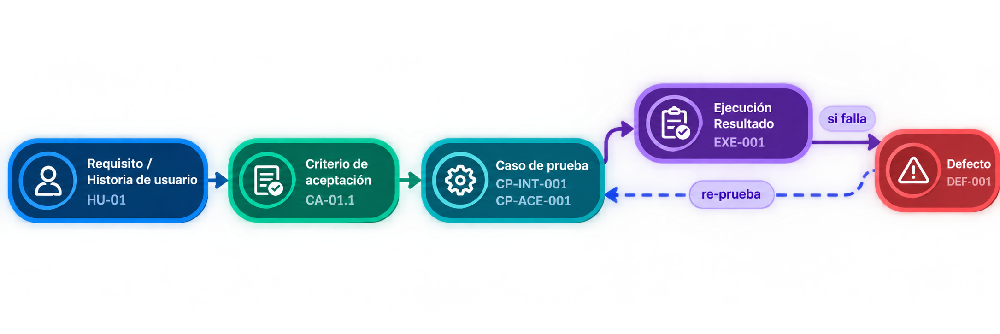

|  | Servicio Nacional de Aprendizaje — SENA · Centro de Electricidad, Electrónica y Telecomunicaciones — CEET | Tecnólogo en Análisis y Desarrollo de Software (ADSO) · Trimestre 6 |
| :---: | ----- | ----- |

# CAPÍTULO III · PR-02

## Especificación de Casos de Prueba y Matriz de Trazabilidad

**Integración, sistema y aceptación**

| Campo | Detalle |
| ----- | ----- |
| **FASE** | **PLANEACIÓN** |
| **Proyecto formativo** | HabitApp |
| **Ficha** | 3278641 |
| **Equipo / Autores** | Carlos Mario Acosta Velasquez, Breiner Rodriguez Causil, Nicolas Estiben Crispoca Caicedo y Juan Esteban Diaz Galindo |
| **Instructor(es)** | Zaida Ojeda · Javier Yara · Victor Cortez |
| **Criterio de evaluación** | Trimestre 6 — En el proyecto se evidencia que se haya usado alguna técnica de pruebas de software. |
| **Versión del documento** | 1.0 |
| **Fecha** | 06 de noviembre de 2026 |
| **Ciudad** | Bogotá D.C. |

## Control del documento

### Historial de versiones

| Versión | Fecha | Autor(es) | Descripción del cambio |
| ----- | ----- | ----- | ----- |
| 0.1 | 21/10/2026 | Carlos Mario Acosta Velasquez | Creación del documento a partir de la plantilla |
| 0.2 | 30/10/2026 | Carlos Mario Acosta Velasquez, Breiner Rodriguez Causil, Nicolas Estiben Crispoca Caicedo y Juan Esteban Diaz Galindo | Incorporación de la matriz de trazabilidad de las 42 HU, técnicas formales y especificación de casos CP-INT, CP-SIS, CP-NF y CP-ACE |
| 1.0 | 06/11/2026 | Carlos Mario Acosta Velasquez | Optimización de la pirámide de pruebas (188 casos), ajuste técnico del Módulo 6 (límites binarios 5 MiB, alarmas exactas Android, geolocalización on-device, respaldo biométrico del SO) y aprobación final |

### Revisión y aprobación

| Rol | Nombre | Firma | Fecha |
| ----- | ----- | :---: | ----- |
| Elaboró (aprendiz / equipo) | Carlos Mario Acosta Velasquez |  | 21/10/2026 |
| Revisó (líder técnico / Scrum Master) | Carlos Mario Acosta Velasquez |  | 30/10/2026 |
| Aprobó (instructor / Product Owner) | Zaida Ojeda |  | 06/11/2026 |

## Ubicación en el paquete documental

| Atributo | Referencia |
| ----- | ----- |
| **Documento que lo precede** | PR-01 Plan maestro de pruebas |
| **Documento que lo sucede** | PR-03 Informe de análisis estático |
| **Norma / referente principal** | ISO/IEC/IEEE 29119-3 (Test Case Specification) · ISO/IEC/IEEE 29119-4 |

## Contenido

 1. [Propósito y alcance](#1-propósito-y-alcance)
 2. [Convenciones de identificación](#2-convenciones-de-identificación)
 3. [Trazabilidad](#3-trazabilidad)
 4. [Plantilla de caso de prueba (formato completo)](#4-plantilla-de-caso-de-prueba-formato-completo)
 5. [Diseño con técnicas formales (ejemplos)](#5-diseño-con-técnicas-formales-ejemplos)
    * 5.1 [Partición de equivalencia y valores límite](#51-partición-de-equivalencia-y-valores-límite)
    * 5.2 [Tabla de decisión](#52-tabla-de-decisión)
 6. [Casos de prueba de integración](#6-casos-de-prueba-de-integración)
 7. [Casos de prueba de sistema](#7-casos-de-prueba-de-sistema)
 8. [Casos de prueba de aceptación (Gherkin)](#8-casos-de-prueba-de-aceptación-gherkin)
 9. [Datos de prueba](#9-datos-de-prueba)
10. [Revisión de la especificación](#10-revisión-de-la-especificación)

## 1. Propósito y alcance

Documentar los casos de prueba de los niveles de integración, sistema y aceptación de HabitApp versiones API 1.4.0, web 1.2.0 y móvil 1.0.0 (aplicación web en Next.js, aplicación móvil en Flutter y API REST en NestJS), y su trazabilidad con las 42 historias de usuario del MVP (US001 a US042). Las pruebas unitarias no se especifican en tabla: su especificación es el propio código automatizado y sus resultados se reportan en PR-04. Las historias de riesgo bajo (US001, US008, US018 y US033) se cubren con casos de sistema y sesiones de pruebas exploratorias, según el Plan Maestro de Pruebas (PR-01).

## 2. Convenciones de identificación

| Prefijo | Nivel | Ejemplo |
| ----- | ----- | ----- |
| CP-INT | Integración | CP-INT-001 |
| CP-SIS | Sistema (funcional / E2E) | CP-SIS-001 |
| CP-NF | Sistema no funcional | CP-NF-001 |
| CP-ACE | Aceptación | CP-ACE-001 |

## 3. Trazabilidad



*Figura 1. Cadena de trazabilidad requisito → caso → ejecución → defecto*

**Tabla 1. Matriz de trazabilidad HU ↔ casos de prueba**

| HU | Criterio de aceptación | CP-INT | CP-SIS | CP-ACE | Estado |
| ----- | ----- | ----- | ----- | ----- | ----- |
| US001 | CA-US001.1 Vistas interactivas de inducción (hábitos, rachas, comunidad) | — | CP-SIS-001 | CP-ACE-001 | Diseñado |
| US001 | CA-US001.2 Botón “Saltar” o “Comenzar” funcional | — | CP-SIS-001 | CP-ACE-001 | Diseñado |
| US001 | CA-US001.3 Detección de primera visita (isFirstTime) | — | CP-SIS-001 | CP-ACE-001 | Diseñado |
| US001 | CA-US001.4 Interfaz adaptable (360–414 px y 1280+ px), Lighthouse ≥ 90 | — | CP-NF-001 | — | Diseñado |
| US002 | CA-US002.1 Validación del formato de correo | CP-INT-002 | CP-SIS-002 | CP-ACE-002 | Diseñado |
| US002 | CA-US002.2 Contraseña de 6 a 50 caracteres | CP-INT-001, CP-INT-002 | CP-SIS-002 | CP-ACE-002 | Diseñado |
| US002 | CA-US002.3 Hash seguro y registro en BD | CP-INT-001 | CP-SIS-002 | CP-ACE-002 | Diseñado |
| US002 | CA-US002.4 Mensaje amigable si el correo ya existe | CP-INT-003 | CP-SIS-002 | CP-ACE-002 | Diseñado |
| US003 | CA-US003.1 Validación de credenciales y verificación del hash | CP-INT-004, CP-INT-005 | CP-SIS-003, CP-NF-002 | CP-ACE-003 | Diseñado |
| US003 | CA-US003.2 Cookie JWT HTTP-only | CP-INT-004 | CP-SIS-003 | CP-ACE-003 | Diseñado |
| US003 | CA-US003.3 Ver/ocultar contraseña | — | CP-SIS-003 | — | Diseñado |
| US003 | CA-US003.4 Redirección al dashboard | — | CP-SIS-003 | CP-ACE-003 | Diseñado |
| US004 | CA-US004.1 Almacenamiento seguro del token (cookies / Secure Storage) | CP-INT-004 | CP-SIS-004 | CP-ACE-004 | Diseñado |
| US004 | CA-US004.2 Renovación silenciosa con refresh token | CP-INT-006, CP-INT-007 | CP-SIS-004 | CP-ACE-004 | Diseñado |
| US004 | CA-US004.3 Acceso directo al dashboard sin cierres inesperados | CP-INT-006 | CP-SIS-004 | CP-ACE-004 | Diseñado |
| US005 | CA-US005.1 Formulario /forgot-password | CP-INT-008 | CP-SIS-005 | CP-ACE-005 | Diseñado |
| US005 | CA-US005.2 Token temporal enviado por correo | CP-INT-008, CP-INT-009 | CP-SIS-005 | CP-ACE-005 | Diseñado |
| US005 | CA-US005.3 Vista /update-password con validación de fortaleza | CP-INT-009 | CP-SIS-005 | CP-ACE-005 | Diseñado |
| US005 | CA-US005.4 Confirmación y redirección al login | CP-INT-009 | CP-SIS-005 | CP-ACE-005 | Diseñado |
| US006 | CA-US006.1 Perfil inicializado y asociado a las credenciales | CP-INT-010 | CP-SIS-006 | CP-ACE-006 | Diseñado |
| US006 | CA-US006.2 UUID y avatar por defecto en gestion.usuarios | CP-INT-010 | CP-SIS-006 | CP-ACE-006 | Diseñado |
| US006 | CA-US006.3 Rol inicial “Usuario regular” | CP-INT-010 | CP-SIS-006 | CP-ACE-006 | Diseñado |
| US007 | CA-US007.1 Edición de nombre, apellido y foto | CP-INT-011, CP-INT-012 | CP-SIS-007 | CP-ACE-007 | Diseñado |
| US007 | CA-US007.2 Selección y almacenamiento de zona horaria | CP-INT-011 | CP-SIS-007 | CP-ACE-007 | Diseñado |
| US007 | CA-US007.3 Reflejo reactivo en el header sin recargar | — | CP-SIS-007 | CP-ACE-007 | Diseñado |
| US008 | CA-US008.1 Panel /ajustes con accesos a Seguridad, Notificaciones, Soporte y Valoración | — | CP-SIS-008 | CP-ACE-008 | Diseñado |
| US008 | CA-US008.2 Configuración de canales y privacidad | — | CP-SIS-008 | CP-ACE-008 | Diseñado |
| US008 | CA-US008.3 Enlaces a soporte y documentación legal | — | CP-SIS-008 | CP-ACE-008 | Diseñado |
| US009 | CA-US009.1 Middleware intercepta /dashboard, /admin y /entrenador | CP-INT-013 | CP-SIS-009 | CP-ACE-009 | Diseñado |
| US009 | CA-US009.2 Redirección a /login sin token válido | CP-INT-013 | CP-SIS-009 | CP-ACE-009 | Diseñado |
| US009 | CA-US009.3 Conservación de la ruta de retorno | — | CP-SIS-009 | CP-ACE-009 | Diseñado |
| US010 | CA-US010.1 Botón de logout en el menú de usuario | — | CP-SIS-010 | CP-ACE-010 | Diseñado |
| US010 | CA-US010.2 Logout en la API y revocación de tokens y cookies | CP-INT-014 | CP-SIS-010 | CP-ACE-010 | Diseñado |
| US010 | CA-US010.3 Redirección a /login y prevención de retroceso por caché | — | CP-SIS-010 | CP-ACE-010 | Diseñado |
| US011 | CA-US011.1 Campos obligatorios: nombre y meta diaria | CP-INT-015, CP-INT-016 | CP-SIS-011 | CP-ACE-011 | Diseñado |
| US011 | CA-US011.2 Selección de categoría predefinida | CP-INT-015, CP-INT-016 | CP-SIS-011 | CP-ACE-011 | Diseñado |
| US011 | CA-US011.3 Asociación automática al usuario autenticado | CP-INT-015 | CP-SIS-011 | CP-ACE-011 | Diseñado |
| US012 | CA-US012.1 Preajustes: Todos los días, L-V, Personalizado | CP-INT-017 | CP-SIS-012 | CP-ACE-012 | Diseñado |
| US012 | CA-US012.2 Selección individual de días | CP-INT-017 | CP-SIS-012 | CP-ACE-012 | Diseñado |
| US012 | CA-US012.3 Validación de al menos un día | CP-INT-018 | CP-SIS-012 | CP-ACE-012 | Diseñado |
| US013 | CA-US013.1 Múltiples horas de recordatorio (HH:mm) | CP-INT-019, CP-INT-020 | CP-SIS-013 | CP-ACE-013 | Diseñado |
| US013 | CA-US013.2 Eliminar horas individuales | CP-INT-019 | CP-SIS-013 | CP-ACE-013 | Diseñado |
| US013 | CA-US013.3 Persistencia de recordatorios en BD | CP-INT-019 | CP-SIS-013 | CP-ACE-013 | Diseñado |
| US014 | CA-US014.1 Filtro por el día actual del usuario | CP-INT-021, CP-INT-023 | CP-SIS-014 | CP-ACE-014 | Diseñado |
| US014 | CA-US014.2 Estado pendiente o completado | CP-INT-021, CP-INT-022 | CP-SIS-014 | CP-ACE-014 | Diseñado |
| US014 | CA-US014.3 Separación de activos y archivados | CP-INT-024 | CP-SIS-014 | CP-ACE-014 | Diseñado |
| US015 | CA-US015.1 Check con respuesta optimista | — | CP-SIS-015, CP-SIS-016 | CP-ACE-015 | Diseñado |
| US015 | CA-US015.2 Registro en registro_habitos con la fecha local | CP-INT-025 | CP-SIS-015, CP-NF-003 | CP-ACE-015 | Diseñado |
| US015 | CA-US015.3 Mitigación del desfase de fecha UTC | CP-INT-026 | CP-SIS-015 | CP-ACE-015 | Diseñado |
| US016 | CA-US016.1 Toggle inverso en el hábito completado | CP-INT-027 | CP-SIS-017 | CP-ACE-016 | Diseñado |
| US016 | CA-US016.2 Eliminación o actualización del registro diario | CP-INT-027 | CP-SIS-017 | CP-ACE-016 | Diseñado |
| US016 | CA-US016.3 Recálculo de barra de progreso y puntos | CP-INT-027 | CP-SIS-017 | CP-ACE-016 | Diseñado |
| US017 | CA-US017.1 Modificación de nombre, meta y categoría | CP-INT-028 | CP-SIS-018 | CP-ACE-017 | Diseñado |
| US017 | CA-US017.2 Archivar cambia el estado a “Inactivo” | CP-INT-029 | CP-SIS-018 | CP-ACE-017 | Diseñado |
| US017 | CA-US017.3 Archivados ocultos pero con registros conservados | CP-INT-029 | CP-SIS-018 | CP-ACE-017 | Diseñado |
| US018 | CA-US018.1 Eliminación física con diálogo de confirmación | CP-INT-030 | CP-SIS-019 | CP-ACE-018 | Diseñado |
| US018 | CA-US018.2 Solo con 0 registros; con 1 o más, error 400 y orientación a archivar | CP-INT-030, CP-INT-031 | CP-SIS-019 | CP-ACE-018 | Diseñado |
| US019 | CA-US019.1 Cálculo (cumplidos hoy / totales hoy) × 100 | CP-INT-032 | CP-SIS-020 | CP-ACE-019 | Diseñado |
| US019 | CA-US019.2 Actualización reactiva al marcar o desmarcar | — | CP-SIS-020 | CP-ACE-019 | Diseñado |
| US019 | CA-US019.3 Indicador de felicitación al llegar al 100 % | — | CP-SIS-020 | CP-ACE-019 | Diseñado |
| US020 | CA-US020.1 Contador numérico con icono de fuego | CP-INT-033 | CP-SIS-021 | CP-ACE-020 | Diseñado |
| US020 | CA-US020.2 Suma +1 si se cumplió el día programado anterior y hoy | CP-INT-033, CP-INT-034, CP-INT-037 | CP-SIS-021 | CP-ACE-020 | Diseñado |
| US020 | CA-US020.3 Regla determinística: 0 si se perdió continuidad y hoy sin check; 1 al registrar hoy tras interrupción | CP-INT-035, CP-INT-036 | CP-SIS-022 | CP-ACE-020 | Diseñado |
| US020 | CA-US020.4 Cálculo ajustado al huso horario local | CP-INT-026, CP-INT-033 | CP-SIS-021 | CP-ACE-020 | Diseñado |
| US021 | CA-US021.1 +10 puntos base al registrar cumplimiento | CP-INT-038 | CP-SIS-023 | CP-ACE-021 | Diseñado |
| US021 | CA-US021.2 Control de concurrencia contra doble sumatoria | CP-INT-039, CP-INT-040 | CP-SIS-023, CP-NF-004 | CP-ACE-021 | Diseñado |
| US021 | CA-US021.3 Puntaje global actualizado y visible en el perfil | CP-INT-038 | CP-SIS-023 | CP-ACE-021 | Diseñado |
| US022 | CA-US022.1 Matriz interactiva de 90 días con escala de color | CP-INT-041 | CP-SIS-024 | CP-ACE-022 | Diseñado |
| US022 | CA-US022.2 Mejor racha histórica | CP-INT-041 | CP-SIS-024 | CP-ACE-022 | Diseñado |
| US022 | CA-US022.3 Tooltips informativos sobre las fechas | — | CP-SIS-024 | CP-ACE-022 | Diseñado |
| US023 | CA-US023.1 Filtro de período dinámico: Semanal, Mensual y Anual (Semanal por defecto) | CP-INT-042 | CP-SIS-025 | CP-ACE-023 | Diseñado |
| US023 | CA-US023.2 Gráficas comparativas por categorías | CP-INT-043 | CP-SIS-025 | CP-ACE-023 | Diseñado |
| US023 | CA-US023.3 Resumen estadístico de la tasa de éxito global | CP-INT-042 | CP-SIS-025 | CP-ACE-023 | Diseñado |
| US023 | CA-US023.4 Registro visual de emociones y estados de ánimo | — | CP-SIS-025 | CP-ACE-023 | Diseñado |
| US024 | CA-US024.1 Campana con contador reactivo de no leídas | CP-INT-044 | CP-SIS-026 | CP-ACE-024 | Diseñado |
| US024 | CA-US024.2 Página /notificaciones con listado cronológico | CP-INT-044 | CP-SIS-026 | CP-ACE-024 | Diseñado |
| US024 | CA-US024.3 Marcar notificaciones individuales o todas como leídas | CP-INT-045 | CP-SIS-026 | CP-ACE-024 | Diseñado |
| US024 | CA-US024.4 Alertas segmentadas por tipo | CP-INT-044 | CP-SIS-026 | CP-ACE-024 | Diseñado |
| US025 | CA-US025.1 Tabla ordenada descendentemente por puntos | CP-INT-046 | CP-SIS-027 | CP-ACE-025 | Diseñado |
| US025 | CA-US025.2 Posición, avatar, nombre, racha y puntos | CP-INT-046 | CP-SIS-027 | CP-ACE-025 | Diseñado |
| US025 | CA-US025.3 Destacado del top 3 y de la posición propia | — | CP-SIS-027 | CP-ACE-025 | Diseñado |
| US026 | CA-US026.1 Logros automáticos por hitos (30, 90, 180 y 365 días, o retos) | CP-INT-047 | CP-SIS-028 | CP-ACE-026 | Diseñado |
| US026 | CA-US026.2 Modal o notificación de felicitación | — | CP-SIS-028 | CP-ACE-026 | Diseñado |
| US026 | CA-US026.3 Vitrina de insignias en el perfil | CP-INT-047 | CP-SIS-028 | CP-ACE-026 | Diseñado |
| US027 | CA-US027.1 Lista de foros con título, autor, fecha, categoría y número de respuestas | CP-INT-048 | CP-SIS-029 | CP-ACE-027 | Diseñado |
| US027 | CA-US027.2 Filtro por categorías temáticas | — | CP-SIS-029 | CP-ACE-027 | Diseñado |
| US027 | CA-US027.3 Búsqueda por palabras clave en tiempo real | — | CP-SIS-029 | CP-ACE-027 | Diseñado |
| US028 | CA-US028.1 Formulario modal para crear foro (título, categoría, contenido) | CP-INT-049 | CP-SIS-030 | CP-ACE-028 | Diseñado |
| US028 | CA-US028.2 Menú contextual con Editar y Eliminar solo en foros propios | CP-INT-050, CP-INT-051, CP-INT-052 | CP-SIS-030 | CP-ACE-028 | Diseñado |
| US028 | CA-US028.3 Confirmación de eliminación y borrado en cascada de las respuestas | CP-INT-050 | CP-SIS-030 | CP-ACE-028 | Diseñado |
| US029 | CA-US029.1 Comentario principal en cada foro | CP-INT-053 | CP-SIS-031 | CP-ACE-029 | Diseñado |
| US029 | CA-US029.2 Botón “Responder” para respuestas anidadas | CP-INT-053 | CP-SIS-031 | CP-ACE-029 | Diseñado |
| US029 | CA-US029.3 Adjuntar imagen opcional en comentarios (máximo 5 MiB = 5.242.880 bytes) | CP-INT-055, CP-INT-056, CP-INT-057 | CP-SIS-032 | CP-ACE-029 | Diseñado |
| US029 | CA-US029.4 Editar o eliminar comentarios propios | CP-INT-054 | CP-SIS-031 | CP-ACE-029 | Diseñado |
| US030 | CA-US030.1 Botón de corazón con contador de apoyos | CP-INT-058 | CP-SIS-033 | CP-ACE-030 | Diseñado |
| US030 | CA-US030.2 Alternar like y unlike con un clic | CP-INT-058 | CP-SIS-033 | CP-ACE-030 | Diseñado |
| US030 | CA-US030.3 Persistencia sin duplicados por usuario | CP-INT-058 | CP-SIS-033 | CP-ACE-030 | Diseñado |
| US031 | CA-US031.1 Pestaña “Hábitos de la comunidad” con contador de personas | CP-INT-059 | CP-SIS-034 | CP-ACE-031 | Diseñado |
| US031 | CA-US031.2 Botón “Clonar hábito” a mi lista personal | CP-INT-059 | CP-SIS-034 | CP-ACE-031 | Diseñado |
| US031 | CA-US031.3 Notificación de éxito y aparición en el dashboard de “Hoy” | — | CP-SIS-034 | CP-ACE-031 | Diseñado |
| US032 | CA-US032.1 Tarjetas de retos con icono, título, meta en días y puntos | CP-INT-060 | CP-SIS-035 | CP-ACE-032 | Diseñado |
| US032 | CA-US032.2 Botones “Unirme” y “Abandonar” | CP-INT-060 | CP-SIS-035 | CP-ACE-032 | Diseñado |
| US032 | CA-US032.3 Check-in diario, una sola vez por día hasta alcanzar la meta | CP-INT-061, CP-INT-062, CP-INT-063, CP-INT-064 | CP-SIS-035 | CP-ACE-032 | Diseñado |
| US032 | CA-US032.4 Validación de retos finalizados o caducados por fecha fin | CP-INT-065 | CP-SIS-035 | CP-ACE-032 | Diseñado |
| US033 | CA-US033.1 Catálogo con categoría y tiempo estimado de lectura | CP-INT-066 | CP-SIS-036 | CP-ACE-033 | Diseñado |
| US033 | CA-US033.2 Modal de lectura con párrafos claros y contraste ≥ 4.5:1 | — | CP-SIS-036, CP-NF-005 | CP-ACE-033 | Diseñado |
| US033 | CA-US033.3 Copiar enlace y marcar o desmarcar favorito | — | CP-SIS-036 | CP-ACE-033 | Diseñado |
| US034 | CA-US034.1 Directorio con nombre, avatar y especialidad | CP-INT-067 | CP-SIS-037 | CP-ACE-034 | Diseñado |
| US034 | CA-US034.2 Modal con el perfil profesional del coach | — | CP-SIS-037 | CP-ACE-034 | Diseñado |
| US034 | CA-US034.3 Botón para solicitar sesión con confirmación interactiva | — | CP-SIS-037 | CP-ACE-034 | Diseñado |
| US035 | CA-US035.1 Panel exclusivo de Entrenador protegido por rol | CP-INT-068 | CP-SIS-038 | CP-ACE-035 | Diseñado |
| US035 | CA-US035.2 Lista de pupilos con porcentaje de cumplimiento semanal y racha | CP-INT-068 | CP-SIS-038 | CP-ACE-035 | Diseñado |
| US035 | CA-US035.3 Vista de detalle de solo lectura de los hábitos de cada cliente | CP-INT-069, CP-INT-070, CP-INT-071 | CP-SIS-038 | CP-ACE-035 | Diseñado |
| US036 | CA-US036.1 Creador de rutinas modelo agrupando múltiples hábitos con metas | CP-INT-072 | CP-SIS-039 | CP-ACE-036 | Diseñado |
| US036 | CA-US036.2 Modal de asignación para seleccionar un cliente y transferir la rutina | CP-INT-073 | CP-SIS-039 | CP-ACE-036 | Diseñado |
| US036 | CA-US036.3 Hábitos clonados automáticamente en el dashboard del cliente | CP-INT-073 | CP-SIS-039 | CP-ACE-036 | Diseñado |
| US037 | CA-US037.1 Panel /admin con tabla de usuarios paginada | CP-INT-074, CP-INT-075, CP-INT-076 | CP-SIS-040 | CP-ACE-037 | Diseñado |
| US037 | CA-US037.2 Selector de rol con actualización inmediata de permisos | CP-INT-077 | CP-SIS-040 | CP-ACE-037 | Diseñado |
| US037 | CA-US037.3 Opción para bloquear o suspender cuentas | CP-INT-078 | CP-SIS-041 | CP-ACE-037 | Diseñado |
| US038 | CA-US038.1 Botón de moderación forzada para eliminar foros o comentarios | CP-INT-079 | CP-SIS-042 | CP-ACE-038 | Diseñado |
| US038 | CA-US038.2 Políticas RLS y aislamiento de esquemas en PostgreSQL | CP-INT-080 | CP-NF-007 | CP-ACE-038 | Diseñado |
| US038 | CA-US038.3 Ningún usuario consulta registros privados ajenos | CP-INT-070, CP-INT-071 | CP-NF-006 | CP-ACE-038 | Diseñado |
| US039 | CA-US039.1 Solicitud de permisos nativos de notificación (Android 13+) | — | CP-SIS-043, CP-SIS-044, CP-SIS-045, CP-NF-008 | CP-ACE-039 | Diseñado |
| US039 | CA-US039.2 Alertas locales en segundo plano a la hora configurada del hábito (tolerancia ≤ 30 s) | — | CP-SIS-046, CP-SIS-047 | CP-ACE-039 | Diseñado |
| US039 | CA-US039.3 Interfaz en Ajustes para silenciar o encender las notificaciones | — | CP-SIS-048 | CP-ACE-039 | Diseñado |
| US039 | CA-US039.4 Al tocar la notificación, la app abre el hábito correspondiente | — | CP-SIS-049 | CP-ACE-039 | Diseñado |
| US040 | CA-US040.1 Solicitud clara de permisos de ubicación (fina y aproximada) en Android | — | CP-SIS-050 | CP-ACE-040 | Diseñado |
| US040 | CA-US040.2 Captura local de coordenadas GPS y resolución on-device de ciudad/país en el perfil (LocationCard) | — | CP-SIS-050 | CP-ACE-040 | Diseñado |
| US040 | CA-US040.3 Si se deniega permanentemente, la app sigue operando con normalidad | — | CP-SIS-051 | CP-ACE-040 | Diseñado |
| US041 | CA-US041.1 Acceso a la cámara y a la galería con permisos de Android | — | CP-SIS-052 | CP-ACE-041 | Diseñado |
| US041 | CA-US041.2 Recorte y compresión automática antes de subir (máximo 5 MiB = 5.242.880 bytes) | CP-INT-081, CP-INT-082 | CP-SIS-052 | CP-ACE-041 | Diseñado |
| US041 | CA-US041.3 Carga al Storage con peticiones binarias optimizadas | CP-INT-012, CP-INT-081 | CP-SIS-052 | CP-ACE-041 | Diseñado |
| US042 | CA-US042.1 Interruptor de seguridad biométrica en la configuración de la cuenta (Android) | — | CP-SIS-053 | CP-ACE-042 | Diseñado |
| US042 | CA-US042.2 Detección de compatibilidad con el hardware biométrico (BiometricPrompt en Android) | — | CP-SIS-055, CP-NF-008 | CP-ACE-042 | Diseñado |
| US042 | CA-US042.3 Intercepción obligatoria al pasar a primer plano con respaldo de PIN/patrón del dispositivo | — | CP-SIS-053, CP-SIS-054, CP-SIS-055, CP-SIS-056 | CP-ACE-042 | Diseñado |

**Nota de arquitectura (US038):** la API se conecta a Supabase con la clave de servicio, que ignora RLS. Las políticas RLS aplican denegación total al acceso directo con la clave pública, y el aislamiento entre usuarios se garantiza en la capa de autorización del backend (usuario extraído del JWT y filtros por usuario en cada repositorio).

| Métrica de trazabilidad | Valor |
| ----- | ----- |
| Total de historias de usuario del MVP | 42 historias de usuario (US001 a US042) |
| Total de criterios de aceptación | 132 criterios de aceptación (CA-US001.1 a CA-US042.3) |
| Criterios con al menos un caso | 132 → cobertura de requisitos = 100 % (82 CP-INT + 56 CP-SIS + 8 CP-NF + 42 CP-ACE = 188 casos especificados) |

## 4. Plantilla de caso de prueba (formato completo)

**Nota metodológica de especificación (ISO/IEC/IEEE 29119-3):** Dado que el alcance de aseguramiento de calidad de HabitApp abarca 146 casos técnicos entre los niveles de integración (82 CP-INT) y sistema (56 CP-SIS funcionales y 8 CP-NF no funcionales), la especificación completa del catálogo se documenta utilizando el formato tabular condensado en las Secciones 6 y 7. En la presente sección se documenta la ficha extendida del caso CP-INT-001 como modelo canónico de referencia de la estructura de diseño adoptada por el equipo de QA.

| Campo | Detalle |
| ----- | ----- |
| **ID del caso** | CP-INT-001 |
| **Título** | Registro exitoso de nuevo usuario con credenciales válidas y almacenamiento seguro de contraseña |
| **HU / requisito** | US002 · CA-US002.2 y CA-US002.3 (Hash seguro y registro en BD) |
| **Nivel / tipo** | Integración · Funcional y Seguridad |
| **Técnica de diseño** | Partición de equivalencia y Análisis de valores límite (contraseña dentro del rango válido de 6 a 50 caracteres) |
| **Prioridad** | Alta |
| **Precondiciones** | 1. Servicio Backend (habitapp-api v1.4.0) activo y conectado a la instancia PostgreSQL/Supabase de QA. 2. El correo nuevo.usuario@habitapp.com no existe previamente en la tabla gestion.usuarios. |
| **Datos de entrada** | POST /api/v1/auth/register — Body JSON: `{ "nombre": "Carlos", "apellido": "Acosta", "email": "nuevo.usuario@habitapp.com", "password": "Password123*" }` |
| **Pasos** | 1. Enviar petición POST /api/v1/auth/register mediante Supertest / Postman con el cuerpo JSON de entrada. 2. Verificar código de respuesta HTTP y ausencia del campo password en el JSON devuelto. 3. Consultar la fila en gestion.usuarios para comprobar que la contraseña esté almacenada como hash criptográfico. |
| **Resultado esperado** | HTTP 201 Created; usuario persistido con hash bcrypt en base de datos; el cuerpo de respuesta no expone la contraseña ni el hash. |
| **Postcondiciones** | Se crea el registro en gestion.usuarios con UUID único, rol inicial “Usuario regular” y avatar por defecto. |
| **Automatizado** | Sí — Suite Supertest (test/app.e2e-spec.ts) y Colección Postman (Auth / CP-INT-001 Register OK). |

## 5. Diseño con técnicas formales (ejemplos)

### 5.1 Partición de equivalencia y valores límite

| Variable | Clase válida | Clases inválidas | Valores límite a probar |
| ----- | ----- | ----- | ----- |
| Contraseña (longitud) | 6 a 50 caracteres | Menor a 6, mayor a 50 | 5, 6, 50 y 51 caracteres |
| Correo electrónico (formato) | Con “@” y dominio válido | Sin “@”, sin dominio, vacío | No aplica (partición por formato) |
| Hora de recordatorio (HH:mm) | 00:00 a 23:59 | Hora $\ge 24$, minutos $\ge 60$, texto | 00:00, 23:59, 24:00 y 12:60 |
| Días de la frecuencia | 1 a 7 días | 0 días seleccionados | 0, 1 y 7 días |
| Registros previos al eliminar un hábito | 0 registros | 1 o más registros | 0 y 1 registro |
| Fecha del registro del check-in (UTC-5) | Día local del usuario | Día UTC desfasado | 23:59 local (04:59 UTC siguiente) y 00:00 local (05:00 UTC) |
| Hábitos programados hoy | 1 o más hábitos | 0 hábitos (progreso 0 %, sin error) | 0, 1 y 4 hábitos |
| Racha actual (días) | Entero $\ge 0$ | Valores negativos | 0, 1 y 2 días |
| Puntos acreditados por check-in | 10 puntos, una sola vez por hábito y día | Distinto de 10 (sin puntos o doble sumatoria) | 1 clic = +10; 2 clics simultáneos = +10 |
| Racha que desbloquea logro | 30, 90, 180 o 365 días | 29, 89, 179 o 364 días | 28→29 (sin logro) y 29→30 (con logro) |
| Notificaciones listadas | 0 a 30 notificaciones | Más de 30 (solo devuelve las 30 más recientes) | 30, 31 y 35 notificaciones |
| Tamaño de la imagen adjunta (binario en ParseFilePipeBuilder) | Hasta 5 MiB ($\le 5.242.880$ bytes) | Más de 5 MiB ($\ge 5.242.881$ bytes) | 1 MiB (1.048.576 B), 5 MiB exactos (5.242.880 B), 5 MiB + 1 byte (5.242.881 B) y 8 MiB (8.388.608 B) |
| Tipo de archivo adjunto | Imagen válida (JPG, PNG, WEBP) | Documentos (PDF) u otros formatos no gráficos | Una imagen JPG/PNG válida y un archivo PDF |
| Check-ins de un reto (en días) | De 1 hasta la meta | 0 y más que la meta | Meta − 1, meta y meta + 1 (con meta 3: 2, 3 y 4) |
| Fecha fin del reto | Hoy o posterior | Anterior a hoy | Ayer (rechaza), hoy (permite) y mañana (permite) |
| Hábitos por rutina | 1 o más (mínimo 1) | 0 hábitos | 0, 1 y 2 hábitos |
| Página de la tabla de usuarios (limit por defecto 10) | De 1 a la última página | 0 y posteriores a la última (lista vacía) | 0, 1, última (3 con 24 usuarios) y 99 |
| Rol de usuario | Usuario, Entrenador, Admin | Cualquier otro valor | Los tres válidos y “Superadmin” |
| Clientes asignados al entrenador | 0 o más (solo los propios) | Clientes de otro entrenador | 0, 1 y varios clientes |
| Estado de cuenta | Pendiente, Activo, Suspendido | Cualquier otro valor | Los tres válidos y “Baneado” |
| Versión de Android | 10 a 12 (sin permiso runtime de notificaciones) y 13 a 14 (solicita POST_NOTIFICATIONS) | Menores de 10 y mayores de 14 (fuera de alcance) | Android 12 y Android 13 |
| Estado del permiso (notificaciones, alarmas exactas, ubicación, cámara) | Concedido | Denegado y denegado permanentemente | Concedido, denegado y denegado permanentemente |
| Estado biométrico del dispositivo | Hardware disponible con huella registrada | Sin hardware, sin huella registrada, huella no reconocida | Registrada y reconocida, sin huella registrada, huella incorrecta (activa respaldo con PIN/patrón del SO) |

### 5.2 Tabla de decisión

**Tabla de decisión 1: hábitos visibles en “Hoy” (US014)**

| Condición / Acción | R1 | R2 | R3 | R4 |
| ----- | ----- | ----- | ----- | ----- |
| Hábito programado para hoy | S | S | N | — |
| Hábito activo (no archivado) | S | S | S | N |
| Tiene registro de cumplimiento hoy | N | S | — | — |
| Acción: mostrar como Pendiente | X |  |  |  |
| Acción: mostrar como Completado |  | X |  |  |
| Acción: no mostrar en “Hoy” |  |  | X | X |

R1 → CP-INT-021, R2 → CP-INT-022, R3 → CP-INT-023, R4 → CP-INT-024

**Tabla de decisión 2: puntos al marcar el check (US021)**

| Condición / Acción | R1 | R2 | R3 | R4 |
| ----- | ----- | ----- | ----- | ----- |
| Hábito pendiente hoy (sin registro) | S | S | N | N |
| Petición duplicada simultánea | N | S | — | — |
| Solicitud de desmarcar | N | N | N | S |
| Acción: sumar +10 una sola vez | X | X |  |  |
| Acción: ignorar peticiones duplicadas |  | X |  |  |
| Acción: no sumar puntos |  |  | X |  |
| Acción: revertir los 10 puntos |  |  |  | X |

R1 → CP-INT-038, R2 → CP-INT-039, R3 → CP-INT-040, R4 → CP-INT-027

**Tabla de decisión 3: cálculo de la racha (US020)**

| Condición / Acción | R1 | R2 | R3 | R4 |
| ----- | ----- | ----- | ----- | ----- |
| Cumplió el día programado anterior consecutivo | S | S | N | N |
| Registra cumplimiento hoy | S | N | N | S |
| Acción: racha +1 | X |  |  |  |
| Acción: racha conserva su valor |  | X |  |  |
| Acción: racha = 0 |  |  | X |  |
| Acción: racha = 1 |  |  |  | X |

R1 → CP-INT-033, R2 → CP-INT-034, R3 → CP-INT-035, R4 → CP-INT-036

**Tabla de decisión 4: permisos sobre foros y comentarios (US028, US029 y US038)**

| Condición / Acción | R1 | R2 | R3 | R4 |
| ----- | ----- | ----- | ----- | ----- |
| Usuario autenticado | S | S | S | N |
| Rol = Administrador | S | N | N | — |
| Es propietario del recurso | — | S | N | — |
| Acción: permitir edición |  | X |  |  |
| Acción: permitir eliminación | X | X |  |  |
| Acción: HTTP 403 |  |  | X |  |
| Acción: HTTP 401 |  |  |  | X |

R1 → CP-INT-079, R2 → CP-INT-050 y CP-INT-054, R3 → CP-INT-051 y CP-INT-054, R4 → CP-INT-052

**Tabla de decisión 5: check-in diario en un reto (US032)**

| Condición / Acción | R1 | R2 | R3 | R4 | R5 |
| ----- | ----- | ----- | ----- | ----- | ----- |
| Usuario inscrito en el reto | S | S | S | N | S |
| Reto vigente (fecha fin hoy o posterior, y no “Finalizado”) | S | S | S | — | N |
| Ya hizo check-in hoy | N | S | N | — | — |
| Meta de días alcanzada | N | — | S | — | — |
| Acción: registrar el check-in | X |  |  |  |  |
| Acción: rechazar el check-in |  | X | X | X | X |

R1 → CP-INT-061, R2 → CP-INT-062, R3 → CP-INT-063, R4 → CP-INT-064, R5 → CP-INT-065

**Tabla de decisión 6: lectura de datos de otro usuario (US035, US038)**

| Condición / Acción | R1 | R2 | R3 | R4 | R5 |
| ----- | ----- | ----- | ----- | ----- | ----- |
| Usuario autenticado | S | S | S | S | N |
| Es el propietario de los datos | S | N | N | N | — |
| Rol = Administrador | — | S | N | N | — |
| Es entrenador con el cliente asignado | — | — | S | N | — |
| Acción: permitir lectura | X | X | X |  |  |
| Acción: HTTP 403 |  |  |  | X |  |
| Acción: HTTP 401 |  |  |  |  | X |

R1 → CP-INT-042, R2 → CP-INT-070, R3 → CP-INT-069, R4 → CP-INT-070, R5 → CP-INT-071

**Tabla de decisión 7: funciones de administración (US037, US038)**

| Condición / Acción | R1 | R2 | R3 |
| ----- | ----- | ----- | ----- |
| Usuario autenticado | S | S | N |
| Rol = Administrador | S | N | — |
| Acción: permitir | X |  |  |
| Acción: HTTP 403 |  | X |  |
| Acción: HTTP 401 |  |  | X |

R1 → CP-INT-074, CP-INT-077, CP-INT-078 y CP-INT-079, R2 → CP-INT-075, R3 → CP-INT-076

**Tabla de decisión 8: emisión de notificaciones locales de recordatorios en Android (US039)**

| Condición / Acción | R1 | R2 | R3 | R4 |
| ----- | ----- | ----- | ----- | ----- |
| Android 13 o superior (POST_NOTIFICATIONS en tiempo de ejecución) | S | S | N | — |
| Permiso de notificaciones concedido y permiso de Alarmas exactas (SCHEDULE_EXACT_ALARM / USE_EXACT_ALARM) activo | S | N | — | — |
| Interruptor de notificaciones encendido en Ajustes de HabitApp | S | — | S | N |
| Acción: emitir la notificación local en la hora exacta ($\le 30$ s con exactAllowWhileIdle) | X |  | X |  |
| Acción: no emitir (la app sigue operando sin bloqueo) |  | X |  | X |

R1 → CP-SIS-046 y CP-SIS-047, R2 → CP-SIS-044, R3 → CP-SIS-045, R4 → CP-SIS-048

**Tabla de decisión 9: desbloqueo biométrico y respaldo del sistema operativo en Android (US042)**

| Condición / Acción | R1 | R2 | R3 | R4 |
| ----- | ----- | ----- | ----- | ----- |
| Biometría activada en Ajustes de HabitApp | S | S | S | N |
| Sensor disponible con huella registrada (BiometricPrompt) | S | S | N | — |
| Huella válida reconocida por el sensor | S | N | — | — |
| Acción: desbloquear al instante | X |  |  |  |
| Acción: mantener la app bloqueada |  | X |  |  |
| Acción: ofrecer PIN, patrón o contraseña de bloqueo del dispositivo Android (biometricOnly: false) |  | X | X |  |
| Acción: no solicitar nada al volver a primer plano |  |  |  | X |

R1 → CP-SIS-053, R2 → CP-SIS-054, R3 → CP-SIS-055, R4 → CP-SIS-056

## 6. Casos de prueba de integración

**Tabla 2. Casos de integración**

| ID | Interfaz / endpoint | Datos de entrada | Resultado esperado | Prioridad |
| ----- | ----- | ----- | ----- | ----- |
| CP-INT-001 | POST /api/v1/auth/register y BD | Correo válido y contraseña en límites válidos (6, 8 y 50 caracteres) | 201; usuario creado con contraseña almacenada como hash bcrypt en BD; la respuesta no expone la contraseña | Alta |
| CP-INT-002 | POST /api/v1/auth/register | Correo sin “@” o contraseña fuera de rango (5 y 51 caracteres) | 400 Bad Request con errores de validación del DTO; sin registro en BD | Alta |
| CP-INT-003 | POST /api/v1/auth/register | Correo electrónico ya registrado previamente | 409 (o 400) con mensaje claro de correo existente; sin duplicado en BD | Alta |
| CP-INT-004 | POST /api/v1/auth/login | Credenciales válidas de usuario activo | 200; emite cookie access_token con directiva HttpOnly y sin hash en el cuerpo | Alta |
| CP-INT-005 | POST /api/v1/auth/login | Contraseña incorrecta o correo inexistente | 401 Unauthorized con el mismo mensaje genérico sin revelar qué campo falló | Alta |
| CP-INT-006 | POST /api/v1/auth/refresh | Cookie refresh_token válida (o refreshToken en el cuerpo) | 200; devuelve un access_token nuevo y expires_in = 900; renueva la sesión | Alta |
| CP-INT-007 | POST /api/v1/auth/refresh | Refresh token expirado, alterado o revocado | 401 con mensaje “Refresh token expirado o inválido” | Alta |
| CP-INT-008 | POST /api/v1/auth/reset-password | Correo electrónico registrado | 200; token temporal generado y correo recibido en el servidor SMTP de pruebas | Alta |
| CP-INT-009 | PUT /api/v1/auth/update-password | Caso A: Token válido y clave de 8 caracteres. Caso B: Token expirado o clave de 5 caracteres | Caso A: 200 y permite iniciar sesión con la nueva clave. Caso B: 400/401 y clave sin cambios | Alta |
| CP-INT-010 | GET /api/v1/users/me y BD | Cookie del usuario recién registrado | 200; fila en gestion.usuarios con UUID único, avatar por defecto y rol inicial “Usuario regular” | Media |
| CP-INT-011 | PATCH /api/v1/users/me | Caso A: Nombre, apellido y zona horaria UTC-5 válidos. Caso B: Nombre vacío | Caso A: 200 y persiste datos y zona horaria. Caso B: 400 por validación sin cambios en BD | Media |
| CP-INT-012 | POST /api/v1/users/me/avatar | Imagen JPG válida de 1 MiB (1.048.576 bytes) | 200 (o 201); URL de la foto de perfil actualizada en Supabase Storage y BD | Media |
| CP-INT-013 | GET /api/v1/users/me | Petición sin cookie de sesión o con JWT expirado | 401 Unauthorized | Alta |
| CP-INT-014 | POST /api/v1/auth/logout y GET /users/me | Sesión activa; posterior intento de uso del token revocado | 200 en logout (cookie eliminada); 401 al reutilizar el token anterior | Alta |
| CP-INT-015 | POST /api/v1/users/habits y GET /categorias | Nombre “Beber agua”, meta 2000 ml, categoría válida del catálogo e idusuario distinto en body | 201; hábito creado y asociado forzosamente al usuario del token JWT (ignora idusuario del body) | Alta |
| CP-INT-016 | POST /api/v1/users/habits | Nombre vacío, sin meta diaria o con categoría inexistente | 400 Bad Request con detalle de validación; sin registro en BD | Alta |
| CP-INT-017 | POST /api/v1/users/habits | Preajustes “Todos los días” (7 días), “L-V” (5 días) y “Personalizado” (solo lunes: 1 día) | 201 en los tres escenarios; días guardados exactamente según la selección | Media |
| CP-INT-018 | POST /api/v1/users/habits | Frecuencia personalizada con 0 días seleccionados | 400 Bad Request exigiendo al menos un día; sin registro en BD | Media |
| CP-INT-019 | PATCH /api/v1/users/habits/:id | Agregar recordatorios “00:00” y “23:59”, y luego eliminar “00:00” | 200; persiste ambas horas en BD y tras la actualización conserva únicamente “23:59” | Media |
| CP-INT-020 | PATCH /api/v1/users/habits/:id | Horas con formato inválido (“24:00” y “12:60”) | 400 Bad Request por formato HH:mm inválido | Media |
| CP-INT-021 | GET /api/v1/users/habits/dashboard | Hábito activo programado para hoy (en zona UTC-5 a las 23:59 locales), sin registro hoy (TD1-R1) | 200; aparece listado en “Hoy” con estado Pendiente respetando el día local del usuario | Alta |
| CP-INT-022 | GET /api/v1/users/habits/dashboard | Hábito activo programado para hoy, con registro de cumplimiento hoy (TD1-R2) | 200; aparece listado en “Hoy” con estado Completado | Alta |
| CP-INT-023 | GET /api/v1/users/habits/dashboard | Hábito activo no programado para el día actual (TD1-R3) | 200; no se incluye en la lista de “Hoy” | Alta |
| CP-INT-024 | GET /api/v1/users/habits/dashboard y ?estado=Inactivo | Hábito archivado programado para el día actual (TD1-R4) | 200; no aparece en “Hoy” y solo se lista al filtrar por estado=Inactivo | Alta |
| CP-INT-025 | POST /api/v1/users/records/completar | Caso A: Hábito propio pendiente hoy. Caso B: Hábito perteneciente a otro usuario | Caso A: 201 y crea fila en registro_habitos. Caso B: 403/404 sin crear registro | Alta |
| CP-INT-026 | POST /api/v1/users/records/completar | Usuario en UTC-5 marcando a las 23:59 local (04:59 UTC D+1) y a las 00:00 local (05:00 UTC D+1) | 201; las fechas guardadas corresponden a los días locales D y D+1 consecutivos sin desfase UTC | Alta |
| CP-INT-027 | DELETE /api/v1/users/records/desmarcar/:habitoId | Hábito completado hoy con puntos otorgados (TD2-R4); segundo intento sobre hábito sin check | 200 en el primero (elimina registro, revierte 10 puntos y recalcula progreso); 400/404 en el segundo | Media |
| CP-INT-028 | PATCH /api/v1/users/habits/:id | Caso A: Datos válidos en hábito propio. Caso B: Nombre vacío (400) o hábito ajeno (403/404) | Caso A: 200 y actualiza hábito. Caso B: Rechaza con 400 o 403/404 sin cambios | Alta |
| CP-INT-029 | PATCH /api/v1/users/habits/:id y GET records | Cambiar estado a “Inactivo” (archivar) y consultar historial del hábito | 200; sale del dashboard diario pero sus registros históricos permanecen intactos en BD | Alta |
| CP-INT-030 | DELETE /api/v1/users/habits/:id | Hábito propio con 0 registros de cumplimiento previos | 200; hábito eliminado físicamente de la base de datos | Baja |
| CP-INT-031 | DELETE /api/v1/users/habits/:id | Hábito propio con 1 o más registros de cumplimiento previos | 400 Bad Request orientando a archivar el hábito; registro intacto en BD | Baja |
| CP-INT-032 | GET /api/v1/users/habits/dashboard | Caso A: 4 hábitos hoy y 1 cumplido. Caso B: 0 hábitos programados hoy | Caso A: progreso del día = 25 %. Caso B: progreso = 0 % sin excepción de división por cero | Media |
| CP-INT-033 | POST completar y GET /records/racha/:habitoId | Hábito cumplido en el día programado anterior (racha 3) y check hoy (TD3-R1); consulta por tercero | 200; racha sube a 4 para el dueño; devuelve 403/404 si consulta otro usuario | Alta |
| CP-INT-034 | GET /api/v1/users/records/racha/:habitoId | Hábito cumplido ayer (racha 3), consultado hoy antes de marcar el check (TD3-R2) | 200; la racha conserva su valor de 3 mientras no termine el día actual | Alta |
| CP-INT-035 | GET /api/v1/users/records/racha/:habitoId | Se omitió el día programado anterior y hoy aún no se registra cumplimiento (TD3-R3) | 200; la racha reportada es exactamente 0 | Alta |
| CP-INT-036 | POST /api/v1/users/records/completar | Hábito con racha en 0 por interrupción previa que registra cumplimiento hoy (TD3-R4) | 201; la racha se reinicia y pasa a 1 (y vuelve al valor previo si se desmarca el check de hoy) | Alta |
| CP-INT-037 | POST completar y GET /records/racha/:habitoId | Hábito L-M-V cumplido el lunes: consultar y marcar el miércoles; omitir miércoles y marcar viernes | El miércoles pasa de 1 a 2 sin perder continuidad el martes; al omitir el miércoles y marcar el viernes queda en 1 | Alta |
| CP-INT-038 | POST /records/completar y GET /users/me | Hábito pendiente hoy para usuario con 100 puntos base (TD2-R1) | 201; suma exactamente +10 puntos (puntostotales = 110 en el perfil) | Alta |
| CP-INT-039 | POST /api/v1/users/records/completar | Dos peticiones simultáneas (concurrencia) para el mismo hábito y día (TD2-R2) | Un único registro creado en BD y una sola acreditación de +10 puntos | Alta |
| CP-INT-040 | POST /api/v1/users/records/completar | Petición posterior sobre un hábito que ya fue completado hoy (TD2-R3) | Rechazada o idempotente; no suma puntos adicionales ni altera la racha | Alta |
| CP-INT-041 | GET /records/historial y GET /records/racha/:id | Usuario user.heatmap90@habitapp.com con 90 días de historial y rachas previas de 5 y 12 días | 200; devuelve los registros YYYY-MM-DD de los 90 días y reporta rachaMaxima = 12 | Media |
| CP-INT-042 | GET /api/v1/reports/user/:userId | Consultas con period=week, month, year y sin parámetro (con 10/20 cumplidos y con 0 programados) | 200; filtra por rango (week por defecto) y calcula tasa de éxito (50 % y 0 % sin error) | Media |
| CP-INT-043 | GET /api/v1/reports/user/:userId/comparative | Usuario con hábitos en Salud (4 de 5 cumplidos) y Enfoque (1 de 2 cumplidos) | 200; devuelve porcentajes comparativos exactos: Salud = 80 % y Enfoque = 50 % | Media |
| CP-INT-044 | GET /api/v1/notifications | Usuario con 35 notificaciones de distintos tipos (recordatorio, logro, ranking, coach) | 200; devuelve las 30 más recientes en orden cronológico descendente con su tipo y estado de lectura | Media |
| CP-INT-045 | PATCH /notifications/:id/read y /read-all | Marcar 1 notificación no leída y luego ejecutar lectura masiva de las restantes | 200; el contador de no leídas disminuye en 1 y luego queda en 0 | Media |
| CP-INT-046 | GET /api/v1/reports/ranking | Usuarios sintéticos con distintos puntajes acumulados | 200; lista ordenada descendentemente por puntos con posición, avatar, nombre, racha y puntos | Media |
| CP-INT-047 | POST /records/completar y GET /me/achievements | Caso A: user.racha29@habitapp.com cumple hoy (llega a 30). Caso B: usuario con racha 28 cumple hoy (llega a 29) | Caso A: desbloquea logro de 30 días en la vitrina. Caso B: racha sube a 29 sin desbloquear logro | Media |
| CP-INT-048 | GET /api/v1/users/community/foros | Muro con foros activos de distintas categorías; foro de prueba con 3 comentarios | 200; devuelve colección con título, descripción, autor, fecha, categoría y conteo de 3 respuestas | Media |
| CP-INT-049 | POST /api/v1/users/community/foros | Caso A: Título, categoría y contenido válidos. Caso B: Título o contenido vacíos | Caso A: 201 y asigna autor del token. Caso B: 400 Bad Request sin crear registro | Alta |
| CP-INT-050 | PUT y DELETE /api/v1/users/community/foros/:id | Autor del foro edita y luego elimina un foro que tiene 3 comentarios hijos (TD4-R2) | 200 en edición; 200 en eliminación borrando en cascada el foro y sus 3 comentarios | Alta |
| CP-INT-051 | PUT y DELETE /api/v1/users/community/foros/:id | Usuario autenticado que no es autor del foro ni administrador (TD4-R3) | 403 Forbidden; el foro y sus comentarios permanecen intactos | Alta |
| CP-INT-052 | PUT /api/v1/users/community/foros/:id | Petición sin sesión activa (TD4-R4) | 401 Unauthorized | Alta |
| CP-INT-053 | POST /api/v1/users/community/foros/:id/comentarios | Comentario raíz válido, respuesta anidada con id_comentario_padre y comentario vacío | 201 en raíz y respuesta anidada (aparece bajo su padre); 400 en comentario vacío | Alta |
| CP-INT-054 | PUT y DELETE /api/v1/users/community/comentarios/:id | Caso A: Autor del comentario (TD4-R2). Caso B: Otro usuario regular (TD4-R3) | Caso A: 200 al editar y eliminar. Caso B: 403 Forbidden sin cambios | Alta |
| CP-INT-055 | POST /api/v1/users/community/upload-image | Imagen JPG de 1 MiB (1.048.576 B) e imagen de exactamente 5 MiB (5.242.880 B, frontera válida) | 200 (o 201) en ambos casos; ParseFilePipeBuilder acepta el archivo y retorna la URL | Alta |
| CP-INT-056 | POST /api/v1/users/community/upload-image | Imagen de 5 MiB + 1 byte (5.242.881 bytes, frontera inválida) | 422 Unprocessable Entity (validación binaria maxSize: 5 * 1024 * 1024); archivo rechazado | Alta |
| CP-INT-057 | POST /api/v1/users/community/upload-image | Archivo documento PDF (application/pdf) | 422 Unprocessable Entity (o 400 Bad Request); rechazado por tipo de archivo no permitido | Alta |
| CP-INT-058 | POST /api/v1/users/community/:targetType/:id/reacciones | Enviar “Me gusta” dos veces secuenciales (toggle) y dos veces en paralelo (concurrencia) | El toggle sube el contador a 1 y luego lo baja a 0; en concurrencia persiste un único registro sin duplicados | Media |
| CP-INT-059 | GET /community/habitos y POST /habitos/:id/clonar | Consultar hábito público (practicado por 3 usuarios) y clonarlo en la cuenta del usuario | 200 en consulta (usuariosCount = 3); 201 al clonar copiando nombre, meta, frecuencia y categoría | Media |
| CP-INT-060 | GET /community/retos, POST /unirse y POST /salir | Consultar retos activos, inscribirse, reintentar inscripción duplicada y abandonar el reto | 200 en listado, inscripción y salida; 400/409 al intentar inscribirse dos veces al mismo reto | Alta |
| CP-INT-061 | POST /api/v1/users/community/retos/:id/checkin | Check-in en días 1, 2 y 3 de un reto vigente de 3 días (incluyendo fecha fin = hoy) (TD5-R1) | 200 en cada día; al completar el día 3 el reto pasa a completado y acredita los puntos de recompensa | Alta |
| CP-INT-062 | POST /api/v1/users/community/retos/:id/checkin | Segundo check-in en el mismo día o dos peticiones simultáneas (TD5-R2) | Rechaza la duplicidad; solo se contabiliza un avance por día calendario | Alta |
| CP-INT-063 | POST /api/v1/users/community/retos/:id/checkin | Check-in adicional tras haber alcanzado el 100 % de la meta de días del reto (TD5-R3) | 400 Bad Request; rechazado sin otorgar puntos adicionales | Alta |
| CP-INT-064 | POST /api/v1/users/community/retos/:id/checkin | Usuario autenticado que no está inscrito en el reto (TD5-R4) | 403 (o 400); rechazado sin registrar avance | Alta |
| CP-INT-065 | POST /retos/:id/checkin y POST /retos/:id/unirse | Reto con fecha fin de ayer o con estado “Finalizado” (TD5-R5) | 400 con mensaje “El reto ya ha finalizado y no es posible registrar más avances.”; bloquea inscripción | Alta |
| CP-INT-066 | GET /api/v1/users/community/articulos | Consulta del catálogo de artículos educativos | 200; cada artículo incluye título, categoría, contenido y tiempo estimado de lectura | Baja |
| CP-INT-067 | GET /api/v1/users/community/especialistas | Consulta del directorio de entrenadores | 200; devuelve los usuarios con rol coach incluyendo nombre, avatar y especialidad | Media |
| CP-INT-068 | GET /api/v1/coach/clients | Caso A: Entrenador con 2 pupilos (1 con 50 % semanal y racha 3) y entrenador con 0 pupilos. Caso B: Rol Usuario o sin sesión | Caso A: 200 (devuelve solo sus pupilos con métricas exactas o lista vacía). Caso B: 403 y 401 | Alta |
| CP-INT-069 | GET /coach/clients/:clientId/progress y PATCH /habits/:id | Entrenador consulta progreso de su pupilo asignado (TD6-R3) e intenta editar un hábito de ese pupilo | 200 en lectura de progreso; 403/404 al intentar modificar el hábito (aislamiento de solo lectura) | Alta |
| CP-INT-070 | GET /reports/user/:userId y GET /coach/clients/:id/progress | Lectura cruzada: Admin lee cualquier usuario (TD6-R2); Usuario regular o Entrenador lee usuario ajeno/no asignado (TD6-R4) | 200 para el Admin; 403/404 para Usuario regular o Entrenador sobre cuentas no asignadas (incluye GET /habits/:id y /records/habito/:id) | Alta |
| CP-INT-071 | GET /api/v1/reports/user/:userId y GET /users/me | Petición sin sesión (TD6-R5), con JWT de firma alterada o con algoritmo “none” | 401 Unauthorized en todos los casos | Alta |
| CP-INT-072 | POST, GET, PATCH y DELETE /api/v1/coach/routines | Crear rutina con 3 hábitos (201), con 0 hábitos o sin nombre (400), listar propias, editar/eliminar ajena (403/404) o con rol Usuario (403) | Cumple reglas de negocio: mínimo 1 hábito, aislamiento entre entrenadores y bloqueo 403 a usuarios regulares | Alta |
| CP-INT-073 | POST /api/v1/coach/clients/:clientId/routines/:routineId/assign | Asignar rutina propia a pupilo asignado (1.ª y 2.ª vez), a pupilo ajeno o rutina de otro coach | 200/201 en la 1.ª (clona hábitos en el pupilo); 409/400 en la 2.ª (“ya tiene asignada esta rutina”); 403/404 en ajenos | Alta |
| CP-INT-074 | GET /api/v1/admin/users | Admin consulta con 24 usuarios: page=1&limit=10, page=3&limit=10, page=99&limit=10 y page=0 (TD7-R1) | 200 en pág. 1 (10 filas, total=24, totalPages=3), pág. 3 (4 filas) y pág. 99 (vacía); 400 en page=0 | Alta |
| CP-INT-075 | GET /api/v1/admin/users | Peticiones autenticadas con rol “Usuario” y con rol “Entrenador” (TD7-R2) | 403 Forbidden en ambos roles | Alta |
| CP-INT-076 | GET /api/v1/admin/users y DELETE /admin/forum/:id | Peticiones sin token de sesión (TD7-R3) | 401 Unauthorized | Alta |
| CP-INT-077 | PATCH /api/v1/admin/users/:id/role y POST /auth/refresh | Admin cambia rol a “Entrenador” (y prueba degradación de Admin a Usuario), renueva token y accede a /coach/clients; prueba rol inválido “Superadmin” y petición por no-admin | 200 en cambio válido y tras refresh el nuevo JWT otorga/revoca permisos (se documenta hallazgo de latencia pre-refresh); 400 en “Superadmin”; 403 por no-admin | Alta |
| CP-INT-078 | PATCH /api/v1/admin/users/:id/status y POST /auth/login | Admin cambia estado_cuenta a “Suspendido”; el usuario intenta login o usar sesión activa; prueba estado “Baneado” y petición por no-admin | 200 al suspender; 403 en login (“Tu cuenta se encuentra suspendida...”) y en sesión activa; 400 en “Baneado”; 403 por no-admin | Alta |
| CP-INT-079 | DELETE /admin/forum/:id y /admin/forum/comments/:id | Admin elimina foro con 3 respuestas y comentario ofensivo (TD4-R1); intento por Usuario/Entrenador | 200 para Admin (borrado en cascada, ya no aparece en GET /foros); 403 para Usuario y Entrenador | Alta |
| CP-INT-080 | BD (RLS Supabase con anon key) vs API (service_role) | SELECT/INSERT/UPDATE/DELETE directo con anon key sobre seguimiento (habitos, registro_habitos, rutinas, usuario_entrenador, usuario_rutina) y gestion.usuarios; control positivo vía GET /users/habits con JWT | 0 filas y bloqueo total con anon key (verifica RLS en gestion.usuarios); 200 con sus 5 hábitos vía API autenticada | Alta |
| CP-INT-081 | POST /api/v1/users/me/avatar | Imagen JPG/PNG de exactamente 5 MiB (5.242.880 bytes, límite frontera válido) | 200 (o 201); ParseFilePipeBuilder acepta el archivo y actualiza la URL del avatar | Media |
| CP-INT-082 | POST /api/v1/users/me/avatar | Caso A: Imagen de 5 MiB + 1 byte (5.242.881 bytes). Caso B: Archivo PDF (application/pdf) | 422 Unprocessable Entity en ambos casos; archivo rechazado y avatar anterior sin cambios | Media |

## 7. Casos de prueba de sistema

**Tabla 3. Casos de sistema**

| ID | Escenario E2E | Plataforma | Pasos clave | Resultado esperado |
| ----- | ----- | ----- | ----- | ----- |
| CP-SIS-001 | Inducción interactiva y detección de primera visita | Web y Móvil | 1) Abrir la app sin datos previos (isFirstTime) 2) Recorrer las vistas de hábitos, rachas y comunidad o pulsar “Saltar” / “Comenzar” 3) Cerrar y reabrir la app | En la primera visita muestra el onboarding y redirige a registro; al reabrir omite la inducción y lleva directo al login |
| CP-NF-001 | Responsividad y auditoría Lighthouse del onboarding | Web | Ejecutar Lighthouse en resoluciones de 360 px, 414 px y 1280+ px sobre las vistas de inducción | Puntajes de Accesibilidad y Buenas prácticas ≥ 90; diseño adaptable sin desbordamiento horizontal |
| CP-SIS-002 | Registro de usuario y validaciones de formulario | Web y Móvil | 1) En /register probar formato inválido, clave de 5/51 caracteres y correo ya registrado 2) Registrar cuenta nueva con datos válidos | Bloquea entradas inválidas y correos duplicados con alertas claras; con datos válidos crea la cuenta y redirige al dashboard |
| CP-SIS-003 | Inicio de sesión, alternancia de clave y error genérico | Web y Móvil | 1) En /login probar clave errónea y botón del ojo (ver/ocultar) 2) Ingresar credenciales válidas | Muestra mensaje genérico ante fallo, alterna visibilidad de clave y con credenciales válidas inicia sesión y redirige al dashboard |
| CP-NF-002 | Rendimiento de inicio de sesión bajo concurrencia | API | Ejecutar prueba de carga en k6 con hasta 100 usuarios concurrentes sobre POST /api/v1/auth/login durante 10 minutos | Tiempo de respuesta p95 ≤ 800 ms; tasa de error < 1 % |
| CP-SIS-004 | Persistencia de sesión, renovación silenciosa y revocación | Web y Móvil | 1) Iniciar sesión, cerrar y reabrir navegador/app (Secure Storage) 2) Superar tiempo de vida del access token 3) Navegar con sesión revocada | Mantiene el acceso directo al dashboard, renueva el token en silencio sin pantallas intermedias y redirige a /login si es revocado |
| CP-SIS-005 | Recuperación y actualización de contraseña por correo | Web | 1) Solicitar enlace en /forgot-password 2) Probar enlace expirado 3) Abrir enlace vigente en /update-password, definir clave válida e iniciar sesión | Rechaza enlaces vencidos; con enlace vigente actualiza la contraseña y permite ingresar al dashboard |
| CP-SIS-006 | Inicialización de perfil base tras el registro | Web | Completar el registro de un usuario nuevo y navegar a la vista de Perfil | Perfil activo con UUID asignado, avatar por defecto y rol inicial “Usuario” |
| CP-SIS-007 | Edición reactiva de perfil, avatar y zona horaria | Web | 1) Intentar guardar nombre vacío 2) Actualizar nombre, apellido, foto y zona horaria UTC-5 y guardar | Rechaza el nombre vacío; al guardar datos válidos actualiza el header de inmediato sin recargar y conserva la zona tras refrescar |
| CP-SIS-008 | Navegación en panel de ajustes y alerta de cambios sin guardar | Web | 1) En /ajustes recorrer Seguridad, Notificaciones, Soporte, Valoración y enlaces legales 2) Modificar preferencia e intentar salir sin guardar | Todos los accesos y documentos abren correctamente; alerta al usuario antes de abandonar cambios pendientes y persiste lo guardado |
| CP-SIS-009 | Protección de rutas por Middleware y ruta de retorno | Web | 1) Sin sesión o con cookie expirada abrir /dashboard, /admin y /entrenador 2) Iniciar sesión tras ser redirigido desde /dashboard | El Middleware intercepta y redirige a /login en las tres rutas; tras autenticarse retorna automáticamente a /dashboard |
| CP-SIS-010 | Cierre de sesión y bloqueo de retroceso por caché | Web | 1) Desde el menú de usuario pulsar “Cerrar sesión” 2) Presionar el botón “Atrás” del navegador | Elimina cookies/tokens, redirige a /login e impide visualizar datos previos del dashboard al retroceder |
| CP-SIS-011 | Creación de hábito con categoría y validaciones | Web y Móvil | 1) En “Nuevo hábito” intentar guardar sin nombre o sin meta 2) Completar nombre, meta diaria y categoría y guardar | Muestra errores de validación cuando faltan campos; al completar datos válidos crea el hábito con su insignia de categoría en el dashboard |
| CP-SIS-012 | Configuración de frecuencia y validación de días | Web | 1) Probar preajustes (Todos los días, L-V) y selección manual (lunes y miércoles) 2) Desmarcar todos los días e intentar guardar | Marca los días según el preajuste o selección manual; bloquea el guardado si no se selecciona al menos un día |
| CP-SIS-013 | Gestión de múltiples recordatorios horarios | Web | En el detalle del hábito agregar las horas 07:00 y 19:30, eliminar 07:00, guardar y reabrir el modal | Persiste los cambios y muestra únicamente el recordatorio de las 19:30 |
| CP-SIS-014 | Visualización filtrada de hábitos de “Hoy” | Web | Con hábitos activos (programados para hoy y para otros días), completados y archivados, abrir el dashboard en el día actual | Muestra exclusivamente los hábitos activos correspondientes a hoy, diferenciando pendientes y completados y ocultando los archivados |
| CP-SIS-015 | Check diario con respuesta optimista y zona horaria local | Web | Con red lenta y reloj en UTC-5 (23:59 locales), marcar el check de un hábito pendiente y recargar la página | Cambia a completado al instante (UI optimista), registra la fecha del día local del usuario y mantiene el estado tras recargar |
| CP-SIS-016 | Registro de cumplimiento diario en aplicación móvil | Móvil | En el dashboard móvil marcar como completado un hábito pendiente (ejecución con integration_test) | El hábito pasa a estado completado y actualiza el progreso diario en pantalla |
| CP-NF-003 | Rendimiento del check-in diario bajo carga | API | Ejecutar k6 con hasta 100 usuarios concurrentes sobre POST /api/v1/users/records/completar | p95 ≤ 800 ms; 0 registros duplicados en BD; tasa de error < 1 % |
| CP-SIS-017 | Desmarcado y reversión de cumplimiento diario | Web y Móvil | Desmarcar un hábito previamente completado en el día actual | El hábito vuelve a estado pendiente y se recalculan de inmediato la barra de progreso y los puntos |
| CP-SIS-018 | Edición y archivado de hábito conservando historial | Web | 1) Modificar nombre, meta y categoría de un hábito 2) Archivar un hábito con registros previos | Refleja los cambios editados; al archivar desaparece de la vista “Hoy” pero conserva intactas sus métricas históricas |
| CP-SIS-019 | Eliminación física condicionada al historial de registros | Web | 1) Intentar eliminar hábito nuevo y cancelar diálogo 2) Confirmar eliminación en hábito con 0 registros 3) Intentar eliminar hábito con ≥ 1 registro | Si se cancela permanece; con 0 registros se elimina definitivamente; con registros previos rechaza la acción y sugiere archivar |
| CP-SIS-020 | Cálculo reactivo de barra de progreso y felicitación al 100 % | Web y Móvil | Con 4 hábitos para hoy: marcar 2, desmarcar 1 y finalmente completar los 4 hábitos | La barra pasa a 50 %, baja a 25 % y al llegar a 100 % despliega el indicador visual de felicitación |
| CP-SIS-021 | Continuidad de racha e icono de fuego en zona local | Web y Móvil | Cumplir un hábito en dos días programados consecutivos (incluyendo cruce de medianoche local 23:59 a 00:01 en UTC-5) | El contador con icono de fuego incrementa en +1 de forma consecutiva en web y móvil |
| CP-SIS-022 | Reinicio determinístico de racha a 0 y recuperación a 1 | Web | Omitir un día programado del hábito, consultar el contador antes de marcar hoy y luego registrar el cumplimiento de hoy | Muestra racha en 0 al consultar tras la interrupción y pasa exactamente a 1 al completar el hábito hoy |
| CP-SIS-023 | Acreditación de puntos y protección ante doble clic/toque | Web y Móvil | 1) Marcar hábito pendiente (y probar ciclo marcar-desmarcar-marcar) 2) Pulsar el check dos veces seguidas muy rápido | Suma exactamente +10 puntos netos en el perfil y bloquea sumatorias duplicadas por doble clic o doble toque |
| CP-NF-004 | Concurrencia transaccional en acreditación de puntos | API | Ejecutar k6 con 100 usuarios enviando 5 peticiones simultáneas cada uno sobre el mismo hábito | Cada usuario recibe únicamente +10 puntos; p95 ≤ 800 ms; errores < 1 % |
| CP-SIS-024 | Matriz Heatmap de 90 días, mejor racha y tooltips | Web | Iniciar sesión con user.heatmap90@habitapp.com, inspeccionar el mapa de calor y pasar el cursor sobre las celdas | Renderiza los 90 días con escala de color por intensidad, muestra la mejor racha histórica y despliega fecha y cumplimientos en el tooltip |
| CP-SIS-025 | Reportes analíticos por período, comparativa y estado de ánimo | Web | En /reportes alternar filtro Semanal (por defecto), Mensual y Anual; revisar gráfica Salud vs Enfoque, tasa global y emojis de ánimo | Actualiza gráficas según el período, muestra porcentajes por categoría, tasa de éxito global e indicadores de ánimo de los días activos |
| CP-SIS-026 | Centro de notificaciones in-app, campana reactiva y lectura | Web | Con 3 alertas sin leer (recordatorio, logro, ranking, coach), revisar badge en campana, abrir /notificaciones y marcar una y luego todas como leídas | Muestra listado cronológico segmentado por tipo y el contador de la campana baja de 3 a 2 y luego a 0 sin recargar |
| CP-SIS-027 | Tabla de clasificación (Leaderboard) y destacados | Web | Abrir el ranking comunitario con usuarios de distinto puntaje | Muestra tabla en orden descendente con posición, avatar, nombre, racha y puntos, destacando el Top 3 (oro, plata, bronce) y la fila propia |
| CP-SIS-028 | Desbloqueo automático de logro y vitrina de insignias | Web | Con user.racha29@habitapp.com registrar el cumplimiento del día 30 y abrir el perfil | Despliega modal/notificación de felicitación por el hito de 30 días y muestra la insignia desbloqueada en la vitrina del perfil |
| CP-SIS-029 | Exploración de foros con filtro temático y búsqueda en vivo | Web | Abrir muro de foros, filtrar por categoría “Nutrición” y escribir “agua” en el buscador en tiempo real | Lista foros con sus metadatos y filtra instantáneamente en el cliente por categoría y palabra clave |
| CP-SIS-030 | Creación, validación, edición y borrado en cascada de foro propio | Web | 1) Intentar publicar foro vacío 2) Crear foro válido, editarlo y eliminarlo confirmando 3) Revisar menú en foro ajeno | Bloquea campos vacíos; permite crear, editar y eliminar el propio (borrando respuestas); oculta opciones de edición/borrado en foros ajenos |
| CP-SIS-031 | Comentarios principales, respuestas en hilo y gestión propia | Web | Publicar comentario principal, responder a otro con “Responder”, editar/eliminar el propio y verificar opciones en comentario ajeno | Renderiza comentarios y respuestas anidadas en tiempo real; habilita edición y eliminación exclusivamente al autor del comentario |
| CP-SIS-032 | Carga de imágenes en comentarios y rechazo de archivos inválidos | Web | 1) Adjuntar imagen JPG de 1 MiB y publicar 2) Intentar adjuntar un PDF o una imagen mayor a 5 MiB (≥ 5.242.881 bytes) | Publica el comentario con la imagen válida; bloquea archivos PDF o mayores a 5 MiB mostrando alerta de validación (HTTP 422) |
| CP-SIS-033 | Reacción de apoyo (corazón) con alternancia y persistencia | Web | En un foro o comentario pulsar el corazón dos veces y luego dejarlo activo y recargar la página | Incrementa a 1, regresa a 0 al desmarcar y persiste el apoyo tras recargar |
| CP-SIS-034 | Catálogo de hábitos comunitarios y clonación en 1 clic | Web | En /comunidad abrir pestaña Hábitos, revisar contador de participantes, pulsar “Clonar” y abrir el dashboard de “Hoy” | Ejecuta la Server Action, muestra notificación de éxito e incorpora el hábito clonado en la lista activa de “Hoy” |
| CP-SIS-035 | Ciclo completo de retos comunitarios, check-in diario y caducidad | Web | 1) Unirse y abandonar un reto 2) En reto de 3 días registrar check-in diario hasta completar la meta 3) Abrir reto con fecha fin vencida | Cambia estado al unirse/salir; deshabilita el botón tras el check-in del día; acredita puntos al día 3; bloquea inscripción en retos finalizados |
| CP-SIS-036 | Lector de artículos, favoritos en localStorage y resiliencia de red | Web | 1) Abrir artículo del catálogo, copiar enlace y marcar favorito (revisar localStorage) 2) Simular fallo de red al abrir artículo | Muestra tiempo de lectura y modal limpio; copia enlace y persiste favorito en habitapp_favoritos_articulos; ante fallo de red muestra botón “Reintentar” |
| CP-NF-005 | Accesibilidad y contraste visual del lector de artículos | Web | Ejecutar axe DevTools y Lighthouse sobre el modal de lectura de artículos | Relación de contraste de texto ≥ 4.5:1 cumpliendo nivel AA de WCAG |
| CP-SIS-037 | Directorio de especialistas, perfil profesional y solicitud de sesión | Web | Abrir directorio de coaches, abrir el modal de perfil de un especialista y confirmar en “Solicitar sesión” | Muestra nombre, avatar y especialidad; despliega el aviso “Sesión solicitada con [nombre]. Te notificaremos pronto.” y cierra el modal |
| CP-SIS-038 | Panel de entrenador protegido por rol y detalle de solo lectura | Web | 1) Intentar abrir /entrenador con rol Usuario 2) Ingresar como Entrenador, ver lista de pupilos y abrir el detalle de un cliente | Deniega acceso al usuario regular; al entrenador le muestra sus pupilos (cumplimiento semanal y racha) y los hábitos del cliente en modo solo lectura |
| CP-SIS-039 | Creación de rutina maestra y asignación a cliente | Web | 1) Intentar guardar rutina vacía 2) Crear rutina con 3 hábitos, asignarla a un pupilo desde el modal e iniciar sesión como el cliente | Valida campos obligatorios; guarda la rutina, confirma la asignación y clona automáticamente los 3 hábitos en el dashboard del cliente |
| CP-SIS-040 | Panel de administración, paginación y cambio de rol | Web | 1) Intentar abrir /admin como Usuario 2) Como Admin recorrer las 3 páginas (24 usuarios) y cambiar un usuario a “Entrenador” | Bloquea acceso sin rol Admin; pagina 10, 10 y 4 registros y actualiza los permisos del usuario promovido tras renovar su sesión |
| CP-SIS-041 | Suspensión de cuenta de usuario desde administración | Web | Desde /admin cambiar el estado de una cuenta a “Suspendido” e intentar iniciar sesión o navegar con esa cuenta | Revoca el acceso e impide iniciar sesión mostrando el aviso de cuenta suspendida |
| CP-SIS-042 | Moderación forzada de foros y comentarios por administrador | Web | 1) Verificar que Usuario y Entrenador no vean controles de moderación global 2) Como Admin eliminar un foro y un comentario | El botón de moderación solo es visible para Admin; al eliminar el contenido desaparece del muro para todos los usuarios |
| CP-NF-006 | Escaneo dinámico de seguridad (DAST) y control de acceso | API | Ejecutar OWASP ZAP autenticado sobre /coach, /admin, /users y /reports con los tres roles | 0 alertas críticas o altas de control de acceso roto (BAC) o inyección SQL/XSS |
| CP-NF-007 | Verificación de no exposición de secretos y claves de servicio | Código y Web | Ejecutar detección de secretos en SonarQube Cloud e inspeccionar el bundle del frontend y variables NEXT_PUBLIC | La clave SUPABASE_SERVICE_ROLE_KEY no se expone en el cliente ni en el historial del repositorio |
| CP-SIS-043 | Solicitud y concesión del permiso de notificaciones en Android 13+ | Móvil (Android 13/14) | Abrir la app por primera vez en Android 13+ y pulsar “Permitir” en el diálogo del sistema (TD8-R1) | Despliega el diálogo nativo POST_NOTIFICATIONS y habilita el servicio de notificaciones locales |
| CP-SIS-044 | Rechazo del permiso de notificaciones sin bloqueo de la app | Móvil (Android 13/14) | Pulsar “No permitir” en el diálogo nativo de permisos de Android 13+ (TD8-R2) | El servicio de alertas queda inactivo en silencio y la aplicación continúa operando sin errores ni cierres |
| CP-SIS-045 | Emisión de recordatorios en Android 10 a 12 sin diálogo runtime | Móvil (Android 10–12) | Abrir la app en Android 10/12 y programar un recordatorio horario (TD8-R3) | No solicita permiso POST_NOTIFICATIONS en tiempo de ejecución y dispara la notificación local a la hora fijada |
| CP-SIS-046 | Alerta local puntual en segundo plano con alarmas exactas | Móvil (Android 12+/14+) | Precondición: Permiso “Alarmas y recordatorios” (SCHEDULE_EXACT_ALARM / USE_EXACT_ALARM) concedido. Programar hábito 2 min adelante (exactAllowWhileIdle) y pasar la app a segundo plano (TD8-R1) | La notificación local se dispara en el minuto exacto configurado con una desviación máxima ≤ 30 segundos mostrando el nombre del hábito |
| CP-SIS-047 | Alerta local puntual con la aplicación cerrada y tras reinicio | Móvil (Android 12+/14+) | Precondición: Permisos SCHEDULE_EXACT_ALARM, USE_EXACT_ALARM y RECEIVE_BOOT_COMPLETED activos. Programar recordatorio y cerrar la app por completo (TD8-R1) | El sistema operativo despierta el receptor local en modo Doze y emite la notificación en el minuto exacto programado (tolerancia ≤ 30 segundos) |
| CP-SIS-048 | Silenciado y reactivación de notificaciones desde Ajustes | Móvil (Android) | Apagar el interruptor de notificaciones en Ajustes, esperar la hora del recordatorio (TD8-R4) y luego volver a encenderlo | Mientras está apagado no emite ninguna alerta; al volver a encenderlo reanuda la programación y emite la notificación |
| CP-SIS-049 | Navegación directa al hábito al tocar la notificación local | Móvil (Android) | Recibir la notificación del recordatorio (con la app en segundo plano y con la app cerrada) y tocar la alerta | La aplicación se abre y navega directamente a la vista del hábito correspondiente |
| CP-SIS-050 | Permiso de GPS y geocodificación inversa on-device en perfil | Móvil (Android) | Con ubicación simulada en Bogotá (4.7110, −74.0721), abrir Perfil (LocationCard) y conceder el permiso nativo (precisa/aproximada) | LocationProvider captura las coordenadas con geolocator y resuelve en el dispositivo “Bogotá, Colombia” en LocationCard sin enviar datos GPS a la API |
| CP-SIS-051 | Operación normal con permiso de ubicación denegado o GPS apagado | Móvil (Android) | Denegar permanentemente el permiso de ubicación o desactivar el sensor GPS de Android y navegar por Perfil y Dashboard | LocationCard informa que la ubicación está desactivada y el resto de la aplicación opera con total normalidad sin excepciones |
| CP-SIS-052 | Captura con cámara/galería, compresión en cliente (≤ 5 MiB) y carga | Móvil (Android) | 1) Probar cámara y galería (y denegación de cámara) en perfil y comentarios 2) Seleccionar imagen de 8 MiB (8.388.608 B) para actualizar el avatar | Si se deniega cámara ofrece galería; recorta y comprime la foto de 8 MiB en el dispositivo a ≤ 5 MiB (≤ 5.242.880 B) y actualiza avatar/comentario con éxito |
| CP-SIS-053 | Activación y desbloqueo biométrico instantáneo con huella válida | Móvil (Android) | Con huella registrada en Android, activar biometría en Ajustes, enviar la app a segundo plano, regresar a primer plano y colocar huella válida (TD9-R1) | Solicita confirmación al activar; al volver a primer plano despliega BiometricPrompt y desbloquea la pantalla al instante tras reconocer la huella |
| CP-SIS-054 | Fallo de huella, cancelación y desbloqueo con PIN/patrón del dispositivo | Móvil (Android) | Colocar huella no registrada o cancelar diálogo; luego pulsar opción de respaldo en BiometricPrompt (biometricOnly: false) e ingresar el PIN/patrón de Android (TD9-R2) | Mantiene bloqueada la app ante fallo o cancelación; al elegir respaldo valida el PIN, patrón o contraseña del dispositivo móvil (nunca la clave de la cuenta HabitApp) y desbloquea |
| CP-SIS-055 | Comportamiento en dispositivo sin hardware o sin huella registrada | Móvil (Android) | Abrir Ajustes e intentar usar bloqueo en un dispositivo/emulador sin sensor biométrico o sin huellas enroladas (TD9-R3) | Informa que la biometría no está configurada o delega el desbloqueo directamente al PIN/patrón de seguridad del sistema operativo |
| CP-SIS-056 | Regreso a primer plano con seguridad biométrica desactivada | Móvil (Android) | Con el interruptor de seguridad biométrica apagado en Ajustes, enviar la app a segundo plano y volver a abrirla (TD9-R4) | Ingresa directamente a la pantalla activa sin invocar el diálogo de BiometricPrompt |
| CP-NF-008 | Matriz de compatibilidad en versiones de Android (API 29 a 34) | Móvil (Android) | Ejecutar CP-SIS-043 a CP-SIS-056 en emuladores Android 10, 12, 13 y 14 y en dispositivo físico Android | Comportamiento uniforme; POST_NOTIFICATIONS se pide en Android 13+, alarmas exactas cumplen tolerancia ≤ 30 s y BiometricPrompt opera con respaldo del SO |

## 8. Casos de prueba de aceptación (Gherkin)

```gherkin
Característica: Módulo 1 — Autenticación, acceso, sesión y perfil de usuario (US001 a US010)
  Como usuario de HabitApp
  Quiero conocer la plataforma, registrarme, gestionar mi sesión y configurar mi perfil
  Para acceder de forma segura y personalizada a mi panel de bienestar

  Escenario: CP-ACE-001 Inducción interactiva en primera visita y omisión en visitas recurrentes (US001)
    Dado que abro HabitApp por primera vez sin registro previo en el dispositivo
    Cuando recorro las pantallas de hábitos, rachas y comunidad o presiono "Saltar" o "Comenzar"
    Entonces llego al formulario de registro y en las aperturas posteriores ingreso directo al inicio de sesión

  Escenario: CP-ACE-002 Registro de cuenta con validación de formato, longitud y duplicados (US002)
    Dado que me encuentro en el formulario de registro "/register"
    Cuando intento registrarme con un correo existente o una clave fuera del rango de 6 a 50 caracteres y luego ingreso credenciales válidas nuevas
    Entonces el sistema bloquea los intentos inválidos con mensajes claros y crea mi cuenta con contraseña hasheada al enviar los datos válidos

  Escenario: CP-ACE-003 Inicio de sesión con credenciales válidas, error genérico y alternancia de clave (US003)
    Dado que tengo una cuenta activa en HabitApp
    Cuando pruebo una clave errónea, uso el icono de mostrar u ocultar contraseña y finalmente ingreso mis credenciales correctas
    Entonces veo un mensaje genérico ante el error y, al autenticarme con éxito, recibo mi cookie JWT HttpOnly y accedo al dashboard

  Escenario: CP-ACE-004 Persistencia de sesión, renovación silenciosa de token y cierre por revocación (US004)
    Dado que inicié sesión y cerré el navegador o la aplicación móvil
    Cuando vuelvo a abrir la aplicación con la sesión vigente o cuando el access token se renueva silenciosamente con el refresh token
    Entonces permanezco en mi dashboard sin cierres inesperados, y solo soy redirigido al login si el refresh token es revocado

  Escenario: CP-ACE-005 Recuperación y restablecimiento de contraseña mediante enlace temporal (US005)
    Dado que olvidé mi contraseña y solicito el restablecimiento en "/forgot-password"
    Cuando abro el enlace temporal vigente recibido por correo y registro una nueva contraseña válida en "/update-password"
    Entonces mi clave se actualiza y soy redirigido al login para ingresar con la nueva contraseña (rechazando cualquier enlace expirado)

  Escenario: CP-ACE-006 Creación automática de perfil base con UUID y rol inicial (US006)
    Dado que acabo de completar mi registro en la plataforma
    Cuando accedo por primera vez a mi vista de perfil
    Entonces visualizo mi perfil inicializado con UUID único, avatar por defecto y rol "Usuario regular"

  Escenario: CP-ACE-007 Edición de datos de perfil, avatar y zona horaria con actualización reactiva (US007)
    Dado que me encuentro en la pantalla de edición de perfil
    Cuando actualizo mi nombre, apellido, foto de perfil y selecciono la zona horaria "UTC-5"
    Entonces los cambios se guardan (rechazando nombres vacíos) y se reflejan inmediatamente en el encabezado sin recargar la página

  Escenario: CP-ACE-008 Navegación en panel de ajustes, preferencias y enlaces legales (US008)
    Dado que estoy autenticado y accedo al panel "/ajustes"
    Cuando navego por Seguridad, Notificaciones, Soporte, Valoración y documentos legales, o intento salir con cambios sin guardar
    Entonces cada sección se despliega correctamente y el sistema me alerta antes de abandonar preferencias no guardadas

  Escenario: CP-ACE-009 Protección de rutas privadas por Middleware y conservación de ruta de retorno (US009)
    Dado que no tengo una sesión activa o mi token ha expirado
    Cuando intento acceder directamente a "/dashboard", "/admin" o "/entrenador"
    Entonces el Middleware me redirige a "/login" y, tras iniciar sesión, me devuelve automáticamente a la ruta solicitada

  Escenario: CP-ACE-010 Cierre de sesión seguro y prevención de acceso por botón atrás (US010)
    Dado que tengo una sesión activa en mi cuenta
    Cuando selecciono "Cerrar sesión" en el menú de usuario y luego presiono el botón "Atrás" del navegador
    Entonces mis tokens y cookies son revocados, soy redirigido a "/login" y no se muestra información en caché del dashboard

Característica: Módulo 2 — Core de hábitos y seguimiento diario (US011 a US018)
  Como usuario autenticado
  Quiero crear, programar, cumplir y administrar mis hábitos
  Para llevar el control diario de mis rutinas

  Escenario: CP-ACE-011 Creación de hábito con nombre, meta diaria y categoría predefinida (US011)
    Dado que estoy en mi dashboard y abro el formulario de nuevo hábito
    Cuando intento guardar sin nombre o sin meta y luego registro "Beber agua", meta "2000 ml" y categoría "Salud"
    Entonces el sistema valida los campos obligatorios y crea el hábito asociado a mi cuenta mostrándolo en mi lista

  Escenario: CP-ACE-012 Configuración de frecuencia por preajustes o selección de días específicos (US012)
    Dado que estoy configurando la frecuencia de un hábito
    Cuando elijo un preajuste o selecciono manualmente lunes y miércoles (impidiendo guardar con cero días marcados)
    Entonces el hábito queda programado únicamente para los días seleccionados

  Escenario: CP-ACE-013 Adición, persistencia y eliminación de múltiples recordatorios horarios (US013)
    Dado que abro la configuración de un hábito existente
    Cuando agrego las horas de recordatorio "07:00" y "19:30", elimino "07:00" y guardo los cambios
    Entonces los recordatorios persisten en la base de datos y al reabrir el detalle solo figura "19:30"

  Escenario: CP-ACE-014 Filtrado del dashboard mostrando únicamente hábitos activos de "Hoy" (US014)
    Dado que tengo hábitos activos programados para hoy y para otros días, además de hábitos archivados
    Cuando consulto mi dashboard principal
    Entonces visualizo únicamente los hábitos activos programados para mi día actual, distinguiendo pendientes y completados

  Escenario: CP-ACE-015 Registro de cumplimiento diario con respuesta optimista y fecha local (US015)
    Dado que tengo un hábito pendiente hoy y mi zona horaria es "UTC-5" a las 23:59 locales
    Cuando presiono el botón de check para marcarlo como cumplido
    Entonces el estado cambia al instante en pantalla y el cumplimiento se guarda con mi fecha local sin desfase UTC

  Escenario: CP-ACE-016 Desmarcado de hábito completado y reversión de progreso y puntos (US016)
    Dado que marqué por error un hábito como completado en el día de hoy
    Cuando vuelvo a presionar el check para desmarcarlo
    Entonces el hábito regresa a estado pendiente, se elimina el registro diario y se revierten el porcentaje de progreso y los 10 puntos

  Escenario: CP-ACE-017 Edición de parámetros de un hábito y archivado conservando historial (US017)
    Dado que tengo un hábito activo con registros históricos de cumplimiento
    Cuando edito su nombre o meta y posteriormente lo archivo cambiando su estado a "Inactivo"
    Entonces el hábito se oculta de la vista diaria de "Hoy" pero conserva intactos todos sus registros pasados en las métricas

  Escenario: CP-ACE-018 Eliminación física permitida solo sin historial y bloqueada con registros previos (US018)
    Dado que gestiono mis hábitos creados
    Cuando elimino y confirmo un hábito con 0 registros, e intento eliminar otro que tiene al menos 1 cumplimiento registrado
    Entonces el hábito sin historial se borra físicamente, mientras que el hábito con registros es rechazado indicando que debe archivarse

Característica: Módulo 3 — Métricas, reportes, notificaciones internas y gamificación (US019 a US026)
  Como usuario constante
  Quiero visualizar mi avance, mis rachas, mis reportes y mis recompensas
  Para mantener mi motivación y evaluar mi rendimiento

  Escenario: CP-ACE-019 Cálculo dinámico de la barra de progreso diario y mensaje al 100 % (US019)
    Dado que tengo 4 hábitos programados para el día de hoy
    Cuando marco 2 como cumplidos y posteriormente completo los 2 restantes
    Entonces la barra se actualiza reactivamente al 50 % y al llegar al 100 % muestra el indicador de felicitación

  Escenario: CP-ACE-020 Cálculo determinístico de rachas continuas, reinicio a 0 y recuperación a 1 (US020)
    Dado que tengo un hábito con racha de 3 días cumplidos hasta ayer
    Cuando lo cumplo hoy sube a 4 con el icono de fuego; si omito el siguiente día programado pasa a 0 y al volver a cumplirlo se sitúa en 1
    Entonces el contador de racha refleja con exactitud la continuidad según mi zona horaria local

  Escenario: CP-ACE-021 Asignación de +10 puntos por cumplimiento y bloqueo ante doble clic concurrente (US021)
    Dado que tengo 100 puntos acumulados y un hábito pendiente hoy
    Cuando presiono el botón de check dos veces seguidas de forma rápida
    Entonces el sistema previene el doble registro, acredita una sola vez +10 puntos y mi perfil muestra 110 puntos totales

  Escenario: CP-ACE-022 Consulta de matriz de consistencia histórica Heatmap de 90 días (US022)
    Dado que cuento con historial de cumplimientos durante los últimos 90 días
    Cuando visualizo el mapa de calor y paso el cursor sobre las fechas
    Entonces observo la cuadrícula de 90 días coloreada por intensidad, mi mejor racha histórica y el tooltip con el detalle de cada día

  Escenario: CP-ACE-023 Análisis de reportes por período, comparativa de categorías y estado de ánimo (US023)
    Dado que tengo registros en las categorías de Salud y Enfoque
    Cuando ingreso a "/reportes" y alterno entre los filtros Semanal (por defecto), Mensual y Anual
    Entonces visualizo las gráficas comparativas por categoría, mi tasa de éxito global y el registro visual de estados de ánimo

  Escenario: CP-ACE-024 Bandeja de notificaciones in-app, contador en campana y marcado de lectura (US024)
    Dado que tengo notificaciones no leídas de recordatorios, logros, ranking y entrenador
    Cuando reviso el contador en la campana, abro "/notificaciones" y marco alertas individuales o todas como leídas
    Entonces el listado muestra las alertas segmentadas por tipo y el contador de no leídas disminuye reactivamente hasta llegar a 0

  Escenario: CP-ACE-025 Tabla de clasificación comunitaria Leaderboard con destacados (US025)
    Dado que existen múltiples usuarios con puntajes acumulados
    Cuando abro la vista de ranking comunitario
    Entonces veo la tabla ordenada de mayor a menor puntaje con posición, avatar, nombre, racha, el Top 3 destacado y mi fila resaltada

  Escenario: CP-ACE-026 Desbloqueo automático de logro al cumplir hito de racha y vitrina en perfil (US026)
    Dado que poseo una racha acumulada de 29 días consecutivos
    Cuando registro el cumplimiento de hoy alcanzando los 30 días
    Entonces recibo la notificación de felicitación por el logro de 30 días y la insignia aparece desbloqueada en la vitrina de mi perfil

Característica: Módulo 4 — Comunidad, foros, retos y bienestar (US027 a US034)
  Como miembro de la comunidad de HabitApp
  Quiero interactuar en foros, unirme a retos, clonar hábitos y consultar contenido educativo y especialistas
  Para apoyarme en la comunidad y recibir orientación profesional

  Escenario: CP-ACE-027 Exploración del muro de foros con filtro por categoría y búsqueda en vivo (US027)
    Dado que existen foros publicados en diversas categorías temáticas
    Cuando filtro por la categoría "Nutrición" e ingreso la palabra clave "agua" en el buscador
    Entonces el muro muestra en tiempo real únicamente los foros coincidentes con su título, autor, fecha, categoría y número de respuestas

  Escenario: CP-ACE-028 Creación, edición y eliminación en cascada de foros propios (US028)
    Dado que estoy autenticado en el muro de comunidad
    Cuando publico un foro nuevo, edito su contenido y finalmente lo elimino confirmando la acción
    Entonces el foro y sus respuestas se eliminan en cascada, mientras que en los foros de otros usuarios no se muestran las opciones de editar ni eliminar

  Escenario: CP-ACE-029 Publicación de comentarios en hilos anidados con imagen adjunta de hasta 5 MiB (US029)
    Dado que abro el detalle de un foro comunitario
    Cuando publico un comentario principal, respondo en un hilo anidado adjuntando una imagen válida (≤ 5.242.880 bytes) y edito mi mensaje
    Entonces el comentario y la imagen se muestran anidados correctamente (rechazando archivos PDF o imágenes mayores a 5 MiB)

  Escenario: CP-ACE-030 Reacción de apoyo con corazón y prevención de duplicados (US030)
    Dado que visualizo una publicación o comentario con 0 apoyos
    Cuando presiono el botón de corazón para dar apoyo, recargo la página y luego vuelvo a presionarlo
    Entonces el contador sube a 1 de forma persistente sin duplicarse y regresa a 0 al retirar el apoyo

  Escenario: CP-ACE-031 Catálogo de hábitos comunitarios y clonación a la lista personal en 1 clic (US031)
    Dado que exploro la pestaña "Hábitos de la comunidad" y veo cuántas personas practica cada hábito
    Cuando presiono el botón "Clonar hábito" sobre un hábito del catálogo
    Entonces recibo una confirmación de éxito y el hábito aparece inmediatamente en mi dashboard de "Hoy"

  Escenario: CP-ACE-032 Inscripción a reto comunitario, check-in diario único y control de fecha fin (US032)
    Dado que consulto las tarjetas de retos comunitarios con su meta en días y recompensa en puntos
    Cuando me uno a un reto vigente de 3 días y realizo un check-in por día hasta completar los 3 días
    Entonces el botón impide más de un check-in diario, al tercer día recibo los puntos del reto, y en los retos caducados por fecha fin la inscripción permanece bloqueada

  Escenario: CP-ACE-033 Lectura de artículos educativos con alto contraste, favoritos y resiliencia (US033)
    Dado que abro el catálogo de artículos con su categoría y tiempo estimado de lectura
    Cuando abro un artículo en el modal, copio su enlace y lo marco como favorito (o reintento si falla la red)
    Entonces leo el contenido con contraste accesible (≥ 4.5:1), el enlace se copia al portapapeles y el favorito persiste localmente

  Escenario: CP-ACE-034 Consulta del directorio de especialistas y solicitud interactiva de asesoría (US034)
    Dado que navego por el directorio de entrenadores y especialistas
    Cuando abro el modal con el perfil profesional de un coach y presiono "Confirmar solicitud de sesión"
    Entonces el sistema muestra la confirmación interactiva en pantalla indicando que la sesión fue solicitada

Característica: Módulo 5 — Roles especializados, entrenamiento y administración (US035 a US038)
  Como entrenador o administrador de HabitApp
  Quiero gestionar pupilos, asignar rutinas, administrar cuentas y moderar el contenido bajo políticas RLS
  Para acompañar a los usuarios y mantener la seguridad de la plataforma

  Escenario: CP-ACE-035 Panel exclusivo de entrenador y auditoría de pupilos en modo solo lectura (US035)
    Dado que inicio sesión con rol "Entrenador" y tengo clientes asignados
    Cuando accedo a "/entrenador" y abro el detalle de uno de mis pupilos (ruta bloqueada para usuarios regulares)
    Entonces visualizo su porcentaje de cumplimiento semanal, su racha actual y el listado de sus hábitos en modo estricto de solo lectura

  Escenario: CP-ACE-036 Creación de rutina maestra por el entrenador y asignación a un pupilo (US036)
    Dado que como entrenador creo una rutina modelo agrupando múltiples hábitos con sus metas
    Cuando abro el modal de asignación, selecciono a mi cliente y confirmo la transferencia
    Entonces los hábitos de la rutina se clonan automáticamente en el dashboard activo del cliente (impidiendo asignaciones duplicadas de la misma rutina)

  Escenario: CP-ACE-037 Gestión paginada de usuarios, cambio de rol y suspensión de cuentas en "/admin" (US037)
    Dado que inicio sesión con rol "Administrador" y abro el panel "/admin"
    Cuando recorro la tabla paginada de usuarios, promuevo una cuenta a "Entrenador" y suspendo otra cuenta infractora
    Entonces el nuevo entrenador adquiere acceso a su panel tras renovar sesión y la cuenta suspendida queda bloqueada con error 403 al intentar ingresar

  Escenario: CP-ACE-038 Moderación forzada de contenidos y aislamiento de datos privados por RLS (US038)
    Dado que existen foros o comentarios inapropiados y registros privados de hábitos en la base de datos
    Cuando el administrador elimina el contenido y un tercero intenta consultar datos ajenos por API o con la clave pública en Supabase
    Entonces el contenido moderado desaparece para todos, la API rechaza accesos cruzados con 403 y las políticas RLS devuelven 0 registros ante consultas directas

Característica: Módulo 6 — Capacidades nativas de hardware móvil en Android (US039 a US042)
  Como usuario de la aplicación móvil en Android
  Quiero utilizar notificaciones locales exactas, ubicación en el dispositivo, cámara y desbloqueo biométrico
  Para aprovechar el hardware de mi teléfono con privacidad y precisión

  Escenario: CP-ACE-039 Permisos de notificación en Android, disparo puntual de alarmas locales (≤ 30 s) y apertura directa (US039)
    Dado que en mi dispositivo Android concedí el permiso de notificaciones (Android 13+) y el permiso de alarmas exactas, y tengo activo el interruptor en Ajustes
    Cuando llega la hora fijada de mi hábito con la app en segundo plano o cerrada y toco la notificación emergente
    Entonces la alerta local se dispara con una desviación máxima de 30 segundos (o se omite en silencio si apago el interruptor o rechazo el permiso) y al tocarla abre directamente el hábito correspondiente

  Escenario: CP-ACE-040 Captura de coordenadas GPS y resolución de ciudad/país 100 % en el dispositivo (US040)
    Dado que abro mi perfil en la aplicación móvil Android
    Cuando concedo el permiso de ubicación fina o aproximada (o cuando lo deniego permanentemente / apago el GPS)
    Entonces con permiso concedido la app obtiene mis coordenadas localmente y muestra mi ciudad y país en "LocationCard" sin enviar datos GPS al backend, y si se deniega continúa operando sin errores

  Escenario: CP-ACE-041 Captura con cámara o galería en Android y compresión automática a ≤ 5 MiB (US041)
    Dado que deseo actualizar mi foto de perfil o adjuntar una imagen desde mi teléfono Android
    Cuando selecciono una fotografía de la cámara o galería (incluso si el archivo original pesa 8 MiB, o usando solo galería si deniego la cámara)
    Entonces la aplicación recorta y comprime la imagen en el dispositivo a un tamaño ≤ 5 MiB (5.242.880 bytes) y la sube exitosamente al Storage

  Escenario: CP-ACE-042 Seguridad biométrica en Android con BiometricPrompt y respaldo de PIN/patrón del dispositivo (US042)
    Dado que activé el interruptor de seguridad biométrica en Ajustes en mi teléfono Android
    Cuando la aplicación vuelve a primer plano y autentico mi huella digital, o cuando la lectura biométrica falla y elijo la opción de respaldo
    Entonces con huella válida se desbloquea al instante, y ante fallo biométrico Android me permite desbloquear ingresando el PIN, patrón o contraseña de bloqueo de mi propio dispositivo móvil (nunca la contraseña de la cuenta HabitApp)
```

## 9. Datos de prueba

| Conjunto | Descripción | Ubicación | Responsable |
| ----- | ----- | ----- | ----- |
| DS-01 | Usuarios sintéticos por rol y estado: Cuentas de prueba para Usuario regular, Entrenador (con pupilos asignados), Admin y cuenta en estado Suspendido (contraseña estándar de QA hasheada con bcrypt). | habitapp-api/scripts/recreate-synthetic-users-v4.mjs y habitapp-api/supabase/seed.sql | Breiner Rodriguez y Juan Diaz |
| DS-02 | Historial de rachas y Heatmap (90 días): Semilla de registros históricos para los usuarios user.heatmap90@habitapp.com (consistencia de 90 días) y user.racha29@habitapp.com (hito frontera de 28/29/30 días para desbloqueo de insignias). | habitapp-api/scratch/seed_history.js y esquema seguimiento.registro_habitos | Carlos Acosta |
| DS-03 | Catálogo maestro de categorías, hábitos, logros y frases: Datos base de categorías predefinidas, retos comunitarios vigentes y vencidos, foros con comentarios anidados y logros de 30, 90, 180 y 365 días. | habitapp-api/supabase/migrations/20261023000001_predefined_logros.sql y seed.sql | Nicolas Crispoca |
| DS-04 | Corpus de archivos para Valores Límite (Storage): Imágenes binarias exactas de 1 MiB (1.048.576 B), 5 MiB exactos (5.242.880 B), 5 MiB + 1 byte (5.242.881 B), fotografía de alta resolución de 8 MiB (8.388.608 B) y documento test.pdf para rechazo MIME. | habitapp-api/test/fixtures/ y almacenamiento local del emulador Android (/sdcard/Download/) | Carlos Acosta |
| DS-05 | Credenciales y estado de sesión E2E Web: Estado de autenticación persistido y variables de entorno de prueba para la suite automatizada de Playwright. | habitapp-web/tests/e2e/auth.setup.ts | Nicolas Crispoca |
| DS-06 | Parámetros de simulación hardware Android: Coordenadas GPS Mock para Bogotá D.C. (Lat: 4.7110, Lng: -74.0721), huellas digitales registradas e inválidas en el emulador (Extended Controls) y PIN de bloqueo del SO (1234). | Configuración AVD Manager (Android Studio) · API 29, 31, 33 y 34 | Juan Diaz y Carlos Acosta |

## 10. Revisión de la especificación

|  |  |
| :---: | :---: |
| **Carlos Mario Acosta Velasquez** | **Zaida Ojeda** |
| Elaboró / Líder de pruebas | Revisó y Aprobó (Instructora) |
| Fecha: 21/10/2026 | Fecha: 06/11/2026 |