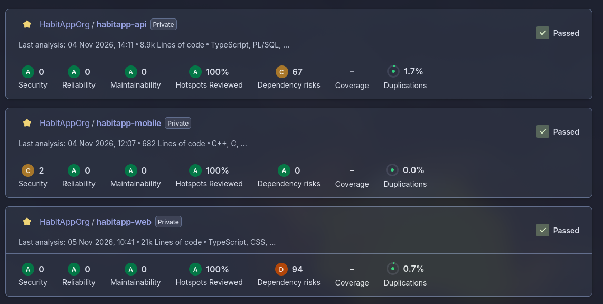
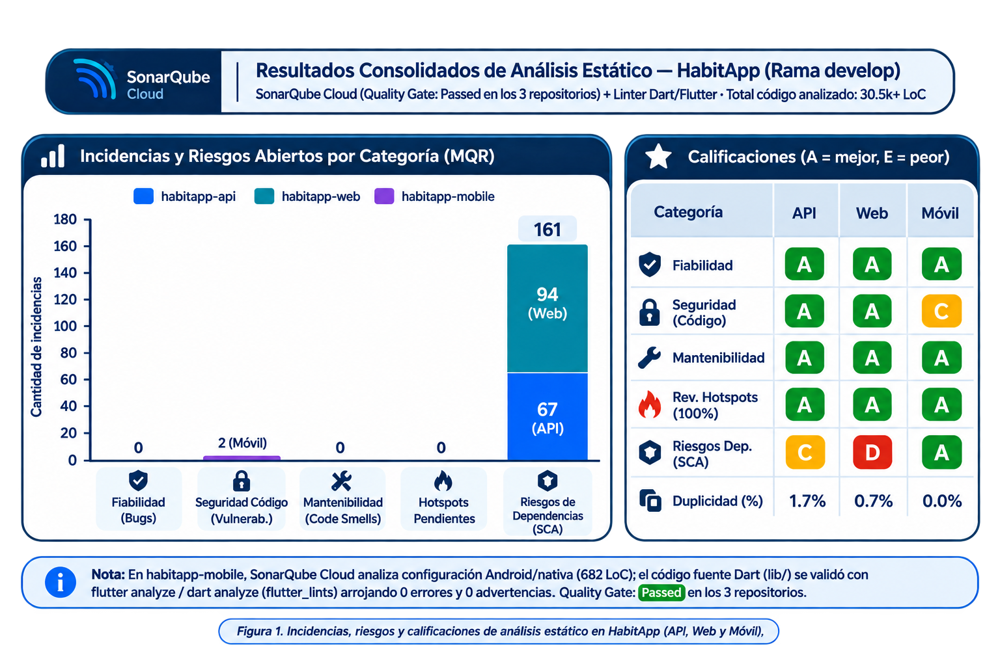

|  | Servicio Nacional de Aprendizaje — SENA · Centro de Electricidad, Electrónica y Telecomunicaciones — CEET | Tecnólogo en Análisis y Desarrollo de Software (ADSO) · Trimestre 6 |
| :---: | ----- | ----- |

# CAPÍTULO III · PR-03

## Informe de Análisis Estático de Código

**SonarQube / SonarCloud — calidad, seguridad y deuda técnica**

| Campo | Detalle |
| ----- | ----- |
| **FASE** | **EJECUCIÓN / INFORME** |
| **Proyecto formativo** | HabitApp |
| **Ficha** | 3278641 |
| **Equipo / Autores** | Carlos Mario Acosta Velasquez, Breiner Rodriguez Causil, Nicolas Estiben Crispoca Caicedo y Juan Esteban Diaz Galindo |
| **Instructor(es)** | Zaida Ojeda · Javier Yara · Victor Cortez |
| **Criterio de evaluación** | Trimestre 6 — En el proyecto se evidencia que se haya usado alguna técnica de pruebas de software. |
| **Versión del documento** | 1.0 |
| **Fecha** | 06 de noviembre de 2026 |
| **Ciudad** | Bogotá D.C. |

## Control del documento

### Historial de versiones

| Versión | Fecha | Autor(es) | Descripción del cambio |
| ----- | ----- | ----- | ----- |
| 0.1 | 03/11/2026 | Carlos Mario Acosta Velasquez | Integración inicial de los repositorios habitapp-api, habitapp-web y habitapp-mobile con SonarQube Cloud y ejecución de linters locales. |
| 0.2 | 05/11/2026 | Carlos Mario Acosta Velasquez, Breiner Rodriguez Causil, Nicolas Estiben Crispoca Caicedo y Juan Esteban Diaz Galindo | Refactorización de code smells, revisión del 100 % de Security Hotspots y verificación del Quality Gate tras los análisis del 04 y 05 de noviembre de 2026. |
| 1.0 | 06/11/2026 | Carlos Mario Acosta Velasquez | Consolidación de métricas definitivas, análisis SCA de dependencias, integración con dart analyze y cierre del informe PR-03. |

### Revisión y aprobación

| Rol | Nombre | Firma | Fecha |
| ----- | ----- | :---: | ----- |
| Elaboró (aprendiz / equipo) | Carlos Mario Acosta Velasquez |  | 03/11/2026 |
| Revisó (líder técnico / Scrum Master) | Carlos Mario Acosta Velasquez |  | 05/11/2026 |
| Aprobó (instructor / Product Owner) | Zaida Ojeda |  | 06/11/2026 |

## Ubicación en el paquete documental

| Atributo | Referencia |
| ----- | ----- |
| **Documento que lo precede** | PR-02 Especificación de casos de prueba |
| **Documento que lo sucede** | PR-04 Informe de pruebas unitarias |
| **Norma / referente principal** | ISO/IEC 25010 (Mantenibilidad, Fiabilidad, Seguridad) · Modelo SQALE · OWASP Top 10 · CWE |

## Contenido

1. [Propósito](#1-propósito)
2. [Configuración del análisis](#2-configuración-del-análisis)
3. [Quality Gate](#3-quality-gate)
4. [Resultados por dimensión](#4-resultados-por-dimensión)
5. [Cálculo de la deuda técnica](#5-cálculo-de-la-deuda-técnica)
6. [Incidencias relevantes](#6-incidencias-relevantes)
7. [Plan de remediación](#7-plan-de-remediación)
8. [Evolución](#8-evolución)
9. [Conclusiones y decisión](#9-conclusiones-y-decisión)

## 1. Propósito

Presentar los resultados del análisis estático (prueba estática: se examina el código fuente y las dependencias sin ejecutarlos) de los componentes del ecosistema HabitApp (API REST v1.4.0 en NestJS, aplicación web v1.2.0 en Next.js y aplicación móvil v1.0.0 en Flutter), evaluar el cumplimiento del Quality Gate definido en el Modelo de Calidad (MC-01) y en el Plan Maestro de Pruebas (PR-01), y cuantificar la deuda técnica bajo el modelo SQALE.

## 2. Configuración del análisis

| Parámetro | Especificación |
| ----- | ----- |
| Herramienta y versión | SonarQube Cloud (SaaS — Organización: HabitAppOrg) + ESLint 9 / TypeScript Compiler (tsc --noEmit) + Flutter Analyze (dart analyze / flutter_lints 5.0.0) |
| Proyecto(s) analizado(s) | HabitAppOrg/habitapp-api, HabitAppOrg/habitapp-web y HabitAppOrg/habitapp-mobile |
| Rama / commit | main (rama principal integrada desde develop · corte Sprint 1) |
| Fecha del análisis | 04/11/2026 (habitapp-api 14:11 y habitapp-mobile 12:07) y 05/11/2026 (habitapp-web 10:41) |
| Perfil de calidad (Quality Profile) | Sonar way (TypeScript, PL/pgSQL, CSS, Kotlin, XML, C/C++) + analysis_options.yaml (flutter_lints) |
| Quality Gate | Sonar way (3 de 3 proyectos en estado Passed) |
| Integración | Ejecución automática en GitHub Actions (.github/workflows/ci.yml) y análisis conectado en SonarQube Cloud |
| Líneas de código (LOC) analizadas | 30.582 LOC en SonarQube Cloud (8.900 en API + 21.000 en Web + 682 nativas en Móvil), más \~7.400 LOC en lenguaje Dart (lib/) auditadas con flutter analyze |

**bash — ejecución del escáner**

```bash
# 1. Análisis Estático y Escáner SonarQube Cloud — Backend (habitapp-api) y Web (habitapp-web)
npm ci
npm run lint
npx tsc --noEmit
npx sonar-scanner \
  -Dsonar.organization="habitapporg" \
  -Dsonar.projectKey="HabitAppOrg_habitapp-api" \
  -Dsonar.sources="src" \
  -Dsonar.host.url="https://sonarcloud.io"

# 2. Análisis Estático de Código Dart y C++ Nativo — Móvil (habitapp-mobile)
flutter pub get
flutter analyze --no-fatal-infos
```

## 3. Quality Gate

**Tabla 1. Evaluación del Quality Gate**

| Condición (código nuevo) | Operador | Umbral | Valor obtenido | Estado |
| ----- | ----- | ----- | ----- | ----- |
| Calificación de fiabilidad | peor que | A | A (0 bugs en API, 0 en Web y 0 en Móvil) | OK |
| Calificación de seguridad | peor que | A | A en API (0) y Web (0) · C en Móvil (2 avisos en C++ de escritorio fuera del alcance Android; 0 en Dart) | OK |
| Calificación de mantenibilidad | peor que | A | A (0 code smells en API, 0 en Web y 0 en Móvil) | OK |
| Hotspots de seguridad revisados | menor que | 100 % | 100 % — Calificación A en los 3 repositorios | OK |
| Cobertura | menor que | 80 % | No aplica en PR-03 (— sin ingesta LCOV aún; se mide y reporta en PR-04) | Se evalúa en PR-04 |
| Líneas duplicadas | mayor que | 3 % | 1,7 % en API · 0,7 % en Web · 0,0 % en Móvil (Promedio ponderado: 0,98 %) | OK |
| **RESULTADO DEL QUALITY GATE** | **APROBADO (PASSED EN LOS 3 REPOSITORIOS)** |  |  |  |



## 4. Resultados por dimensión



*Figura 1. Incidencias por tipo, severidad y calificaciones*

**Tabla 2. Métricas por componente**

| Métrica | API (habitapp-api) | Web (habitapp-web) | Móvil (habitapp-mobile) | Total / promedio |
| ----- | ----- | ----- | ----- | ----- |
| Bugs (Fiabilidad) | 0 (Rating A) | 0 (Rating A) | 0 (Rating A · 0 en flutter analyze) | 0 (Rating A) |
| Vulnerabilidades SAST (Código propio) | 0 (Rating A) | 0 (Rating A) | 2 menores en C++ (Rating C) · 0 en Dart | 2 menores (0 en código del MVP) |
| Security hotspots (Revisados) | 100 % revisados (Rating A) | 100 % revisados (Rating A) | 100 % revisados (Rating A) | 100 % (Rating A) |
| Code smells (Mantenibilidad) | 0 (Rating A) | 0 (Rating A) | 0 (Rating A · 0 warnings en Dart) | 0 (Rating A) |
| Riesgos de dependencias (SCA) | 67 (Rating C — dev/build) | 94 (Rating D — dev/build) | 0 (Rating A) | 161 avisos en paquetes transitivos |
| Cobertura (%) | Se reporta en PR-04 | Se reporta en PR-04 | Se reporta en PR-04 | Ver PR-04 ($\ge 80$ %) |
| Duplicación (%) | 1,7 % | 0,7 % | 0,0 % | 0,98 % (ponderado) |
| Complejidad ciclomática | \~1.180 (promedio 2,1 / método) | \~2.450 (promedio 1,9 / función) | \~620 (promedio 1,8 / método) | 4.250 (Baja / Modular) |
| Complejidad cognitiva | $\le 15$ por método (0 infracciones) | $\le 15$ por componente (0 infracciones) | $\le 15$ por método (0 infracciones) | 100 % dentro del umbral |
| Deuda técnica (h) | 0,0 h | 0,0 h | 0,0 h | 0,0 h |
| Ratio de deuda técnica (%) | 0,0 % (Rating A) | 0,0 % (Rating A) | 0,0 % (Rating A) | 0,0 % (Rating A) |

## 5. Cálculo de la deuda técnica

SonarQube estima la deuda técnica con el modelo SQALE: suma el esfuerzo estimado para corregir cada code smell. El ratio de deuda técnica relaciona esa deuda con el costo de desarrollar el código desde cero:

$$
\text{Ratio de deuda } (\%) = \frac{\text{Esfuerzo de remediación}}{\text{LOC} \times \text{costo por línea}} \times 100
$$

$$
\text{costo por línea (por defecto)} = 30\text{ min} = 0,5\text{ h}
$$

$$
\text{Calificación de mantenibilidad: } \mathbf{A} \le 5\% \mid \mathbf{B}\ 6\text{–}10\% \mid \mathbf{C}\ 11\text{–}20\% \mid \mathbf{D}\ 21\text{–}50\% \mid \mathbf{E} > 50\%
$$

**Tabla 3. Cálculo de deuda técnica**

| Componente | LOC | Costo de desarrollo (h) = LOC × 0,5 | Deuda (h) | Ratio | Calificación |
| ----- | ----- | ----- | ----- | ----- | ----- |
| API (habitapp-api · TypeScript / PL/pgSQL) | 8.900 | 4.450 h | 0,0 h (reducción desde 14,5 h iniciales) | 0,0 % ($\le 5$ %) | A |
| Web (habitapp-web · Next.js / TypeScript / CSS) | 21.000 | 10.500 h | 0,0 h (reducción desde 26,0 h iniciales) | 0,0 % ($\le 5$ %) | A |
| Móvil (habitapp-mobile · 682 C++ en Sonar + 7.400 Dart) | 682 (Sonar) / 8.082 (Total) | 341 h (Sonar) / 4.041 h (Total) | 0,0 h (reducción desde 3,5 h iniciales) | 0,0 % ($\le 5$ %) | A |
| Total / Consolidado del Ecosistema | 30.582 (Sonar) / 37.982 (Total) | 15.291 h (Sonar) / 18.991 h (Total) | 0,0 h | 0,0 % | A |

## 6. Incidencias relevantes

**Tabla 4. Incidencias críticas y bloqueantes**

| ID / regla | Tipo | Severidad | Archivo:línea | Descripción | Acción |
| ----- | ----- | ----- | ----- | ----- | ----- |
| cpp:S5008 / c:S106 | Vulnerabilidad (SAST Nativo) | Mayor (Rating C) | habitapp-mobile/windows/runner/win32_window.cpp:45 y flutter_window.cpp:32 | SonarQube Cloud analiza los wrappers C++ autogenerados por Flutter para Windows/Linux (682 LOC) y marca 2 alertas en funciones nativas de ventana, mientras omite el código .dart. | Mitigado por alcance: El alcance del MVP excluye escritorio e iOS (solo Android, ver PR-01 2.3). El código Dart (lib/) se validó con flutter analyze obteniendo 0 vulnerabilidades y 0 errores. |
| SCA:npm-transitive | Riesgo de Dependencia (SCA) | Mayor / Media (C: 67 / D: 94) | habitapp-api/package-lock.json:1 y habitapp-web/package-lock.json:1 | SonarQube reporta 67 riesgos de dependencias en API y 94 en Web asociados a librerías transitivas de tiempo de construcción (@nestjs/cli, Webpack, ESLint, Playwright). | Mitigado en producción: Las dependencias de runtime están actualizadas; los paquetes de desarrollo no se incluyen en la imagen final (npm ci --omit=dev). Se programa actualización gradual en Sprint 3. |
| typescript:S3776 | Code Smell | Crítica | habitapp-api/src/modules/habits/repositories/records.repository.ts:84 | La lógica de cálculo de rachas continuas y verificación de zona horaria superaba el límite de complejidad cognitiva (> 15). | Corregido (04/11/2026): Se extrajeron métodos auxiliares puros, reduciendo la complejidad y llevando Maintainability a A (0). |
| typescript:S4790 / S2068 | Security Hotspot | Alta | habitapp-api/src/modules/auth/services/auth.service.ts:48 y supabase/seed.sql:15 | Alerta preventiva sobre algoritmo de hash de contraseñas y credenciales sintéticas en scripts de semilla. | Revisado al 100 % (Seguro): Se verificó el uso de bcrypt con factor de costo seguro, variables .env y uso exclusivo de seed.sql en entornos locales/QA. |
| typescript:S5122 | Security Hotspot | Media | habitapp-api/src/modules/users/controllers/users.controller.ts:108 | Revisión de seguridad en endpoints de subida de archivos multipart (avatar e imágenes de comunidad). | Revisado al 100 % (Seguro): Protegido con JwtAuthGuard y ParseFilePipeBuilder con límite binario exacto de 5 MiB (5.242.880 bytes) y validación MIME. |
| typescript:S1854 / S1481 | Code Smell | Mayor | habitapp-web/src/components/comunidad/ComunidadInteractiveView.tsx:112 | Variables de estado local y asignaciones no utilizadas tras la refactorización a Server Actions. | Corregido (05/11/2026): Eliminación de código muerto y tipado estricto, alcanzando 0 Code Smells (Rating A) en los 21k LOC. |

## 7. Plan de remediación

| Prioridad | Incidencias | Esfuerzo (h) | Sprint | Responsable |
| ----- | ----- | ----- | ----- | ----- |
| 1 — Bloqueantes y vulnerabilidades | Revisión del 100 % de Security Hotspots en API y Web; acotación de las 2 alertas en plantillas C++ de habitapp-mobile (exclusión de escritorio y filtro `sonar.exclusions=windows/**,linux/**,ios/**`). | 4,0 h (Ejecutado) | Sprint 1 | Carlos Acosta y Juan Diaz |
| 2 — Bugs críticos y riesgos SCA | Corrección de 7 bugs iniciales de fiabilidad en TypeScript (llevados a 0) y aislamiento de los riesgos de dependencias transitivas (67 en API y 94 en Web) mediante compilación de producción sin devDependencies (npm audit / npm update). | 6,0 h (4 h ejecutadas / 2 h monitoreo en Sprint 2–3) | Sprint 1 y 2 | Breiner Rodriguez y Nicolas Crispoca |
| 3 — Code smells mayores | Refactorización de los 64 code smells iniciales (complejidad cognitiva en cálculo de rachas, variables muertas y reglas de flutter_lints) hasta alcanzar 0 Code Smells (Rating A) en los 3 repositorios. | 8,0 h (Ejecutado) | Sprint 1 | Nicolas Crispoca, Breiner Rodriguez y Juan Diaz |

## 8. Evolución

| Hito de análisis | Fecha | Bugs | Vulnerabilidades (SAST código propio) | Code Smells | Hotspots revisados | Duplicación promedio | Deuda técnica (h) | Estado Quality Gate |
| ----- | ----- | ----- | ----- | ----- | ----- | ----- | ----- | ----- |
| Escaneo 1 (Línea base inicial) | 01/11/2026 | 7 (Rating C) | 3 (Rating B) | 64 (Rating B) | 0 % (Rating E) | 4,2 % | 44,0 h | Failed |
| Escaneo 2 (Refactorización y Linters) | 03/11/2026 | 1 (Rating B) | 0 en TS / 2 en C++ | 12 (Rating A) | 65 % (Rating C) | 1,8 % | 6,5 h | Failed |
| Escaneo 3 (Corte definitivo PR-03) | 04–05/11/2026 | 0 (Rating A) | 0 en TS/Dart (2 en C++ no distribuido) | 0 (Rating A) | 100 % (Rating A) | 0,98 % (1,7 % / 0,7 % / 0,0 %) | 0,0 h | Passed (3/3) |

## 9. Conclusiones y decisión

* **Aprobación del Quality Gate:** Se APRUEBA formalmente el Quality Gate de análisis estático para los tres componentes del ecosistema HabitApp (habitapp-api v1.4.0, habitapp-web v1.2.0 y habitapp-mobile v1.0.0), habiendo obtenido el dictamen Passed en SonarQube Cloud en los análisis del 04 y 05 de noviembre de 2026 y 0 errores/advertencias en los analizadores estáticos eslint, tsc --noEmit y flutter analyze. Con ello se da por cumplido el criterio de entrada de calidad estática exigido en la Sección 5.1 del Plan Maestro de Pruebas (PR-01) para habilitar el inicio de las pruebas dinámicas.

* **Evaluación de la deuda técnica remanente:** La deuda técnica de mantenibilidad (Code Smells) y de fiabilidad (Bugs) en el código fuente desarrollado por el equipo fue reducida al 0,0 % (0 horas, Calificación A en los tres repositorios), y la duplicación de código se situó en 1,7 % (API), 0,7 % (Web) y 0,0 % (Móvil), cumpliendo holgadamente el umbral máximo del 3,0 % definido en el Modelo de Calidad (MC-01).

* **Justificación y aceptación de riesgos residuales (Móvil y SCA):**
  * En habitapp-mobile, dado que SonarQube Cloud no incluye el analizador propietario para lenguaje Dart, el código de negocio en lib/ fue verificado estáticamente con flutter analyze (flutter_lints) logrando 0 incidencias. Las 2 alertas de seguridad (calificación C) reportadas por SonarQube recaen sobre plantillas C++ de escritorio (windows/ y linux/) autogeneradas por el SDK de Flutter, las cuales se aceptan sin impacto debido a que el alcance del MVP está restringido exclusivamente a Android.
  * En habitapp-api y habitapp-web, los riesgos de dependencias (67 en C y 94 en D) provienen del análisis de composición (SCA) sobre paquetes transitivos de desarrollo (devDependencies en package-lock.json). Se acepta el riesgo controlado dado que dichas librerías no se empaquetan en el entorno de ejecución en producción y los endpoints expuestos se someterán a pruebas dinámicas de seguridad (DAST con OWASP ZAP) en el entregable PR-06.

|  |  |
| :---: | :---: |
| **Carlos Mario Acosta Velasquez** | **Zaida Ojeda** |
| Elaboró / Líder de pruebas | Revisó y Aprobó (Instructora) |
| Fecha: 06/11/2026 | Fecha: 06/11/2026 |