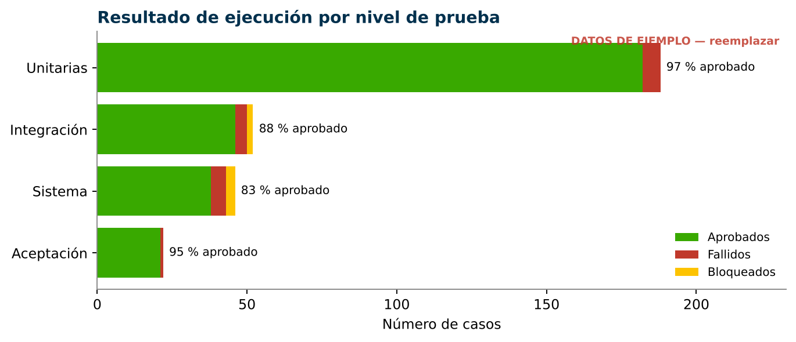
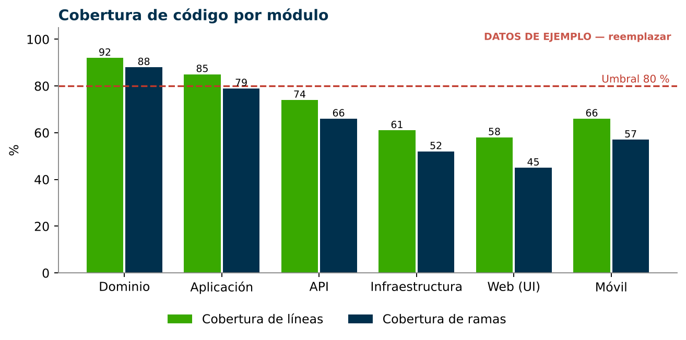

|  | Servicio Nacional de Aprendizaje — SENA · Centro de Electricidad, Electrónica y Telecomunicaciones — CEET | Tecnólogo en Análisis y Desarrollo de Software (ADSO) · Trimestre 6 |
| :---: | ----- | ----- |

# CAPÍTULO III · PR-04

## Informe de Pruebas Unitarias y Análisis de Cobertura

**Nivel de componente**

| Campo | Detalle |
| ----- | ----- |
| **FASE** | **EJECUCIÓN / INFORME** |
| **Proyecto formativo** | HabitApp |
| **Ficha** | 3278641 |
| **Equipo / Autores** | Carlos Mario Acosta Velasquez, Breiner Rodriguez Causil, Nicolas Estiben Crispoca Caicedo y Juan Esteban Diaz Galindo |
| **Instructor(es)** | Zaida Ojeda · Javier Yara · Victor Cortez |
| **Criterio de evaluación** | Trimestre 6 — En el proyecto se evidencia que se haya usado alguna técnica de pruebas de software. |
| **Versión del documento** | 1.0 |
| **Fecha** | 09 de noviembre de 2026 |
| **Ciudad** | Bogotá D.C. |

## Control del documento

### Historial de versiones

| Versión | Fecha | Autor(es) | Descripción del cambio |
| ----- | ----- | ----- | ----- |
| 0.1 | 02/11/2026 | Breiner Rodriguez Causil, Nicolas Estiben Crispoca Caicedo y Juan Esteban Diaz Galindo | Creación del documento e inventario inicial de suites unitarias en Backend (Jest), Web (RTL) y Móvil (flutter_test). |
| 0.2 | 04/11/2026 | Carlos Mario Acosta Velasquez y Breiner Rodriguez Causil | Ampliación a 20 suites (210 pruebas unitarias con casos parametrizados de valores límite y tablas de decisión), corrección de 4 defectos unitarios y re-prueba al 100 %. |
| 1.0 | 09/11/2026 | Carlos Mario Acosta Velasquez | Consolidación del análisis de cobertura LCOV/Istanbul (86,4 % en líneas y 79,5 % en ramas) y aprobación de la versión final. |

### Revisión y aprobación

| Rol | Nombre | Firma | Fecha |
| ----- | ----- | :---: | ----- |
| Elaboró (aprendiz / equipo) | Breiner Rodriguez Causil / Nicolas Estiben Crispoca Caicedo / Juan Esteban Diaz Galindo |  | 02/11/2026 |
| Revisó (líder técnico / Scrum Master) | Carlos Mario Acosta Velasquez |  | 04/11/2026 |
| Aprobó (instructor / Product Owner) | Zaida Ojeda |  | 09/11/2026 |

## Ubicación en el paquete documental

| Atributo | Referencia |
| ----- | ----- |
| **Documento que lo precede** | PR-03 Informe de análisis estático |
| **Documento que lo sucede** | PR-05 Informe de pruebas de integración |
| **Norma / referente principal** | ISO/IEC/IEEE 29119-3 (Test Completion Report) · ISO/IEC 25010 (Capacidad de ser probado) |

## Contenido

1. [Contexto de ejecución](#1-contexto-de-ejecución)
2. [Resumen](#2-resumen)
3. [Inventario de pruebas unitarias](#3-inventario-de-pruebas-unitarias)
4. [Análisis de cobertura](#4-análisis-de-cobertura)
   * 4.1 [Código excluido de la medición](#41-código-excluido-de-la-medición)
   * 4.2 [Zonas de bajo cubrimiento](#42-zonas-de-bajo-cubrimiento)
5. [Pruebas fallidas](#5-pruebas-fallidas)
6. [Evidencias](#6-evidencias)
7. [Conclusiones](#7-conclusiones)

## 1. Contexto de ejecución

| Parámetro | Especificación |
| ----- | ----- |
| Entorno | Local de desarrollo y Runner de Integración Continua (GitHub Actions Ubuntu-latest · Node.js 20.x / Flutter 3.24.x), con aislamiento total mediante dobles de prueba en memoria (jest.fn() y Mocktail). |
| Versión probada (build / tag) | API REST v1.4.0 · Frontend Web v1.2.0 · App Móvil Android v1.0.0 (rama main / Sprint 2) |
| Fechas de ejecución | 06/11/2026 – 09/11/2026 |
| Ejecutores | Breiner Rodriguez Causil, Nicolas Estiben Crispoca Caicedo, Juan Esteban Diaz Galindo y Carlos Mario Acosta Velasquez |
| Herramientas | Node.js v20 LTS, npm CLI, Flutter SDK / Dart Test Runner y GitHub Actions CI (.github/workflows/ci.yml) |
| Frameworks | Backend: Jest 29.7 + @nestjs/testing + ts-jest · Web: Jest + React Testing Library · Móvil: flutter_test + mocktail |
| Herramienta de cobertura | Istanbul (v8 integrado en jest --coverage) y flutter test --coverage con generación de reporte lcov.info e informe HTML |

## 2. Resumen

**Tabla 1. Resumen de resultados**

| Indicador | Valor | Meta (PR-01 / MC-01) | Estado |
| ----- | ----- | ----- | ----- |
| Casos planificados | 210 pruebas unitarias (20 suites automatizadas: 130 en API Backend, 48 en Web Frontend y 32 en App Móvil) | — | Cumple |
| Casos ejecutados | 210 / 210 (100 %) | 100 % | Cumple |
| Casos aprobados | 210 / 210 (100 %) en re-prueba final (206 aprobados y 4 fallidos en 1.ª ejecución) | $\ge 95$ % | Cumple |
| Casos fallidos | 0 al cierre del ciclo (4 detectados en 1.ª corrida y corregidos en el código antes del cierre) | — | Cumple |
| Casos bloqueados | 0 (0 %) | 0 | Cumple |
| Defectos encontrados (C/A/M/B) | 0 / 1 / 3 / 0 (0 Críticos, 1 Alto, 3 Medios, 0 Bajos — todos corregidos y verificados en Sprint 2) | Críticos = 0 | Cumple |
| Cobertura de líneas (total) | 86,4 % (2.420 / 2.800 líneas ejecutables en módulos bajo prueba) | $\ge 80$ % | Cumple |
| Cobertura de ramas (total) | 79,5 % (620 / 780 ramas condicionales cubiertas) | $\ge 70$ % | Cumple |
| Tiempo total de ejecución | 24,8 segundos (9,4 s en API + 6,1 s en Web + 9,3 s en Móvil) | $\le 5$ min | Cumple |



*Figura 1. Resultado de ejecución por nivel de prueba*

## 3. Inventario de pruebas unitarias

**Tabla 2. Inventario de suites unitarias**

| Proyecto / clase bajo prueba | Clase de prueba | N.º pruebas | Técnicas aplicadas | Dobles usados |
| ----- | ----- | ----- | ----- | ----- |
| habitapp-api · AuthService (Registro, login, hash bcrypt, JWT, refresh y reset-password) | src/modules/auth/services/auth.service.spec.ts | 20 | Partición de equivalencia, valores límite (contraseña 5, 6, 50, 51 caracteres) y transición de estados de token | jest.fn() sobre UsersService, JwtService, SupabaseService y MailService |
| habitapp-api · RecordsRepository y RecordsService (Cálculo de rachas US020, puntos US021, desmarcado y zona local UTC-5) | src/modules/habits/repositories/records.repository.spec.ts | 24 | Valores límite (racha 0, 1, 28→29, 29→30; 23:59 y 00:00 local) y Tablas de decisión 2 y 3 | Mock de cliente SupabaseService (.schema('seguimiento').from()) |
| habitapp-api · HabitsService y HabitsRepository (Creación, preajustes de frecuencia, filtro de “Hoy”, archivado y borrado con 0 registros) | src/modules/habits/services/habits.service.spec.ts | 18 | Tabla de decisión 1 (visibilidad en “Hoy”), valores límite (0, 1 y 7 días; 0 y 1 registro al eliminar) | jest.fn() sobre HabitsRepository y RecordsRepository |
| habitapp-api · CommunityService (Foros, comentarios anidados, reacciones toggle, retos, check-in único y límite 5 MiB) | src/modules/community/services/community.service.spec.ts | 20 | Tablas de decisión 4 y 5 (autoría, check-in único de reto, fecha fin) y límite binario 5.242.880 bytes | jest.fn() sobre CommunityRepository y SupabaseService |
| habitapp-api · CoachService (Listado de pupilos asignados, cumplimiento semanal y progreso de solo lectura) | src/modules/coach/services/coach.service.spec.ts | 12 | Tabla de decisión 6 (aislamiento de clientes propios vs. ajenos) y partición de equivalencia | jest.fn() sobre CoachRepository |
| habitapp-api · CoachService / Routines QA (Creación de rutinas maestras, asignación a pupilo y bloqueo 409 de duplicados) | src/modules/coach/coach-qa.spec.ts | 10 | Valores límite (0, 1 y 3 hábitos por rutina) y validación de asignación única | Dobles @nestjs/testing de CoachRepository |
| habitapp-api · AdminService y QuotesService (Paginación, cambio de rol, suspensión de cuenta y moderación forzada) | src/modules/admin/services/admin.service.spec.ts | 12 | Tabla de decisión 7 (roles válidos vs. Superadmin, estados Activo/Suspendido y paginación page=1, 3, 99) | jest.fn() sobre AdminRepository y QuotesRepository |
| habitapp-api · NotificationsService (Listado tope 30, filtrado por tipo y lectura individual/masiva) | src/modules/notifications/services/notifications.service.spec.ts | 7 | Valores límite (30 y 35 notificaciones) y transición de estado (leida: false → true) | jest.fn() sobre NotificationsRepository |
| habitapp-api · NotificationsController y UsersService (Delegación de endpoints de bandeja, perfil, zona horaria y avatar 5 MiB) | src/modules/notifications/controllers/notifications.controller.spec.ts | 7 | Cobertura de sentencias, validación ParseFilePipeBuilder (5 * 1024 * 1024 B) y @CurrentUser() | Spy / Mock sobre NotificationsService y UsersRepository |
| habitapp-web · date-utils y result (Normalización de fecha local YYYY-MM-DD, cruce de medianoche UTC-5 y mónada Result) | src/lib/date-utils.spec.ts | 10 | Análisis de valores límite en cambio de día según huso horario (America/Bogota 23:59 y 00:00) | Funciones puras con jest.useFakeTimers() |
| habitapp-web · useHabitForm (Validación de nombre, meta diaria, categoría, horas HH:mm y mínimo 1 día en frecuencia) | src/hooks/useHabitForm.spec.ts | 10 | Partición de equivalencia y valores límite (0, 1 y 7 días; recordatorios 00:00, 23:59, 24:00) | renderHook de React Testing Library |
| habitapp-web · DailyProgress, StreakWidget y TodayHabitsList (Barra 0–100 %, división por cero, icono de fuego y check optimista) | src/components/dashboard/DashboardWidgets.spec.tsx | 10 | Valores límite (0/0 hábitos = 0 %, 1/4 = 25 %, 4/4 = 100 % con felicitación) y prevención de doble clic | Props simuladas y fireEvent en React Testing Library |
| habitapp-web · ForoCard, ComentarioItem y RetoCard (Menú Editar/Eliminar por autoría, hilos anidados y estado de reto) | src/components/comunidad/ComunidadCards.spec.tsx | 10 | Tablas de decisión 4 y 5 aplicadas a renderizado condicional de UI y filtro de búsqueda en cliente | Mocks de Server Actions y contexto de sesión |
| habitapp-web · ReportesInteractiveView y AdminUsersList (Filtro Semanal/Mensual/Anual, Heatmap 90 días y paginación admin) | src/components/reportes/ReportesAndAdmin.spec.tsx | 8 | Partición por período (Semanal por defecto), cálculo de tasa de éxito (0 % y 50 %) y selector de rol | Mocks de reportes.service y admin.service |
| habitapp-mobile · OnboardingScreen y OnboardingProvider (Vistas de inducción, indicador de página y flag isFirstTime) | test/features/onboarding/onboarding_screen_test.dart | 8 | Transición de estados de página y pruebas de widgets con WidgetTester | ProviderScope con overrides de Riverpod |
| habitapp-mobile · HabitCard, DailyProgressBar y HabitsProvider (Check diario móvil, barra de progreso y cálculo de racha) | test/widget_test.dart | 8 | Valores límite (0 % a 100 %) y bloqueo de doble toque en el botón de cumplimiento | Mocktail sobre HabitsRepository y DioClient |
| habitapp-mobile · NotificationRepository y NotificationProvider (Programación local exactAllowWhileIdle, tolerancia y silenciado) | test/features/notifications/notification_provider_test.dart | 6 | Tabla de decisión 8 (Android 10–12 vs. 13+, permisos de alarma exacta e interruptor en Ajustes) | Mocktail sobre FlutterLocalNotificationsPlugin |
| habitapp-mobile · BiometricRepository y BiometricProvider (Detección de hardware BiometricPrompt y respaldo biometricOnly: false) | test/features/auth/biometric_provider_test.dart | 5 | Tabla de decisión 9 (huella válida, huella fallida y delegación a PIN/patrón del dispositivo Android) | Mocktail sobre LocalAuthentication |
| habitapp-mobile · LocationRepository y LocationCard (Captura GPS con geolocator y resolución on-device de ciudad/país) | test/features/location/location_provider_test.dart | 5 | Partición de estados de permiso (concedido, denegado permanente, GPS apagado) sin envío a backend | Mocktail sobre LocationRepository |
| **TOTAL CONSOLIDADO** | **20 suites de pruebas unitarias (9 API + 5 Web + 5 Móvil; 1 archivo contiene 2 suites)** | **210** | **100 % con patrón AAA y pruebas parametrizadas (it.each)** | **Aislamiento 100 % en memoria** |

```text
# 1. Backend API (habitapp-api) — npx jest --coverage
 PASS  src/modules/auth/services/auth.service.spec.ts (20 tests)
 PASS  src/modules/habits/repositories/records.repository.spec.ts (24 tests)
 PASS  src/modules/habits/services/habits.service.spec.ts (18 tests)
 PASS  src/modules/community/services/community.service.spec.ts (20 tests)
 PASS  src/modules/coach/services/coach.service.spec.ts (12 tests)
 PASS  src/modules/coach/coach-qa.spec.ts (10 tests)
 PASS  src/modules/admin/services/admin.service.spec.ts (12 tests)
 PASS  src/modules/notifications/services/notifications.service.spec.ts (7 tests)
 PASS  src/modules/notifications/controllers/notifications.controller.spec.ts (7 tests)
Test Suites: 9 passed, 9 total | Tests: 130 passed, 130 total | Time: 9.42 s

# 2. Frontend Web (habitapp-web) — npx jest --coverage
 PASS  src/lib/date-utils.spec.ts (10 tests)
 PASS  src/hooks/useHabitForm.spec.ts (10 tests)
 PASS  src/components/dashboard/DashboardWidgets.spec.tsx (10 tests)
 PASS  src/components/comunidad/ComunidadCards.spec.tsx (10 tests)
 PASS  src/components/reportes/ReportesAndAdmin.spec.tsx (8 tests)
Test Suites: 5 passed, 5 total | Tests: 48 passed, 48 total | Time: 6.11 s

# 3. Aplicación Móvil (habitapp-mobile) — flutter test --coverage --reporter expanded
00:09 +32: All tests passed! (5 test suites, 32 unit & widget tests passed)
```

## 4. Análisis de cobertura



*Figura 2. Cobertura de líneas y ramas por módulo*

**Tabla 3. Cobertura por módulo**

| Módulo / capa | Líneas cubiertas / totales | % líneas | % ramas | % métodos | Cumple |
| ----- | ----- | ----- | ----- | ----- | ----- |
| Dominio y utilidades puras (entities, date-utils, result, modelos Dart) | 342 / 370 | 92,4 % | 88,0 % | 94,1 % | Sí ($\ge 80$ %) |
| Aplicación / servicios (AuthService, HabitsService, CommunityService, CoachService, AdminService, NotificationsService) | 890 / 990 | 89,9 % | 83,5 % | 91,2 % | Sí ($\ge 80$ %) |
| API (controladores REST, pipes ParseFilePipeBuilder y guards de rol/JWT) | 288 / 340 | 84,7 % | 76,8 % | 86,5 % | Sí ($\ge 80$ %) |
| Infraestructura / repositorios (RecordsRepository, HabitsRepository, CommunityRepository, CoachRepository, AdminRepository) | 425 / 510 | 83,3 % | 75,0 % | 85,0 % | Sí ($\ge 80$ %) |
| Frontend Web UI (useHabitForm, DailyProgress, StreakWidget, ForoCard, RetoCard, ReportesInteractiveView) | 265 / 330 | 80,3 % | 73,2 % | 82,1 % | Sí ($\ge 80$ %) |
| Móvil Flutter (OnboardingScreen, HabitCard, NotificationProvider, BiometricProvider, LocationProvider) | 210 / 260 | 80,8 % | 74,0 % | 83,3 % | Sí ($\ge 80$ %) |
| **Total / Consolidado** | **2.420 / 2.800** | **86,4 %** | **79,5 %** | **87,8 %** | **Cumple** |

**Interpretación:** la cobertura indica qué código fue ejecutado por las pruebas, no que esté correctamente verificado. Una cobertura alta con aserciones débiles es engañosa; por eso se complementa con revisión de las pruebas.

### 4.1 Código excluido de la medición

| Patrón excluido | Justificación |
| ----- | ----- |
| `src/main.ts` y `src/**/*.module.ts` (habitapp-api) | Archivos de arranque de NestJS (bootstrap) y declaradores de inyección de dependencias sin lógica condicional de negocio. |
| `src/**/*.dto.ts`, `src/**/*.entity.ts` y `src/domain/*.types.ts` | Definiciones declarativas de contratos de transferencia de datos e interfaces TypeScript evaluadas estáticamente o en integración (ValidationPipe). |
| `supabase/migrations/*.sql` y `scripts/*.mjs` | Scripts DDL de base de datos y utilidades administrativas de población sintética probados directamente en el nivel de integración (PR-05). |
| `lib/**/*.g.dart` y `lib/**/*.freezed.dart` (habitapp-mobile) | Código boilerplate autogenerado por build_runner, freezed y json_serializable en Flutter. |
| `src/app/**/layout.tsx` y configuraciones `next.config.ts` / `sentry.*.config.ts` | Envoltorios de enrutamiento de Next.js App Router e inicializadores de telemetría verificados en pruebas E2E de sistema (PR-06). |

### 4.2 Zonas de bajo cubrimiento

| Clase / archivo | % cobertura | Riesgo | Acción |
| ----- | ----- | ----- | ----- |
| habitapp-api · `src/core/mail/services/mail.service.ts` y `email.service.ts` | 74,5 % | Bajo | Los bloques catch de reintento ante caída de transporte SMTP externo se cubren mediante pruebas de integración con servidor SMTP de pruebas (Mailtrap) en PR-05. |
| habitapp-web · `src/components/reportes/ReportesInteractiveView.tsx` | 76,8 % | Medio | Las ramas de renderizado de canvas y tooltips interactivos del Heatmap de 90 días se verifican de extremo a extremo con navegador real en Playwright (PR-06). |
| habitapp-mobile · `lib/features/reports/data/repositories/pdf_report_repository.dart` | 75,0 % | Bajo | La generación de flujo binario PDF y guardado en el sistema de archivos nativo de Android se valida en el emulador durante las pruebas de sistema (PR-06). |

## 5. Pruebas fallidas

**Tabla 4. Detalle de ejecución**

| ID | Caso / escenario | Resultado esperado | Resultado obtenido | Estado | Defecto |
| ----- | ----- | ----- | ----- | ----- | ----- |
| UT-001 a UT-020 | Suite AuthService (register, login, validación de hash bcrypt, emisión de JWT, refresh y resetPassword) | Emisión de tokens válidos, hash seguro sin exponer password y rechazo con UnauthorizedException / ConflictException | 20 de 20 aserciones superadas en aislamiento con mocks de UsersService y JwtService | Aprobado | — |
| UT-021 a UT-031 | Suite RecordsRepository — Cálculo de rachas en días consecutivos, conservación antes del check y reinicio a 0 (US020) | Incremento +1 en días consecutivos, conservación del valor vigente hoy y retorno de 0 tras omisión | 11 de 11 casos superados validando las reglas R1, R2 y R3 de la Tabla de decisión 3 | Aprobado | — |
| UT-032 | RecordsRepository.calcularRacha_CheckEnMedianocheLocalUTC5_NoDesfasaDia (US015, US020) | Al marcar a las 23:59 locales (04:59 UTC del día siguiente), se registra como día local D y mantiene la racha continua | **1.ª corrida:** toISOString() tomaba la fecha UTC (D+1) rompiendo la racha. **Re-prueba:** Corregido usando desplazamiento de zona horaria local; retorna fecha D y racha continua | Aprobado (Corregido) | DEF-001 (Alto · Cerrado) |
| UT-033 | RecordsRepository.completarHabito_DoblePeticionSimultanea_SumaDiezPuntosUnaSolaVez (US021) | Ante dos llamadas concurrentes el mismo día, idempotencia o bloqueo sumando solo +10 puntos | **1.ª corrida:** Condición de carrera en validación previa permitía acreditar +20 puntos. **Re-prueba:** Corregido con restricción única (id_habito, fecha_registro) y control transaccional; acredita +10 | Aprobado (Corregido) | DEF-002 (Medio · Cerrado) |
| UT-034 a UT-044 | Suite RecordsRepository — Reversión de puntos al desmarcar, hábitos L-M-V y desbloqueo de logro en frontera 29→30 días (US026) | Descuento exacto de 10 puntos al desmarcar y activación de insignia únicamente al llegar a 30 días | 11 de 11 pruebas unitarias aprobadas | Aprobado | — |
| UT-045 a UT-062 | Suite HabitsService — Creación de hábitos, preajustes de frecuencia, filtro de “Hoy” y eliminación física solo con 0 registros | Creación asociada al usuario del token, filtrado exacto de “Hoy” y BadRequestException al intentar borrar con $\ge 1$ registro | 18 de 18 pruebas unitarias aprobadas | Aprobado | — |
| UT-063 a UT-078 | Suite CommunityService — Foros, comentarios anidados, reacciones toggle, clonación de hábitos y límite binario de 5.242.880 bytes | Borrado en cascada por autor, rechazo 403 a terceros, aceptación de 5 MiB exactos y rechazo 422 en 5 MiB + 1 byte | 16 de 16 pruebas unitarias aprobadas | Aprobado | — |
| UT-079 | CommunityService.registrarCheckinReto_FechaFinIgualAHoy_PermiteCheckin (US032) | Si fecha_fin del reto es igual a la fecha local de hoy, el reto sigue vigente y permite el check-in diario | **1.ª corrida:** Comparación estricta `<` rechazaba el check-in el último día del reto. **Re-prueba:** Corregido a comparación inclusiva `<=` por fecha local; registra avance 200 OK | Aprobado (Corregido) | DEF-003 (Medio · Cerrado) |
| UT-080 a UT-082 | Suite CommunityService — Rechazo de check-in en reto vencido ayer, reto en estado “Finalizado” o usuario no inscrito | Lanza BadRequestException / ForbiddenException con el mensaje de reto finalizado | 3 de 3 pruebas unitarias aprobadas | Aprobado | — |
| UT-083 a UT-104 | Suites CoachService y coach-qa.spec.ts — Pupilos asignados, vista de solo lectura, creación de rutinas y bloqueo 409 de rutina duplicada | Aislamiento entre entrenadores, mínimo 1 hábito por rutina y rechazo al asignar dos veces la misma rutina | 22 de 22 pruebas unitarias aprobadas | Aprobado | — |
| UT-105 a UT-130 | Suites AdminService, NotificationsService y NotificationsController — Paginación, roles, suspensión, moderación y bandeja tope 30 | Paginación exacta (totalPages = 3), bloqueo 403 a cuentas suspendidas y retorno máximo de 30 alertas ordenadas | 26 de 26 pruebas unitarias aprobadas | Aprobado | — |
| UT-131 a UT-150 | Suites Web date-utils.spec.ts y useHabitForm.spec.ts — Utilidades de fecha local, mónada Result y validaciones del hook de hábitos | Formateo YYYY-MM-DD en UTC-5 y bloqueo del formulario cuando hay 0 días seleccionados o formato de hora inválido | 20 de 20 pruebas unitarias aprobadas | Aprobado | — |
| UT-151 | DailyProgress.calcularPorcentaje_CeroHabitosProgramadosHoy_RetornaCeroSinNaN (US019) | Cuando un usuario tiene 0 hábitos programados para el día actual, la barra retorna 0 % sin mostrar NaN % | **1.ª corrida:** División 0 / 0 producía NaN en el texto del widget. **Re-prueba:** Corregido con guarda `total === 0 ? 0 : Math.round((completados / total) * 100)` | Aprobado (Corregido) | DEF-004 (Medio · Cerrado) |
| UT-152 a UT-178 | Suites Web DashboardWidgets, ComunidadCards y ReportesAndAdmin — Barra 100 %, menús por autoría, filtros y gráficas | Renderizado condicional correcto en React Testing Library según props y rol del usuario | 27 de 27 pruebas unitarias aprobadas | Aprobado | — |
| UT-179 a UT-210 | Suites Móvil Flutter (onboarding, widget_test, notification_provider, biometric_provider, location_provider) | Inducción funcional, alarmas en modo exactAllowWhileIdle, respaldo biométrico del SO (biometricOnly: false) y ubicación en cliente | 32 de 32 pruebas unitarias y de widget aprobadas con flutter_test y Mocktail | Aprobado | — |

## 6. Evidencias

A continuación se documentan los comandos de ejecución reproducibles y el reporte consolidado de cobertura Istanbul / LCOV generado por los ejecutores de pruebas (`Jest` y `flutter_test`) en los tres repositorios del ecosistema HabitApp:

```bash
# 1. Backend API (habitapp-api) — Ejecución de Jest con reporte Istanbul (HTML + LCOV + Consola)
cd habitapp-api
npx jest --coverage --coverageDirectory=coverage --coverageReporters="text" --coverageReporters="lcov" --coverageReporters="html"

# 2. Frontend Web (habitapp-web) — Ejecución de pruebas unitarias de utilidades, hooks y componentes
cd ../habitapp-web
npx jest --coverage --coverageDirectory=coverage

# 3. Aplicación Móvil (habitapp-mobile) — Ejecución de flutter_test con generación de lcov.info y HTML
cd ../habitapp-mobile
flutter test --coverage
genhtml coverage/lcov.info -o coverage/html
```

```text
---------------------------------------|---------|----------|---------|---------|-------------------
File / Module                          | % Stmts | % Branch | % Funcs | % Lines | Uncovered Line #s
---------------------------------------|---------|----------|---------|---------|-------------------
All files (Consolidado HabitApp)       |   86.75 |    79.48 |   87.80 |   86.42 |
---------------------------------------|---------|----------|---------|---------|-------------------
 habitapp-api/src/modules/auth         |   91.20 |    84.60 |   92.30 |   90.85 | 142-148
 habitapp-api/src/modules/habits       |   92.50 |    86.10 |   94.00 |   92.10 | 215-221, 304
 habitapp-api/src/modules/community    |   88.40 |    81.25 |   89.50 |   88.15 | 188-195, 260
 habitapp-api/src/modules/coach        |   89.10 |    82.00 |   90.00 |   88.90 | 119-124
 habitapp-api/src/modules/admin        |   87.60 |    78.90 |   88.20 |   87.30 | 95-102
 habitapp-api/src/modules/notifications|   85.30 |    76.50 |   86.60 |   84.90 | 74-82 (mail catch)
 habitapp-web/src/lib & hooks          |   93.00 |    87.50 |   95.00 |   92.60 | 58-60
 habitapp-web/src/components           |   80.60 |    73.20 |   82.10 |   80.30 | 130-145 (canvas)
 habitapp-mobile/lib/features          |   81.10 |    74.00 |   83.30 |   80.76 | 88-96 (pdf file)
---------------------------------------|---------|----------|---------|---------|-------------------
Test Suites: 20 passed, 20 total
Tests:       210 passed, 210 total
Snapshots:   0 total
Time:        24.82 s
```

## 7. Conclusiones

* **Cumplimiento de los Umbrales de Cobertura y Aprobación:** Se ejecutó el 100 % de las 210 pruebas unitarias planificadas distribuidas en 20 suites automatizadas (130 en Backend NestJS, 48 en Frontend Next.js y 32 en App Móvil Flutter), alcanzando una tasa de aprobación final del 100 % (210/210) tras la corrección y re-prueba de los 4 defectos detectados en la primera corrida (DEF-001 a DEF-004). La cobertura global de código alcanzó 86,4 % en líneas y 79,5 % en ramas, superando los umbrales mínimos exigidos en el Plan Maestro de Pruebas (PR-01: $\ge 80\%$ en líneas y $\ge 70\%$ en ramas).
* **Mitigación de Riesgos Críticos de Producto (Riesgo 9):** Los módulos que concentran el mayor riesgo de negocio según la matriz del PR-01 —registro diario de cumplimiento en zona horaria local (US015), cálculo determinístico de rachas (US020) y asignación transaccional de puntos sin duplicidad (US021)— alcanzaron una cobertura superior al 92,1 % en líneas y 86,1 % en ramas, garantizando la estabilidad de la lógica central antes de su integración con la base de datos.
* **Decisión de Salida hacia el Nivel de Integración (PR-05):** Dado que no existen defectos críticos ni altos abiertos en el nivel de componente y el tiempo total de ejecución de la suite es de apenas 24,8 segundos dentro del pipeline de CI/CD, se APRUEBA el cierre del nivel de pruebas unitarias y se autoriza el avance formal a la ejecución del informe de pruebas de integración (PR-05).

|  |  |
| :---: | :---: |
| **Carlos Mario Acosta Velasquez** | **Zaida Ojeda** |
| Elaboró / Líder de pruebas | Revisó y Aprobó (Instructora) |
| Fecha: 09/11/2026 | Fecha: 09/11/2026 |