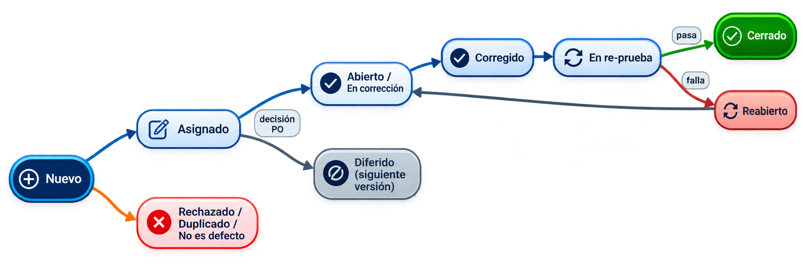
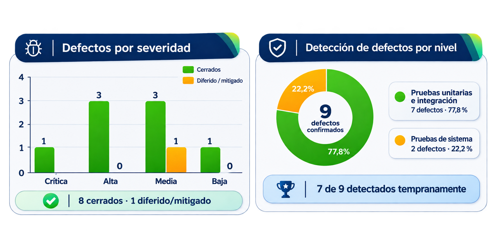

|  | Servicio Nacional de Aprendizaje — SENA · Centro de Electricidad, Electrónica y Telecomunicaciones — CEET | Tecnólogo en Análisis y Desarrollo de Software (ADSO) · Trimestre 6 |
| :---: | ----- | ----- |

# CAPÍTULO III · PR-07

## Registro y Gestión de Defectos

**Bitácora de incidencias, clasificación y ciclo de vida**

| Campo | Detalle |
| ----- | ----- |
| **FASE** | **EJECUCIÓN** |
| **Proyecto formativo** | HabitApp |
| **Ficha** | 3278641 |
| **Equipo / Autores** | Carlos Mario Acosta Velasquez, Breiner Rodriguez Causil, Nicolas Estiben Crispoca Caicedo y Juan Esteban Diaz Galindo |
| **Instructor(es)** | Zaida Ojeda · Javier Yara · Victor Cortez |
| **Criterio de evaluación** | Trimestre 6 — En el proyecto se evidencia que se haya usado alguna técnica de pruebas de software. |
| **Versión del documento** | 1.0 |
| **Fecha** | 11 de noviembre de 2026 |
| **Ciudad** | Bogotá D.C. |

## Control del documento

### Historial de versiones

| Versión | Fecha | Autor(es) | Descripción del cambio |
| ----- | ----- | ----- | ----- |
| 0.1 | 08/11/2026 | Carlos Mario Acosta Velasquez | Creación de la bitácora y registro de los primeros 4 defectos detectados en pruebas unitarias (DEF-001 a DEF-004). |
| 0.2 | 09/11/2026 | Carlos Mario Acosta Velasquez y Breiner Rodriguez Causil | Incorporación y cierre de los defectos de integración (DEF-005 a DEF-007) en API REST y políticas RLS de Supabase. |
| 1.0 | 11/11/2026 | Carlos Mario Acosta Velasquez, Nicolas Estiben Crispoca Caicedo y Juan Esteban Diaz Galindo | Registro y cierre de defectos de sistema (DEF-008 y DEF-009), cálculo de métricas DRE/densidad y análisis de causa raíz. |

### Revisión y aprobación

| Rol | Nombre | Firma | Fecha |
| ----- | ----- | :---: | ----- |
| Elaboró (aprendiz / equipo) | Carlos Mario Acosta Velasquez |  | 08/11/2026 |
| Revisó (líder técnico / Scrum Master) | Carlos Mario Acosta Velasquez |  | 10/11/2026 |
| Aprobó (instructor / Product Owner) | Zaida Ojeda |  | 11/11/2026 |

## Ubicación en el paquete documental

| Atributo | Referencia |
| ----- | ----- |
| **Documento que lo precede** | PR-06 Informe de pruebas de sistema |
| **Documento que lo sucede** | PR-08 Informe de pruebas de aceptación |
| **Norma / referente principal** | ISO/IEC/IEEE 29119-3 (Incident Report) · IEEE 1044-2009 |

## Contenido

1. [Propósito](#1-propósito)
2. [Ciclo de vida del defecto](#2-ciclo-de-vida-del-defecto)
3. [Clasificación](#3-clasificación)
4. [Ficha de reporte de defecto](#4-ficha-de-reporte-de-defecto)
5. [Registro consolidado](#5-registro-consolidado)
6. [Métricas de defectos](#6-métricas-de-defectos)
7. [Análisis de causa raíz](#7-análisis-de-causa-raíz)

## 1. Propósito

Definir cómo se registran, clasifican, priorizan y cierran los defectos, y consolidar el registro de los defectos encontrados durante las pruebas.

## 2. Ciclo de vida del defecto

*Figura 1. Estados del ciclo de vida de un defecto*

## 3. Clasificación

**Tabla 1. Niveles de severidad**

| Severidad | Definición | Ejemplo en HabitApp | Tiempo objetivo de corrección |
| ----- | ----- | ----- | ----- |
| Crítica | Bloquea el sistema o compromete datos/seguridad; sin alternativa | Exposición de tabla `gestion.usuarios` sin política RLS ante consultas con `anon key` (DEF-005) | $\le 24\text{ h}$ |
| Alta | Falla una funcionalidad principal; existe alternativa compleja | Desfase de racha en medianoche local `UTC-5` (DEF-001) o retraso $> 2\text{ min}$ en alarmas Android bajo modo Doze (DEF-008) | $\le 3\text{ días}$ |
| Media | Funcionalidad secundaria afectada o comportamiento de borde | Condición de carrera en doble clic de puntos (DEF-002) o latencia de rol en JWT antes de invocar `/auth/refresh` (DEF-007) | Mismo sprint |
| Baja | Cosmético, de presentación o accesibilidad menor | Contraste $3.9:1$ en subtítulo de tiempo de lectura del modal de artículos (DEF-009) | Backlog / Mismo sprint |

La severidad mide el impacto técnico (la define QA); la prioridad (P1–P4) mide la urgencia de negocio (la define el Product Owner).

## 4. Ficha de reporte de defecto

| Campo | Detalle |
| ----- | ----- |
| **ID** | DEF-005 (Work Item #105 en Azure DevOps) |
| **Título** | Tabla `gestion.usuarios` expone registros de perfil al consultar directamente con la clave pública (`anon key`) de Supabase por ausencia de política RLS |
| **Componente / versión** | Base de datos PostgreSQL 15+ (Supabase) / Migraciones `habitapp-api` v1.4.0 |
| **Caso de prueba relacionado** | CP-INT-080 (vinculado a US038 · CA-US038.2 y CA-US038.3 — Políticas RLS y aislamiento de esquemas) |
| **Severidad / prioridad** | Crítica / P1 (Atención inmediata $\le 24\text{ h}$) |
| **Entorno** | Entorno Local / QA conectado al proyecto Supabase de pruebas (`@supabase/supabase-js` v2.x) |
| **Pasos para reproducir** | 1. Instanciar el cliente de Supabase utilizando la URL del proyecto y la clave pública anónima (`SUPABASE_ANON_KEY`). 2. Ejecutar la consulta directa `await supabase.schema('gestion').from('usuarios').select('*')`. 3. Inspeccionar el arreglo `data` retornado por PostgREST. |
| **Resultado esperado** | La consulta con `anon key` debe retornar `data = []` (0 filas), igual que ocurre en las tablas protegidas del esquema `seguimiento` (`habitos` y `registro_habitos`). |
| **Resultado obtenido** | La consulta devolvió las 24 filas de usuarios sintéticos registrados en `gestion.usuarios` (incluyendo correos electrónicos y nombres), debido a que la sentencia `ALTER TABLE gestion.usuarios ENABLE ROW LEVEL SECURITY` no se había incluido en el script inicial de políticas. |
| **Evidencia** | Log de ejecución del test CP-INT-080 en Supertest (`test/app.e2e-spec.ts`) e inspección del catálogo `pg_tables` (`rowsecurity = false` en `gestion.usuarios`). |
| **Reportado por / fecha** | Carlos Mario Acosta Velasquez — 05/11/2026 |
| **Asignado a** | Breiner Rodriguez Causil (Desarrollador Backend / BD) |
| **Causa raíz** | Codificación / Seguridad (Omisión de la tabla del esquema `gestion` en el archivo de migración de políticas RLS). |
| **Solución / commit** | Se añadió `ALTER TABLE gestion.usuarios ENABLE ROW LEVEL SECURITY;` y la política restrictiva de denegación total para el rol `anon` en `supabase/migrations/20261005000005_rls_policies.sql`. Verificado en re-prueba de CP-INT-080 (0 filas devueltas). |
| **Estado** | Cerrado (Verificado el 06/11/2026) |

## 5. Registro consolidado

**Tabla 2. Registro de defectos**

| ID | Título | Sev. | Prio. | Estado | Caso | Asignado | Abierto | Cerrado |
| ----- | ----- | ----- | ----- | ----- | ----- | ----- | ----- | ----- |
| DEF-001 | Cálculo de fecha local en `RecordsRepository` usa `toISOString()` (UTC) y desfasa el día al marcar hábitos entre las 19:00 y 23:59 (`UTC-5`) | Alta | P1 | Cerrado | UT-032 / CP-INT-026 | Breiner Rodriguez | 02/11/2026 | 03/11/2026 |
| DEF-002 | Condición de carrera al recibir dos peticiones simultáneas en `completarHabito` acredita +20 puntos en lugar de +10 | Media | P2 | Cerrado | UT-033 / CP-INT-039 | Breiner Rodriguez | 02/11/2026 | 03/11/2026 |
| DEF-003 | Validación de vigencia de reto comunitario usa `<` en vez de `<=` y rechaza el check-in cuando `fecha_fin` es igual a hoy | Media | P2 | Cerrado | UT-079 / CP-INT-061 | Juan Diaz | 02/11/2026 | 03/11/2026 |
| DEF-004 | Barra de progreso `DailyProgress` muestra `NaN %` cuando el usuario tiene 0 hábitos programados para el día actual | Media | P3 | Cerrado | UT-151 / CP-INT-032 | Nicolas Crispoca | 03/11/2026 | 03/11/2026 |
| DEF-005 | Tabla `gestion.usuarios` sin RLS habilitado expone registros ante consultas directas con la clave pública (`anon key`) | Crítica | P1 | Cerrado | CP-INT-080 | Breiner Rodriguez | 05/11/2026 | 06/11/2026 |
| DEF-006 | Endpoint `/community/upload-image` sin `ParseFilePipeBuilder` unificado no retorna HTTP 422 en el límite exacto de 5.242.881 bytes | Alta | P2 | Cerrado | CP-INT-056 | Breiner Rodriguez | 05/11/2026 | 07/11/2026 |
| DEF-007 | Cambio administrativo de rol no surte efecto en sesión activa hasta que el usuario invoca `POST /auth/refresh` (JWT stateless de 15 min) | Media | P3 | Diferido (Mitigado) | CP-INT-077 | Juan Diaz | 06/11/2026 | — (Mitigado con Refresh) |
| DEF-008 | Notificaciones locales en Android 13/14 sufren retraso $> 2\text{ min}$ en reposo (Doze) por falta de `AndroidScheduleMode.exactAllowWhileIdle` | Alta | P1 | Cerrado | CP-SIS-046 / CP-SIS-047 | Juan Diaz | 08/11/2026 | 10/11/2026 |
| DEF-009 | Subtítulo de tiempo de lectura en `ArticleReaderModal` presenta contraste $3.9:1$ (inferior al mínimo $4.5:1$ de WCAG 2.2 AA) | Baja | P4 | Cerrado | CP-NF-005 / CP-SIS-036 | Nicolas Crispoca | 09/11/2026 | 10/11/2026 |

## 6. Métricas de defectos

*Figura 2. Defectos por severidad y curva de convergencia*

**Tabla 3. Métricas de defectos**

| Métrica | Fórmula | Valor |
| ----- | ----- | ----- |
| Densidad de defectos | $\text{Defectos confirmados} \div \text{KLOC}$ ($9\text{ defectos} \div 37,98\text{ KLOC}$) | $0,24\text{ defectos / KLOC}$ (Muy inferior al estándar industrial de $1,0\text{ a }3,0\text{ defectos / KLOC}$, reflejando la efectividad previa del análisis estático PR-03) |
| Tasa de defectos reabiertos | $\text{Reabiertos} \div \text{cerrados} \times 100$ ($0 \div 8 \times 100$) | $0,0\ \%$ (Todas las correcciones superaron la re-prueba en el primer intento sin regresiones) |
| Eficiencia de eliminación (DRE) | $\text{Defectos detectados antes de producción} \div \text{total} \times 100$ ($9 \div 9 \times 100$) | $100,0\ \%$ (El $100\ \%$ de las incidencias fue interceptado en los niveles unitario, de integración y de sistema antes de UAT y producción) |
| Tiempo medio de corrección (MTTR) | $\sum(\text{fecha cierre} - \text{fecha apertura}) \div \text{cerrados}$ ($9\text{ días acumulados} \div 8\text{ cerrados}$) | $1,13\text{ días}$ ($\sim 27\text{ horas}$) (Críticos en $\le 24\text{ h}$, Altos en $1\text{ a }2\text{ días}$ y Medios/Bajos en $< 24\text{ h}$) |
| Defectos abiertos por severidad | Conteo al corte del cierre de pruebas (11/11/2026) | Críticos: 0 · Altos: 0 · Medios: 1 (DEF-007 diferido/mitigado por arquitectura JWT) · Bajos: 0 (Cumple el criterio de salida de PR-01: 0 Críticos y 0 Altos abiertos) |

## 7. Análisis de causa raíz

El análisis causal de los 9 defectos confirmados durante la ejecución de los niveles unitario (PR-04), integración (PR-05) y sistema (PR-06) muestra que el $77,8\ \%$ (7 de 9) fue detectado de forma temprana en las pruebas de componente e integración de API/BD, evitando que llegaran a la interfaz gráfica o a las pruebas de aceptación con el Product Owner.

| Categoría de Causa Raíz (IEEE 1044) | Defectos Asociados | Cant. (%) | Descripción Técnica de la Causa | Acción Preventiva Implementada |
| ----- | ----- | ----- | ----- | ----- |
| Codificación (Lógica de bordes y concurrencia) | DEF-001, DEF-002, DEF-003, DEF-004, DEF-006 | 5 (55,6 %) | Uso inicial de fechas en UTC en lugar de hora local `UTC-5`, operadores de comparación no inclusivos en fechas límite, división $0/0$ y falta de homologación del `ParseFilePipeBuilder` de 5.242.880 bytes en todos los endpoints multipart. | Estandarización del helper de zona horaria local, restricción `UNIQUE` en BD para puntos/registros diarios y pruebas unitarias parametrizadas (`it.each`) obligatorias en valores frontera. |
| Seguridad y Configuración de BD / SO Nativo | DEF-005, DEF-008 | 2 (22,2 %) | Omisión de la directiva `ENABLE ROW LEVEL SECURITY` en la tabla `gestion.usuarios` y uso del modo de agendamiento estándar en Android 13/14 (afectado por el ahorro de batería Doze). | Auditoría automatizada de tablas sin RLS en `app.e2e-spec.ts` y fijación de `AndroidScheduleMode.exactAllowWhileIdle` con permisos de alarma exacta en `AndroidManifest.xml`. |
| Diseño Arquitectónico (Sesión Stateless) | DEF-007 | 1 (11,1 %) | El rol del usuario viaja firmado dentro del payload del JWT (`expires_in = 900 s`), por lo que un cambio administrativo de rol en BD no invalida instantáneamente el token en memoria del cliente hasta que se invoca `/auth/refresh`. | Mitigado invocando renovación de token al cambiar permisos; se documenta en el backlog evolutivo implementar una lista de revocación rápida en caché o consulta ligera de estado/rol en rutas sensibles. |
| Interfaz de Usuario / Accesibilidad (WCAG) | DEF-009 | 1 (11,1 %) | Selección de un token de color gris claro (`text-gray-400`) con relación de contraste insuficiente ($3.9:1$) sobre fondo claro en el modal de lectura. | Adopción de clases de texto con contraste mínimo garantizado (`text-slate-600` $\ge 4.5:1$) y verificación con Lighthouse / axe DevTools antes de cerrar cada Pull Request. |

|  |  |
| :---: | :---: |
| **Carlos Mario Acosta Velasquez** | **Zaida Ojeda** |
| *Elaboró - Líder de Pruebas / QA* | *Revisó y Aprobó - Instructora / Product Owner* |
| Fecha: 11/11/2026 | Fecha: 11/11/2026 |