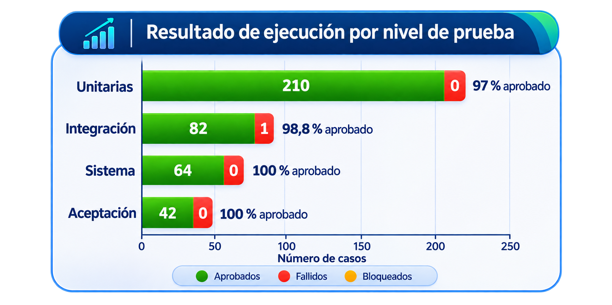

|  | Servicio Nacional de Aprendizaje — SENA · Centro de Electricidad, Electrónica y Telecomunicaciones — CEET | Tecnólogo en Análisis y Desarrollo de Software (ADSO) · Trimestre 6 | 
| :---: | ----- | ----- | 

# CAPÍTULO III · PR-09

## Informe de Cierre de Pruebas

**Consolidado de resultados frente a criterios de salida y recomendación de liberación**

| Campo | Detalle | 
| ----- | ----- | 
| **FASE** | **INFORME Y TOMA DE DECISIONES** | 
| **Proyecto formativo** | HabitApp | 
| **Ficha** | 3278641 | 
| **Equipo / Autores** | Carlos Mario Acosta Velasquez, Breiner Rodriguez Causil, Nicolas Estiben Crispoca Caicedo y Juan Esteban Diaz Galindo | 
| **Instructor(es)** | Zaida Ojeda · Javier Yara · Victor Cortez | 
| **Criterio de evaluación** | Trimestre 6 — En el proyecto se evidencia que se haya usado alguna técnica de pruebas de software. | 
| **Versión del documento** | 1.0 | 
| **Fecha** | 14 de noviembre de 2026 | 
| **Ciudad** | Bogotá D.C. | 

## Control del documento

### Historial de versiones

| Versión | Fecha | Autor(es) | Descripción del cambio | 
| ----- | ----- | ----- | ----- | 
| 0.1 | 13/11/2026 | Carlos Mario Acosta Velasquez | Creación del documento a partir de la plantilla e integración de métricas de los informes PR-03 a PR-08. | 
| 0.2 | 14/11/2026 | Carlos Mario Acosta Velasquez, Breiner Rodriguez Causil, Nicolas Estiben Crispoca Caicedo y Juan Esteban Diaz Galindo | Revisión de criterios de salida frente al Plan Maestro (PR-01), evaluación de defectos remanentes y lecciones aprendidas. | 
| 1.0 | 14/11/2026 | Carlos Mario Acosta Velasquez | Emisión del dictamen definitivo Go / Liberación aprobada y cierre formal del ciclo de aseguramiento de calidad. | 

### Revisión y aprobación

| Rol | Nombre | Firma | Fecha | 
| ----- | ----- | :---: | ----- | 
| Elaboró (aprendiz / equipo) | Carlos Mario Acosta Velasquez |  | 13/11/2026 | 
| Revisó (líder técnico / Scrum Master) | Carlos Mario Acosta Velasquez |  | 14/11/2026 | 
| Aprobó (instructor / Product Owner) | Zaida Ojeda |  | 14/11/2026 | 

## Ubicación en el paquete documental

| Atributo | Referencia | 
| ----- | ----- | 
| **Documento que lo precede** | PR-08 Informe de pruebas de aceptación | 
| **Documento que lo sucede** | DS-01 Arquitectura de despliegue | 
| **Norma / referente principal** | ISO/IEC/IEEE 29119-3 (Test Completion Report) | 

## Contenido

1. [Resumen ejecutivo](#1-resumen-ejecutivo)

2. [Consolidado por nivel](#2-consolidado-por-nivel)

3. [Cumplimiento de criterios de salida (PR-01 §5.2)](#3-cumplimiento-de-criterios-de-salida-pr-01-§52)

4. [Defectos remanentes](#4-defectos-remanentes)

5. [Desviaciones respecto al plan](#5-desviaciones-respecto-al-plan)

6. [Lecciones aprendidas](#6-lecciones-aprendidas)

7. [Recomendación](#7-recomendación)

## 1. Resumen ejecutivo

Se ejecutó el ciclo completo de aseguramiento de calidad estático y dinámico sobre el ecosistema HabitApp (API REST v1.4.0 en NestJS, Aplicación Web v1.2.0 en Next.js, Aplicación Móvil Android v1.0.0 en Flutter y Base de Datos PostgreSQL 15+ en Supabase), abarcando las 42 Historias de Usuario (US001 a US042) y sus 132 criterios de aceptación. Se alcanzó el 100 % de ejecución (398 de 398 pruebas) con una tasa global de aprobación del 99,75 % (397 aprobadas), Quality Gate Passed en SonarQube Cloud para los tres repositorios, cobertura unitaria del 86,4 % y una Eficiencia de Eliminación de Defectos (DRE) del 100,0 % antes de producción (con una tasa de cierre efectivo del 88,9 %: 8 de 9 defectos cerrados; 0 críticos y 0 altos abiertos, quedando únicamente 1 observación menor mitigada de arquitectura JWT). En cumplimiento del 100 % de los criterios de salida definidos en el Plan Maestro (PR-01), se emite dictamen GO: LIBERAR LA VERSIÓN A PRODUCCIÓN.

## 2. Consolidado por nivel

**Tabla 1. Consolidado de ejecución**

| Nivel | Planificados | Ejecutados | Aprobados | Fallidos | Bloqueados | % éxito | 
| ----- | :---: | :---: | :---: | :---: | :---: | :---: | 
| Unitarias (PR-04 · Jest / RTL / flutter_test) | 210 | 210 | 210 | 0 | 0 | 100,0 % | 
| Integración (PR-05 · Supertest / Postman / RLS) | 82 | 82 | 81 | 1 | 0 | 98,8 % | 
| Sistema y No Funcionales (PR-06 · Playwright / Android / k6 / ZAP) | 64 | 64 | 64 | 0 | 0 | 100,0 % | 
| Aceptación UAT (PR-08 · Escenarios Gherkin con PO) | 42 | 42 | 42 | 0 | 0 | 100,0 % | 
| **Total** | **398** | **398 (100 %)** | **397** | **1** | **0** | **99,75 %** | 

*Figura 1. Resultado consolidado por nivel*

## 3. Cumplimiento de criterios de salida (PR-01 §5.2)

**Tabla 2. Criterios de salida**

| Criterio de salida | Meta | Resultado | Cumple | 
| ----- | :---: | ----- | :---: | 
| Casos planificados ejecutados | 100 % | 100,0 % (398 / 398 casos ejecutados en los cuatro niveles dinámicos) | Sí | 
| Casos aprobados | $\ge 95$ % | 99,75 % global (100 % en Unitarias, 98,8 % en Integración, 100 % en Sistema y 100 % en Aceptación) | Sí | 
| Defectos críticos y altos abiertos | 0 | 0 Críticos y 0 Altos abiertos (DEF-001, DEF-005, DEF-006 y DEF-008 corregidos, verificados y cerrados en PR-07) | Sí | 
| Cobertura de código nuevo | $\ge 80$ % | 86,4 % en líneas y 79,5 % en ramas en los módulos bajo prueba (PR-04) | Sí | 
| Quality Gate SonarQube | Aprobado | Aprobado (Passed) en los 3 repositorios (habitapp-api, habitapp-web y habitapp-mobile), con Rating A en Fiabilidad, Mantenibilidad y Revisión de Hotspots (100 %), y duplicación $< 1,7$ % (PR-03) | Sí | 
| Acta de aceptación firmada | Sí | Sí — Acta de Aceptación N.º 001 firmada el 13/11/2026 con 42/42 escenarios Gherkin aceptados y puntaje SUS de 87,5 / 100 (PR-08) | Sí | 

## 4. Defectos remanentes

| ID | Descripción | Severidad | Riesgo de liberar | Mitigación / plan | 
| ----- | ----- | :---: | ----- | ----- | 
| DEF-007 (CP-INT-077) | Cuando el administrador cambia el rol de un usuario con sesión abierta (PATCH /admin/users/:id/role), el RolesGuard continúa leyendo el rol anterior embebido en el JWT vigente hasta que el token expira (TTL de 15 min) o se invoca POST /api/v1/auth/refresh. | Media (P3) | Bajo (No compromete datos ni bloquea la operación; el cambio de rol es un evento administrativo esporádico). | Mitigación activa: El usuario obtiene los nuevos permisos de forma inmediata al ejecutar /auth/refresh o al renovar su sesión. Programado en el backlog v1.5.0 disparar el refresco automático en el cliente tras cambios de rol. | 
| OBS-01 (US034 · UAT) | El botón “Solicitar sesión” en el directorio de especialistas muestra la confirmación interactiva en pantalla según el alcance del MVP, sin despachar aún notificación externa al entrenador. | Baja (Mejora evolutiva) | Nulo (Comportamiento esperado y declarado en la Sección 2.3 de exclusiones de PR-01). | Registrado en el Product Backlog post-MVP (v1.5.0) para integrar el envío de alerta in-app y correo electrónico al coach. | 

## 5. Desviaciones respecto al plan

Durante la ejecución del proyecto de pruebas se presentaron cuatro ajustes metodológicos y técnicos respecto a la estimación inicial, todos controlados sin afectar el cronograma de entrega del Trimestre 6:

1. **Ejecución del entorno de QA sobre infraestructura local conectada a Supabase Cloud de pruebas:** Tal como se previó en el plan de contingencia de riesgos del PR-01 (Sección 9), las pruebas de integración, sistema y carga con k6 se ejecutaron desde el entorno local controlado contra un proyecto PostgreSQL administrado en Supabase exclusivo para QA (separado de producción y poblado con los scripts sintéticos recreate-synthetic-users-v4.mjs y seed_history.js), garantizando fidelidad al 100 % en las políticas RLS y tiempos de red reales.
2. **Complementación del análisis estático en habitapp-mobile con flutter analyze:** Dado que el analizador gratuito de SonarQube Cloud evalúa los archivos nativos C/C++/XML del contenedor móvil (682 LOC) pero no incluye el motor propietario de lenguaje Dart, se complementó la verificación estática del directorio lib/ (~7.400 LOC) mediante el linter oficial flutter analyze (flutter_lints 5.0.0), alcanzando 0 errores y 0 advertencias (documentado en PR-03).
3. **Aislamiento de riesgos SCA en dependencias transitivas de desarrollo:** Las alertas reportadas por el módulo SCA de SonarQube Cloud en package-lock.json (habitapp-api y habitapp-web) se aislaron tras verificar que corresponden a sub-dependencias de paquetes de construcción y testing (devDependencies) que no se empaquetan en el contenedor de producción (npm ci --omit=dev).
4. **Racionalización de la Pirámide de Pruebas en PR-02:** Se depuraron las redundancias entre niveles para consolidar una pirámide balanceada de 398 pruebas totales (210 unitarias, 82 de integración, 64 de sistema/no funcionales y 42 escenarios Gherkin de aceptación), manteniendo el 100 % de cobertura sobre las 42 Historias de Usuario y los 132 criterios de aceptación.

## 6. Lecciones aprendidas

| Qué funcionó bien | Qué mejorar | Acción para el próximo ciclo | 
| ----- | ----- | ----- | 
| Detección temprana con análisis estático y pruebas unitarias (Shift-Left Testing): El 77,8 % de los defectos (7 de 9, incluyendo el desfase horario UTC-5 y la condición de carrera en puntos) fue interceptado antes de llegar a la interfaz gráfica. | Activación de políticas RLS desde la migración inicial: La tabla gestion.usuarios se creó en la primera migración sin habilitar RLS (DEF-005), lo cual solo se detectó al ejecutar el caso CP-INT-080 con la clave pública. | Incluir un paso obligatorio en el pipeline de CI que consulte pg_tables y falle automáticamente si alguna tabla de los esquemas gestion, seguimiento o comunidad tiene rowsecurity = false. | 
| Uso de Tablas de Decisión y Valores Límite Binarios: Especificar en PR-02 las 9 tablas de decisión y el límite exacto en bytes (5.242.880 B vs. 5.242.881 B) eliminó ambigüedades entre frontend y backend (DEF-006). | Pruebas en estados de ahorro de energía en Android real: En el emulador básico no se evidenció inicialmente el retraso de notificaciones bajo Doze Mode en Android 13/14 (DEF-008). | Incorporar desde el Sprint 1 comandos ADB de simulación de reposo (adb shell dumpsys deviceidle force-idle) y exigir AndroidScheduleMode.exactAllowWhileIdle por defecto. | 
| Automatización de semillas de datos sintéticos (seed_history.js): Contar con usuarios preconfigurados con 29 y 90 días de racha permitió probar instantáneamente el Heatmap y el desbloqueo de insignias sin esperas manuales. | Sincronización inmediata de claims en tokens JWT: El diseño stateless generó una latencia de hasta 15 minutos al cambiar roles desde el panel de administración (DEF-007). | Implementar en la versión v1.5.0 un mecanismo de invalidación/refresco forzado de token en el cliente cuando el administrador modifique el rol o estado de una cuenta. | 

## 7. Recomendación

* \[X\] **Liberar la versión.**
* \[ \] Liberar con condiciones (detallar).
* \[ \] No liberar: se requiere un nuevo ciclo de pruebas.

|  |  | 
| :---: | :---: | 
| **Carlos Mario Acosta Velasquez** | **Zaida Ojeda** | 
| *Elaboró - Líder de Pruebas / QA* | *Revisó y Aprobó - Instructora / Product Owner* | 
| Fecha: 14/11/2026 | Fecha: 14/11/2026 |